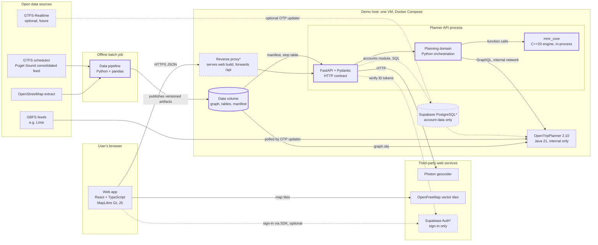
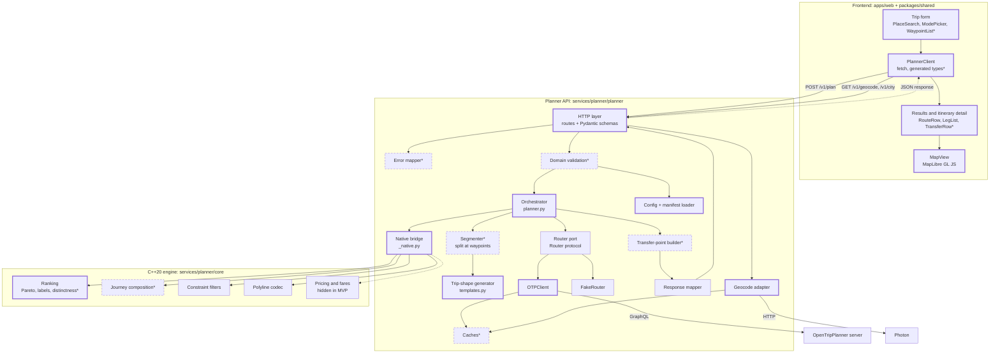
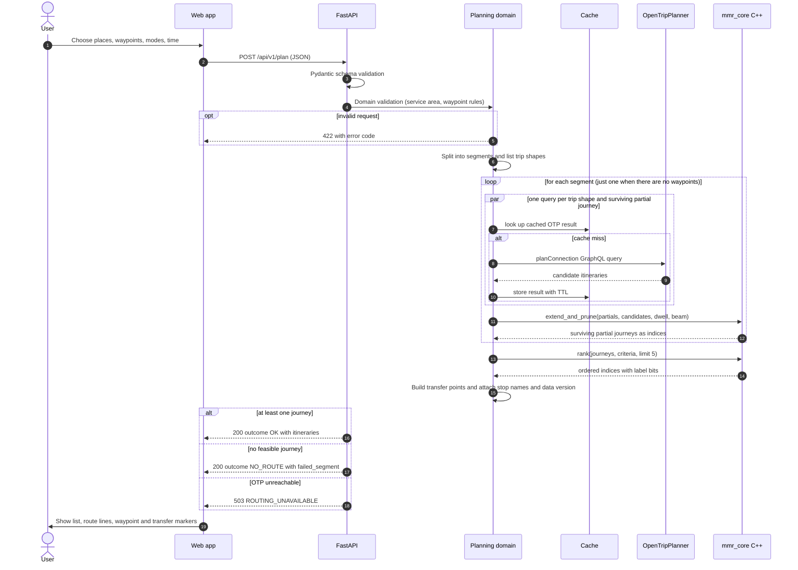
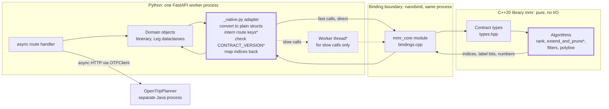
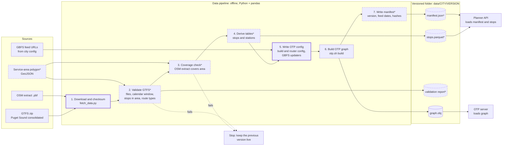
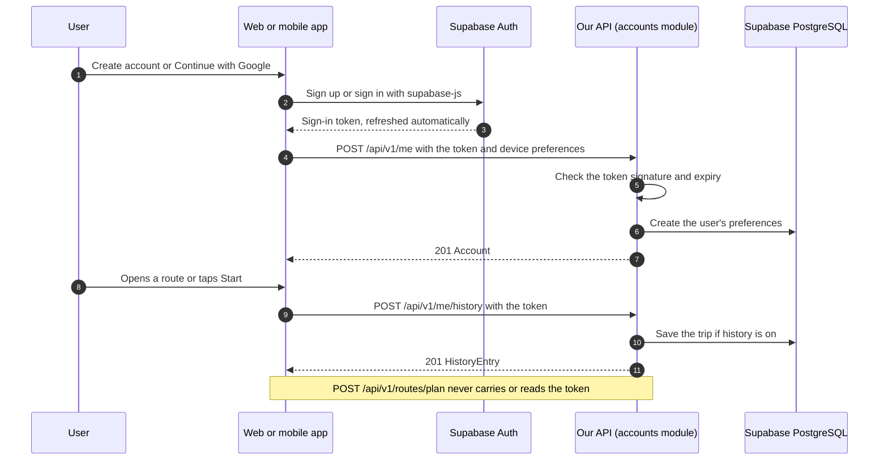

# Multimodal Router: Software Architecture

| | |
|---|---|
| **Status** | **Decided** by the team (2026-11-17). This is the architecture we are building; items are still marked Implemented or Planned to show what exists in code today. Optional accounts are in section 16 |
| **Date** | 2026-11-13 (v0.1) · 2026-11-16 (v0.2) |
| **Inputs** | [repository-analysis.md](repository-analysis.md) · [product-requirements.md](product-requirements.md) · code at `016a2e9` |
| **Scope** | MVP architecture (PRD section 5) and how it can grow afterwards. No code was written or moved for this document. |

### Reading guide

**Every component has a status:**

| Status | Meaning | Diagram style |
|---|---|---|
| **Implemented** | Exists in the repository and works today (see the analysis) | Thin solid border |
| **Implemented, changes needed** | Exists, but the MVP needs it extended or fixed | Thick border |
| **Planned** | Does not exist yet | Dashed border, and the name ends in `*` |
| **Optional** | Only if a later decision calls for it | Dashed border |

**Other conventions:**
- IDs such as `D2` and `R1` refer to the repository analysis. IDs such as `PD-6` and `FR-WAY-1` refer to the PRD.
- Diagrams use Mermaid. GitHub renders it automatically; in VS Code, use a Mermaid-capable Markdown preview.
- Numbers (latencies, call counts, memory sizes) are estimates unless marked as measured.

---

## 0. Architecture decisions at a glance

| # | Area | Decision |
|---|---|---|
| **AD-1** | Overall shape | **One main server program:** our Python API (FastAPI) with the C++ engine built in. OpenTripPlanner runs next to it as the only other server. |
| **AD-2** | Python and C++ | Python calls the C++ engine directly, like a library (the existing `mmr_core` module), through one file: `_native.py`. |
| **AD-3** | Finding routes | **OpenTripPlanner finds street and transit routes. Our C++ engine picks the best ones:** it ranks them, keeps up to 5 genuinely different options and joins trips across stopovers. Our own transit route-finder (RAPTOR) is an optional research project that can plug in later through the `Router` interface. |
| **AD-4** | Data storage | **Routing uses no database:** schedules and maps are files prepared by the data pipeline. **One Supabase PostgreSQL database stores account data only** (section 16). |
| **AD-5** | Data preparation | A separate Python + pandas pipeline downloads, checks and versions the data ahead of time. The API only reads the finished files and never downloads anything while a user waits. |
| **AD-6** | Website and server | The website talks **only** to our API (JSON over HTTPS). The website never talks to OpenTripPlanner, the C++ engine or the database. Two exceptions: map tiles come from OpenFreeMap, and the sign-in screens talk to Supabase Auth. TypeScript types are generated from the API description. |
| **AD-7** | Hosting | The app runs on **one rented server** with Docker Compose, behind a reverse proxy (the "front door" that handles HTTPS). OpenTripPlanner isn't reachable from the internet. Supabase hosts sign-in and the account database. |
| **AD-8** | Algorithm code | New algorithms are written **once, in C++**. The existing Python copies are kept only to check C++ results in tests. Frontend developers run the API in a container, so they never compile C++. |
| **AD-9** | Sign-in | **Supabase Auth** handles sign-up, log-in, "Continue with Google", password reset and email checks. Our API only checks the sign-in token. We never store passwords. |
| **AD-10** | Account features | They live **inside the same API**, under `/api/v1/me`. No extra server. Route planning never uses the account; trip history is saved by a separate request (section 16). |

---

## 1. High-level system architecture

### Diagram A: High-level system architecture



### What runs where

| Runtime unit | Kind | Status | Notes |
|---|---|---|---|
| Web app | Static files in the browser | Implemented, changes needed | Vite build of apps/web |
| Planner API | Python process (uvicorn) with the C++ module inside it | Implemented, changes needed | services/planner. Docker image currently broken |
| OpenTripPlanner | Java server | Implemented (config + scripts) | Off-the-shelf server. We configure it but don't write its code |
| Data pipeline | Batch job, run manually or on a schedule | Implemented, changes needed | Today fetch_data.py + otp.sh. The pandas stages are planned |
| Reverse proxy | Container | Planned | Needed for one origin, HTTPS and rate limiting |
| PostgreSQL 16 | Supabase (managed PostgreSQL) | Planned (accounts, section 16) | Account data only. Not used by routing. Only the API connects to it |
| Supabase Auth | Supabase (same project as the database) | Planned (accounts, section 16) | Sign-in only. We run nothing for it |

So there are **three long-running backend pieces on our server** (the proxy, the API and OTP), plus Supabase (sign-in and database) once accounts ship. Only the API is code we write. That is the "no unnecessary microservices" baseline (section 13).

---

## 2. Component responsibilities

| Component | Location | Status | Responsible for | Not responsible for |
|---|---|---|---|---|
| **Web app** | `apps/web` | Implemented, changes needed | Collecting inputs (places, modes, time, waypoints*); showing results, steps, transfer and waypoint markers; client-side sorting; showing friendly error messages | Any routing, ranking or schedule logic beyond re-sorting; talking to OTP or C++ |
| **Map view** | `apps/web/src/components/MapView.tsx` | Implemented, changes needed | MapLibre map, route lines, markers (origin, destination, numbered waypoints*, transfer symbols*), service-area outline* | Choosing routes |
| **Shared client package** | `packages/shared` | Implemented, changes needed | `PlannerClient` (fetch), API types (to be *generated* from OpenAPI*), formatting, polyline decoding | Business rules that must match the server, other than the documented sort formulas |
| **HTTP layer** | `planner/main.py` | Implemented, changes needed | Routes, Pydantic request and response schemas, mapping errors to status codes*, CORS, request IDs* | Orchestration logic |
| **Domain validation** | planner package | Planned | Service-area checks, waypoint rules (count, spacing, no arrive-by), same origin and destination | Schema-level validation, which Pydantic does |
| **Orchestrator** | `planner/planner.py` | Implemented, changes needed | Turning a journey request into segments*, trip shapes, router calls, composition, ranking, response | Talking HTTP to clients; doing the algorithm maths itself |
| **Trip-shape generator** | `planner/templates.py` | Implemented, changes needed | Listing mode combinations to ask the router for (limited to MVP modes, PD-2) | Routing |
| **Router port** | `Router` protocol in `planner/otp_client.py` | Implemented | The interface every router implements: `plan(...)`, `nearest_hubs(...)` | — |
| **OTP client** | `planner/otp_client.py` | Implemented, changes needed | GraphQL queries, turning OTP JSON into domain legs. Extended to request headsign, stops and sub-mode* | Ranking; deciding what to show |
| **Fake router** | `planner/fake_router.py` | Implemented | Fast, deterministic stand-in for UI work and tests | Realistic routes |
| **Native bridge** | `planner/_native.py` | Implemented, changes needed | The *only* Python module that imports C++. Converts domain objects to plain structs, checks the contract version*, maps returned indices back | Business logic |
| **C++20 engine** | `services/planner/core` | Implemented, changes needed | Pure algorithms: ranking (Pareto, labels, distinctness*), waypoint composition*, filters, polylines; pricing (hidden) | Network or file access, logging, presentation data |
| **Transfer-point builder** | planner package | Planned | Deriving transfer points (stop pairs, walk, wait) from legs | Choosing routes |
| **Geocode adapter** | `planner/main.py` | Implemented, changes needed | Calling Photon, caching results*, filtering to the service area* | — |
| **Config and manifest loader** | `planner/config.py` | Implemented, changes needed | City config (YAML), service-area polygon*, feature flags*, data manifest* | Writing data |
| **Data pipeline** | `scripts/` today. A new `services/pipeline/` package will hold the pandas stages | Implemented, changes needed | Download, validate (pandas)*, check coverage*, derive tables*, write OTP config, build graph, write manifest* | Serving requests |
| **OpenTripPlanner** | `services/otp` config; runs from jar or official image | Implemented | Street and transit pathfinding over OSM + GTFS; live GBFS availability; optional GTFS-RT | Our ranking, waypoints, UI concepts |
| **Reverse proxy** | deployment config | Planned | HTTPS, serving static files, `/api` → FastAPI, rate limiting, keeping OTP private | Application logic |
| **Accounts module** | `services/planner/planner/accounts/` (new modules in the existing package) | Planned | `/api/v1/me` endpoints: profile, preferences, saved places, trip history, export, delete. Scopes every query to the signed-in user | Route planning; storing passwords |
| **Token verifier** | `planner/accounts/auth.py` | Planned | Checks the Supabase sign-in token on `/me` requests (signature, expiry); the token's user ID is our user ID | Sign-up and log-in screens (Supabase client library in the app) |
| **Account database** | PostgreSQL + Alembic migrations in `services/planner/migrations/` | Planned | Tables in section 16.4. Nightly backup. Nightly deletion of history older than 90 days | Routing data |

---

## 3. Module boundaries and data ownership

### 3.1 Boundary rules

1. **The browser talks only to FastAPI** for application data. It never reaches OTP, the C++ engine, the data volume or the database. The frontend knows nothing about how routes are computed (it doesn't know whether OTP or C++ produced them). It sees only the API contract. The two exceptions are map tiles and Supabase sign-in.
2. **The domain talks to routers only through the `Router` port.** OTP, the fake router and any future C++ router are interchangeable behind it.
3. **Only `_native.py` imports `mmr_core`.** C++ receives plain value types and returns indices and numbers. Names, coordinates for display and geometry stay in Python.
4. **The C++ engine is pure.** It does no I/O, keeps no global mutable state and gives the same output for the same input.
5. **Ingestion and serving are separate.** The pipeline *writes* artifacts; the API and OTP *read* them. No request ever triggers a download.
6. **One owner per piece of data** (table below). If two components need the same data, one owns it and the other reads it.
7. **Routing and accounts don't mix.** The planning domain never reads the user's identity, and the accounts module never calls the router. Only the accounts module touches PostgreSQL.

### 3.2 Data ownership

| Data | Owner (writer) | Readers | Storage | Lifecycle | Status |
|---|---|---|---|---|---|
| Raw OSM `.pbf`, GTFS `.zip` | Pipeline | OTP graph build | `data/<city>/<version>/raw/` | Kept per version | Implemented (unversioned `data/<city>/`) |
| Validation report | Pipeline | Team | `data/<city>/<version>/report.*` | Per version | Planned |
| Stop and station table | Pipeline (pandas) | API: transfer labels, station search | `…/stops.parquet` (or CSV) | Per version | Planned |
| Service-area polygon | Team (config) | Pipeline, API, web (through the API) | `cities/<city>.geojson` | Changed by PR | Planned (today a bbox in YAML) |
| OTP graph | Pipeline (OTP build step) | OTP server | `…/graph.obj` | Per version | Implemented |
| Data manifest (version ID, feed dates, hashes) | Pipeline | API (`/health`, responses), UI | `…/manifest.json` | Per version | Planned |
| Prices and city settings | Team (config) | API | `cities/<city>.yaml` | Changed by PR | Implemented (prices are placeholders, hidden per PD-1) |
| Live bike-share and scooter availability | OTP (GBFS updater, in memory) | OTP routing | OTP memory | Refreshed every minute | Implemented |
| Real-time trip updates | OTP (GTFS-RT updater) | OTP routing | OTP memory | Continuous | Optional |
| Journey requests and responses | API (transient) | — | Not stored. `/routes/plan` is anonymous even for signed-in users | Per request | — |
| Sign-in identity: email, password hash, Google link | Supabase Auth | Token verifier (reads the checked token) | Supabase | Until the account is deleted | Planned |
| Account profile and preferences | Accounts module | Web and mobile apps through `/api/v1/me` | PostgreSQL | Until the account is deleted | Planned |
| Saved places | Accounts module | Apps through `/api/v1/me/places` | PostgreSQL | Until removed or the account is deleted | Planned |
| Trip history (chosen trips only, never GPS traces) | Accounts module | Apps through `/api/v1/me/history` | PostgreSQL | 90 days, then deleted nightly; the user can delete or pause at any time | Planned |
| Guest preferences | Web or mobile app | Same device | Browser `localStorage` / device storage | Until cleared; offered for upload at sign-up | Planned |
| Caches | API process | API | Process memory | TTL, keyed by data version | Planned |
| Logs | API, OTP | Team | stdout → Docker logs | Rotated | Partial |

Only one component reads live GBFS: OTP. The API does not poll GBFS separately in the MVP, which avoids two sources disagreeing.

### 3.3 Where planned modules would live (no repository reorganisation)

Existing directories stay where they are. Planned code goes into existing packages or into **one** new directory:

| Planned module | Location |
|---|---|
| Domain validation, segmenter, transfer builder, caches, error codes | New modules inside `services/planner/planner/` |
| Waypoint composition and new ranking (C++) | `services/planner/core/src/` + `include/mmr/` |
| Data pipeline stages (pandas) | **New** `services/pipeline/`. `scripts/fetch_data.py` and `scripts/otp.sh` stay as entry points |
| Generated TS types | `packages/shared/src/` (generated file) |
| Service-area polygon | `cities/seattle.geojson` next to `seattle.yaml` |
| Reverse proxy and Compose config | Repository root (next to the existing `docker-compose.yml`) |
| Accounts module (endpoints, token verifier, data access) | New modules in `services/planner/planner/accounts/` |
| Database migrations (Alembic) | `services/planner/migrations/` |
| Web sign-in screens and auth state | `apps/web/src/` (new components); the API client in `packages/shared` attaches the token for `/me` calls only |

### Diagram B: Component interaction



---

## 4. Frontend ↔ FastAPI communication

### 4.1 Contract

| Aspect | Today (implemented) | MVP (planned) |
|---|---|---|
| Protocol | REST over HTTP, JSON bodies | Same, over HTTPS behind the proxy, from the **same origin** (`/api/...`), so CORS isn't needed in production |
| Endpoints | `POST /v1/plan`, `GET /v1/geocode`, `GET /v1/reverse`, `GET /v1/city`, `GET /health` | Same paths, extended: plan gains waypoints and sub-mode exclusions; `/v1/city` returns the service-area polygon, enabled modes and data version, and the UI actually uses it |
| Schema source of truth | Pydantic models in `main.py`, with TS interfaces copied by hand | Pydantic models → FastAPI's built-in `/openapi.json` → **generated** TS types in `packages/shared` (e.g. `openapi-typescript`, which `types.ts` already mentions in a TODO) |
| HTTP client | `PlannerClient` using `fetch` | Same client, plus: `AbortController` so a newer search cancels an older one, a client-side timeout, and parsing of the error envelope |
| Geometry | Encoded polylines (precision 5) decoded in the browser | Same |
| Map library | MapLibre GL JS 5 with OpenFreeMap tiles | Same (decision confirmed by repository inspection) |

No extra state-management or data-fetching library is needed for the MVP. React state plus the client is enough. A query-caching library (such as TanStack Query) is an option later if screens multiply.

### 4.2 Request and response shape (illustrative; the contract in api-contract.md is authoritative)

```jsonc
// POST /api/v1/plan
{
  "origin":      { "lat": 47.6553, "lon": -122.3035, "name": "UW Seattle" },
  "destination": { "lat": 47.6205, "lon": -122.3493, "name": "Seattle Center" },
  "waypoints":   [ { "lat": 47.66, "lon": -122.31, "name": "Stop 1", "dwell_min": 15 } ],
  "modes": ["WALK", "TRANSIT", "BIKE"],
  "exclude_transit": ["FERRY"],
  "when": "2026-11-20T08:30:00",          // Seattle local time
  "arrive_by": false,                      // must be false when waypoints are present
  "prefs": { "max_walk_m": 2000, "max_transfers": 3, "has_bike": false }
}
```

```jsonc
// 200 OK
{
  "outcome": "OK",                         // OK | NO_ROUTE
  "incomplete": false,                     // true if some candidate queries failed or timed out
  "failed_segment": null,                  // index of the segment with no route, when NO_ROUTE
  "data_version": "seattle-2026-11-20-a1b2c3d4",
  "itineraries": [{
    "id": "…", "labels": ["Fastest"], "start": "…", "end": "…",
    "duration_s": 2280, "transfers": 1, "walk_m": 640,
    "segments": [
      { "from": "origin", "to": "waypoint:1", "legs": [ /* mode, sub_mode, route, headsign, agency,
                                                            board/alight stops, intermediate_stops, polyline */ ] },
      { "from": "waypoint:1", "to": "destination", "dwell_s": 900, "legs": [ /* … */ ] }
    ],
    "transfer_points": [ { "after_leg": 1, "from_stop": "…", "to_stop": "…", "walk_m": 110, "wait_s": 360 } ]
  }]
}
```

```jsonc
// Error envelope (4xx/5xx other than FastAPI's default 422 schema errors)
{ "error": { "code": "ROUTING_UNAVAILABLE", "message": "Route planning is temporarily unavailable.", "request_id": "…" } }
```

**Design notes:**
- "No route" is a *valid answer*, not an error, so it returns `200` with `outcome: NO_ROUTE`.
- Waypoints and transfer points are separate fields. Waypoints are segment boundaries the user created; transfer points are derived by the system (PRD glossary).
- Cost fields stay in the schema behind a flag but are left out of MVP responses.

---

## 5. End-to-end data flow for a route request

### 5.1 Steps

1. **Input (browser).** The user sets the origin, destination and optional waypoints (by search through `/v1/geocode`, by map click, or by current location), selects modes and sets a time. The client checks that required fields are filled in.
2. **Request.** `PlannerClient` sends `POST /api/v1/plan`. Any older pending request is aborted.
3. **Schema validation (FastAPI + Pydantic).** Types, ranges, list lengths (e.g. ≤ 3 waypoints) and enum values are checked. A failure returns `422`.
4. **Domain validation.** Every point must be inside the service-area polygon; points must not duplicate each other; arrive-by must not be combined with waypoints; at least one mode must be selected. A failure returns `422` with a specific error code.
5. **Segmenting.** The request becomes *N + 1* segments: origin → waypoint 1 → … → destination. Without waypoints there is one segment.
6. **Trip shapes.** For the permitted modes, `templates.py` lists the shapes to try. With the MVP modes (walk, transit, bike) that is 6 shapes and no taxi stitching (verified for the PRD).
7. **Candidate generation, one segment at a time.**
   - For the first segment, the orchestrator sends one OTP `planConnection` query per shape, in parallel, through the cache.
   - For each later segment, it sends one query per shape *for each surviving partial journey*. Each query departs at that journey's arrival time plus the waypoint's dwell time.
8. **Composition (C++).** After each segment, `extend_and_prune` combines the surviving partial journeys with the new candidates.
   - It drops any combination that is worse on every criterion than another (arrival time, transfers, walking).
   - It keeps at most *B* journeys (the beam width, e.g. 3) for the next segment.
   - Without waypoints, this step is a pass-through.
9. **Filtering and ranking (C++).** Mode and constraint filters are applied. `rank` keeps the best journeys on (duration, transfers, walking), keeps them distinct by route sequence, caps them at 5 and assigns the labels Fastest, Fewest transfers and Least walking.
10. **Enrichment (Python).** The orchestrator builds transfer points (stop pairs, walking distance, wait) and attaches stop names (from OTP fields or the stop table) and the data version.
11. **Response.** Domain objects are mapped to Pydantic response models and serialised to JSON.
12. **Rendering (browser).** The app draws the list, route lines, numbered waypoint markers, transfer markers and the step list with intermediate stops. Changing the sort happens in the browser without a new request.

### 5.2 Routing cost estimate (to be measured in M0/M2)

| Journey | OTP calls (6 shapes, beam *B* = 3) | Rounds of calls that must run one after another |
|---|---|---|
| No waypoints | 6 | 1 |
| 1 waypoint | 6 + 3 × 6 = 24 | 2 |
| 3 waypoints | 6 + 3 × (3 × 6) = 60 | 4 |

**Latency is set by the number of rounds × the slowest OTP call in each round.** The CPU time spent in C++ is negligible by comparison.

**Mitigations:**
- the cache (section 10.1);
- a concurrency limit on OTP calls;
- skipping shapes that produced nothing in the previous segment;
- a smaller beam (*B* = 2) for 3 waypoints.

**Note:** we join segments ourselves. OpenTripPlanner's own via-point support is not used, because it isn't proven for our cases.

### Diagram C: Route-request sequence



---

## 6. How FastAPI calls the C++20 engine

### 6.1 How it works

Python calls the C++ engine **directly, as a library** (decision AD-2), using the existing `mmr_core` module built with **nanobind** (a tool that lets Python call C++ code). This is already built: 21 C++ tests and the C++/Python matching tests pass.

**Why this fits:**
- the C++ work is pure computation over a few dozen candidate trips;
- it keeps no large data in memory and is called up to about 5 times per request;
- a direct call takes microseconds, with no extra program to deploy and no network in between.

**The one risk:** if the C++ code crashes, it takes down that API worker. We reduce this by:
- keeping the C++ code small and pure;
- unit tests and randomised tests that compare C++ with the Python copies;
- builds with crash-detection tools (sanitizers) in CI;
- running more than one API worker, so one crash doesn't stop the service;
- Docker restarting a crashed container.

**Later:** if the optional C++ route-finder (section 7) needs a large timetable in memory, it can move into its own service then. Nothing in the website or the API changes.

### 6.3 Explicit Python ↔ C++ contract

**Contract rules** (planned unless marked):

1. **One header owns the types.** types.hpp (implemented) defines every type that crosses the boundary. A `CONTRACT_VERSION` constant* is exposed to Python. `_native.py` checks it at start-up and refuses to run if it doesn't match.
2. **Plain values only.** Allowed: numbers, enums, booleans, and vectors of structs of these. Not allowed: Python objects, callbacks, strings for anything other than polylines, file paths or sockets.
3. **Identity by index.** C++ returns **indices into its inputs** (plus label bitmasks and numbers). Python keeps the rich objects (names, geometry) and maps the results back. This is the existing pattern of `rank`.
4. **Units:**
   - distances in metres;
   - times in seconds since one reference time per request (today, the first leg's start; for composition, the journey's departure);
   - money in currency units (only for the hidden pricing).
5. **Route identity.** Python turns route IDs into small integers (`route_key`*, a new `Leg` field), so C++ can tell routes apart without strings.
6. **Errors.** Contract violations throw `std::invalid_argument`. Both nanobind and pybind11 turn standard C++ exceptions into Python exceptions (e.g. `ValueError`). No other exceptions are expected, and nothing may abort.
7. **Threading.** Functions are re-entrant with no global mutable state. Any function that may take more than ~10 ms releases the GIL* and is called from a worker thread (`starlette.concurrency.run_in_threadpool` or `asyncio.to_thread`), so the event loop is never blocked. Today's calls are sub-millisecond and run directly. That is fine for now.
8. **Determinism.** Ties are broken by input order (implemented: "first minimum wins").
9. **Tests on both sides.** Catch2 unit tests (implemented), Python contract and parity tests (implemented), and shared golden fixtures such as `score-cases.json` (implemented).

**C++ functions in the MVP:**

| Function | Input | Output | Status |
|---|---|---|---|
| `rank` | itineraries (legs: mode, times, distance, `route_key`*), options (criteria set, limit, min_results) | list of (index, label bits) | Implemented for (duration, cost). **Change** to (duration, transfers, walking) + distinctness by route sequence |
| `extend_and_prune`* | partial journeys (arrival time, running criteria totals), candidates grouped by parent partial, dwell, beam width | surviving (parent index, candidate index) pairs | Planned |
| `satisfies`, `uses_allowed_modes` | itinerary, preferences or mode mask | bool | Implemented |
| `encode_polyline`, `decode_polyline` | points / string | string / points | Implemented |
| `price_itinerary`, `transit_fares` | itinerary, city prices | costs | Implemented, hidden |

### 6.4 The Python fallback policy

**Today:** every C++ function has a Python twin, and the two are kept bit-identical.

**Recommendation:**
- New algorithm code (composition, new ranking) is written **once, in C++**.
- The existing Python twins are frozen and used only as test oracles.
- Frontend developers run the API from a Docker image with the C++ module prebuilt (fake router mode), so they never need a compiler. That requires fixing D1.

**Trade-off:**
- Backend developers need a C++ toolchain. Xcode Command Line Tools or g++ is enough; on Windows, use WSL.
- In return, nobody has to keep two implementations in sync.

**Alternative if the team prefers:** keep writing every new algorithm in both languages, at the cost of double work.

### Diagram E: Routing engine integration



---

## 7. Why OpenTripPlanner plus our own C++

### 7.1 Why OpenTripPlanner plus our C++

- **OpenTripPlanner** is a mature, open-source route-finder. It already handles streets (walk, bike), transit timetables, transfers and rentals, so we configure it instead of rebuilding it.
- **Our C++ engine** does the parts that make this app different: ranking routes on several criteria, keeping options genuinely different, and joining trips across stopovers.
- This keeps the MVP on schedule and still gives the team real algorithm work.

### 7.2 The optional C++ route-finder (research project)

Writing our own transit route-finder (RAPTOR) is a **research project, not part of the MVP**. It is built behind the existing `Router` interface:

1. Build a transit-only RAPTOR in C++ over the same schedule data.
2. Compare it with OpenTripPlanner on the benchmark trips (correctness and speed).
3. Switch over only if it matches.

The website and the API don't change either way.

### 7.3 Where the "graph algorithms" live in the recommended design

| Algorithm | Graph view | Phase |
|---|---|---|
| Multi-criteria ranking (Pareto over duration, transfers, walking) with distinctness | Picking the non-dominated options among candidates | MVP (extends existing `pareto.cpp`) |
| Waypoint journey composition (`extend_and_prune`) | Labels pass through a layered graph (one layer per segment); edges depend on the time you arrive; prune labels that are worse on every criterion; beam limit | MVP |
| Waypoint order optimisation | A small travelling-salesman problem with travel times that depend on departure time, over a travel-time matrix built from OTP queries (exhaustive search for ≤ 3 stops, dynamic programming beyond) | Future |
| Custom transit router (RAPTOR) | Round-based search over timetables | Optional research track |

---

## 8. Data ingestion pipeline

**Principle:** ingestion runs **offline** and publishes an immutable, versioned folder. The serving side (OTP + API) switches to a new version only after it passes validation. The API never parses raw feeds while handling a request.

### Diagram D: Data ingestion pipeline



### 8.1 Pipeline stages

| Stage | Tool | Status | Output |
|---|---|---|---|
| Download + checksum | Python (`fetch_data.py`) | Implemented (checksums planned) | Raw files |
| Validate GTFS | pandas | Planned | Report. Stops the pipeline on fatal errors |
| Coverage check | pandas + polygon test | Planned | Pass/fail (fixes R1) |
| Derive tables | pandas → Parquet or CSV | Planned | Stop and station table |
| Write OTP config | Python | Implemented | `build-config.json`, `router-config.json` (GBFS updaters, optional GTFS-RT) |
| Build graph | OTP (Java) | Implemented | `graph.obj` |
| Manifest | Python | Planned | `manifest.json` with `data_version` |

**Format choice:** Parquet is compact and keeps column types, but pandas needs `pyarrow` to write it. CSV needs no extra dependency. Either is fine at this size.

**Live feeds:**
- **GBFS** is consumed **by OTP's updater at runtime**, not by the pipeline. The pipeline only writes the feed URLs into OTP's config (implemented).
- **GTFS-Realtime** (Optional) would follow the same pattern through OTP's real-time updaters. Which Puget Sound agencies publish usable GTFS-RT feeds still has to be confirmed.

**Keeping OTP and the API in step:** the API and OTP mount the **same version folder**. The manifest the API reports always matches the graph OTP has loaded. This works without asking OTP about its version.

**Refresh cadence:** at least every 4 weeks, or when the feed changes. Run manually for the MVP; a scheduled CI job is possible later.

---

## 9. Is a database necessary for the MVP?

**Not for routing.** Optional accounts (section 16) add **one PostgreSQL database for account data only**. The table below explains why routing still doesn't need one.

| Need | Served by | Why not a database |
|---|---|---|
| Transit schedules and street network | OTP graph built from files | OTP owns its own in-memory model |
| Stop and station lookups | Parquet or CSV loaded into memory at start-up | Tens of thousands of rows fit comfortably in memory |
| City config, prices, feature flags | YAML / GeoJSON in git | Changed by PR, reviewed like code |
| User data | **PostgreSQL** (accounts only, section 16) | Guests store nothing on the server. Account holders' preferences, saved places and trip history must persist across devices, which needs a database |
| Caching | In-process caches with TTLs | A single API instance (or a few workers) doesn't need a shared cache |
| Analytics | Privacy-preserving counts from logs (optional) | Low volume |

**Add a database when one of these triggers happens:**

| Trigger | Add |
|---|---|
| Accounts, saved trips or personalisation | PostgreSQL. **Triggered 2026-11-16**; see section 16 |
| Several API instances needing a shared cache or rate limits | Redis |
| Spatial queries beyond point-in-polygon (e.g. nearby-station search over large layers) | PostGIS |
| Keeping real-time history for analysis | A time-series store, or Postgres tables |

For team data *analysis* (not serving), pandas over Parquet files, or DuckDB, is enough.

---

## 10. Caching, error handling, logging, deployment

### 10.1 Caching

| What | Where | Key | TTL | Notes | Status |
|---|---|---|---|---|---|
| Geocoding results | API memory (TTL-LRU, e.g. `cachetools`) | normalised query text + service area | 24 h | Reduces load on the public Photon service (fair use) | Planned |
| OTP responses: walk, transit, own bike | API memory | from/to (5 decimal places), trip shape, departure minute, arrive-by flag, sub-mode exclusions, **data_version** | 15 min | Schedules are fixed within a data version | Planned |
| OTP responses that include rentals | API memory | as above | ≤ 60 s, or not cached | Rental availability changes every minute | Planned |
| `/v1/city` | HTTP `Cache-Control` | — | 1 h | Changes only with config or data | Planned |
| Static web build | Browser / proxy | hashed file names | long | Vite already produces hashed assets | Implemented (build) |
| Map tiles | Browser | — | provider headers | Handled by MapLibre and the browser | Implemented |
| Stop table, manifest, config | API memory | — | process lifetime | Reloaded on restart or new version | Planned |

**Notes:**
- Each uvicorn worker keeps its own in-process cache. That is acceptable for the MVP.
- A shared cache (Redis) is justified only with several API instances.
- Because every key includes `data_version`, publishing new data invalidates old entries automatically.

### 10.2 Error handling

| Situation | Detected by | API behaviour | UI message | Status |
|---|---|---|---|---|
| Malformed request | Pydantic | `422` (FastAPI default `detail` format) | "Please check your inputs" + field hints | Implemented |
| Outside the area, duplicate points, waypoint rules | Domain validation | `422` + `error.code` (e.g. `OUTSIDE_SERVICE_AREA`) | Specific message | Planned |
| No feasible itinerary | Orchestrator | `200`, `outcome: NO_ROUTE`, `failed_segment` | "No route … using Walk + Transit at 23:40" | Planned |
| Some trip-shape queries fail or time out | Orchestrator | `200` with results, `incomplete: true` | "Some options may be missing" | Partial (silently skipped today) |
| **Every** query fails with connection or HTTP errors | Orchestrator | `503 ROUTING_UNAVAILABLE` | "Route planning is temporarily unavailable" | Planned (fixes D2) |
| Overall deadline exceeded with nothing found | `asyncio.timeout` around the request | `504 ROUTING_TIMEOUT` | "That took too long, please try again" | Planned |
| Geocoder failure | Geocode adapter | `502 GEOCODER_UNAVAILABLE` | "Search unavailable, click the map" | Implemented (status code) |
| C++ contract violation | `std::invalid_argument` → `ValueError` | `500 INTERNAL` + logged with request ID | Generic error | Planned (mapping) |
| C++ crash (segfault) | Process dies | Worker restarted by uvicorn or Docker; that request fails | Generic error | Mitigated (section 6.2) |
| Missing, invalid or expired sign-in token on `/me` | Token verifier | `401 UNAUTHENTICATED` + `WWW-Authenticate: Bearer` | Refresh the token once; otherwise "Please log in again" | Planned |
| Valid token but no account record yet | Accounts module | `404 ACCOUNT_NOT_FOUND` | Client calls `POST /me` to finish sign-up | Planned |
| Supabase unreachable | Accounts module | `503 ACCOUNT_SERVICE_UNAVAILABLE`. **Route planning keeps working** | "Your account is unavailable right now. You can keep planning trips." | Planned |

**Back-pressure and timeouts** (planned unless marked):
- **Per OTP call:** 10 s (implemented).
- **Whole request:** 25–30 s deadline.
- **Load on OTP:** concurrent OTP calls per worker are capped with `asyncio.Semaphore` (e.g. 16).
- **Retries:** one retry with a short random delay, for **connection errors only**. Never retry timeouts.
- **Browser:** `AbortController` cancels superseded requests.

### 10.3 Logging and observability

- **Format:** structured JSON logs to stdout, collected by Docker (`docker compose logs`).
  - Standard `logging` with a JSON formatter is enough. `structlog` is optional.
- **Fields per request:**
  - request ID (generated, or taken from an `X-Request-ID` header, and returned to the client);
  - endpoint, status, outcome code, total latency;
  - per OTP call: shape name, latency and result count, plus the number of failures;
  - time spent in C++, number of candidates, waypoint count;
  - cache hit or miss;
  - `data_version`.
- **Privacy:** never log full-precision coordinates or place names. Round to 3 decimal places (~100 m) or leave them out. Don't log geocoding query text.
- **Accounts:**
  - never log tokens, emails, saved places or history contents;
  - log only our internal `user_id` (a random UUID), and only on `/me` endpoints;
  - plan-request logs never contain a `user_id`.
- **Health:** `GET /health` reports routing-engine reachability (a lightweight OTP query), `data_version`, schedule-window end date, `native: true` and the contract version. The Docker Compose healthcheck uses it (implemented in part).
- **C++ doesn't log** (rule 4, section 3.1). Python logs around each call.

### 10.4 Deployment

#### Environments

| Environment | Purpose | Routing | How it runs | Status |
|---|---|---|---|---|
| Local, UI development | Frontend work | FakeRouter | `docker compose up api` in fake mode (prebuilt C++) + `npm run web` | Planned (needs D1 fixed) |
| Local, full | Routing and algorithm work | Local OTP | `scripts/otp.sh` + planner venv + `npm run core:build` | Implemented |
| CI | Tests on every PR | FakeRouter + fixtures | GitHub Actions | Planned |
| Demo / staging | Shared environment, usability tests | OTP | One VM, Docker Compose | Planned |

#### Demo host topology (one VM)

| Service | Image or build | Exposed | Notes |
|---|---|---|---|
| Reverse proxy | e.g. Caddy or nginx | 443 (public) | Serves the web build; forwards `/api` to the API; rate limiting; adds HTTPS |
| `api` | `services/planner/Dockerfile` (with `mmr_core` built) | Internal only | uvicorn with 2+ workers; mounts `cities/` and the current data version (read-only) |
| `otp` | official `opentripplanner/opentripplanner:2.10.0` image | **Internal only** | Runs in `--load --serve` mode (not `--build` on every start; fixes D6). Mounts the current data version |
| Account database | **Supabase** (managed PostgreSQL 16), US West region | Reached only by the API, over TLS, with a restricted database role | Account data only (section 16). Supabase's automatic backups if our plan includes them; otherwise a nightly `pg_dump` from the VM. A restore is tested each release. Not on our VM |

**Secrets** (from accounts on): the Supabase database connection string and the Supabase service key (used only to delete users). They live in environment files on the VM, never in git. Locally, developers run Supabase with the Supabase CLI.

#### Sizing

| Item | Estimate |
|---|---|
| OTP heap | ~8 GB (the README default; E3) |
| Whole VM | **≥ 16 GB RAM** |
| Measure in M0 | Graph build and load memory for the King County area |

#### Releasing new data

1. Run the pipeline on a machine with enough memory.
2. Copy the new version folder to the VM.
3. Point the Compose environment at it.
4. Restart `otp` (about 1 minute to load) and `api`.

A brief outage is acceptable for the MVP. Blue/green switching (start a second OTP, then flip the proxy) is a later improvement.

#### CI/CD

- **CI** (GitHub Actions) runs:
  - pytest in pure-Python and native modes;
  - `ctest`;
  - `node --test`;
  - typecheck and lint;
  - Docker image builds.
- **CD** is a manual `docker compose pull && up -d` on the VM for the MVP.

#### Prerequisites from the analysis

- Fix D1 (Docker path crash) and D6 (OTP rebuilding the graph on every start).
- Pin Python and Node versions.
- Restrict CORS, or remove the need for it with one origin.

---

## 11. Security notes (MVP)

- **OTP stays private.** Its HTTP port is reachable only on the Compose network. Only the API talks to it.
- **The C++ engine has no network surface.**
- **Input limits** are enforced in Pydantic: coordinate ranges, ≤ 3 waypoints, string lengths, and a request body size limit at the proxy.
- **Rate limiting** happens at the proxy (e.g. nginx `limit_req`) or in the app.
- **No secrets are needed today.** Accounts add two (the Supabase database connection string and service key). They go in environment variables, never in the repository.
- **Dependency scanning** runs in CI.

**Accounts (section 16):**
- **Authentication.** Every `/api/v1/me*` request needs `Authorization: Bearer <Supabase sign-in token>`. The API checks:
  - the signature, against Google's public keys (cached);
  - the expiry (tokens live 1 hour; the SDK refreshes them);
  - the issuer.
- **Authorisation.** Every query is scoped to the token's user. A user can never read or change another user's data. Tested explicitly (ACC-10).
- **No cookies, no server sessions.** The bearer header avoids CSRF. The Supabase client library keeps the token in the browser's storage, so the web app sets a strict Content-Security-Policy to limit XSS risk.
- **Rate limits** on `/me*` at the proxy. Supabase Auth applies its own sign-up and log-in limits.
- **Deletion.** `DELETE /me` deletes the Supabase Auth user, which removes all of their rows. Backups age out after 30 days.
- **Least data.** Supabase Auth holds the email and password; we keep only what the features need (section 16.4).

---

## 12. Planned vs. implemented: summary

| Area | Implemented today | Planned for the MVP |
|---|---|---|
| Frontend | React + MapLibre web app, fetch client, accessible search, results, leg list | Waypoint UI, transfer markers and rows, intermediate stops, service-area outline, generated types, AbortController, error-code messages |
| API | FastAPI with 5 endpoints, Pydantic schemas | Waypoints and sub-modes in the schema, outcome and error codes, domain validation, request IDs, caches, concurrency limits, deadline |
| Orchestration | Trip shapes → parallel OTP calls → price → filter → rank | Segmenting, segment-by-segment composition, new ranking criteria, transfer builder |
| C++ | nanobind module: pricing, filters, Pareto (time, cost), polylines | Contract version, `route_key`, new `rank` criteria and distinctness, `extend_and_prune`, GIL release for slow calls |
| Routing | OTP 2.10 client + fake router + `Router` port | Richer OTP query (headsign, stops, sub-mode). *Optional:* C++ RAPTOR router |
| Data | Download script, OTP config writer, graph build script | pandas validation, coverage check, stop table, manifest, versioned folders |
| Ops | `docker-compose.yml` (broken: D1, D6), npm scripts | Fixed Compose + proxy, CI, health checks, structured logs |
| Database | None | PostgreSQL for account data only (AD-4 revised, section 16). Routing data stays in files |
| Accounts | None | Supabase sign-in, `/api/v1/me` (profile, preferences, saved places, trip history, export, delete) (section 16) |

---

## 13. Incremental architecture (avoiding unnecessary microservices)

The system grows by **adding modules inside the existing processes**, not by adding services. A new process is added only when a specific trigger (below) makes it worth the operational cost.

| Stage | When | Adds | Runtime units |
|---|---|---|---|
| **0. Today** | Implemented | Web + FastAPI (with C++ inside) + OTP + scripts | API, OTP |
| **1. Hardened baseline** | M0–M1 | CI; fixes for D1, D2, D6; generated TS types; MVP modes and flags; richer OTP query; new `rank` in C++; pandas validation, stop table and manifest; error codes | API, OTP (+ batch pipeline) |
| **2. MVP complete** | M2 | Segmenter + `extend_and_prune` (waypoints); transfer builder; caches; proxy + single-VM deploy; structured logs | Proxy, API, OTP |
| **3. After the MVP** | M3+ | **Optional accounts** (section 16): accounts module in the API + Supabase (sign-in and database). Optional: GTFS-RT updaters in OTP; time-vs-cost (un-hide pricing); waypoint order optimisation (C++) | Proxy, API, OTP, **PostgreSQL** |
| **4. Only if triggered** | Year 2 | Separate C++ routing service (custom router with a large graph); Redis (several instances) | +1 each, as justified |

**Deliberately avoided:**
- separate services for geocoding, ranking, data or "transfers";
- message queues;
- Kubernetes;
- service mesh;
- server-side sessions.

**Each of these would add deployment, monitoring and failure modes that a student team must maintain, with no MVP requirement that needs them.** OTP is a separate process only because it is an existing Java server we reuse rather than build.

---

## 14. Main risks to this architecture

| Risk | Impact | Mitigation |
|---|---|---|
| OTP doesn't provide the needed leg fields (intermediate stops, headsign) | ITIN-2/3 blocked | M0 query spike. Fall back to the GTFS stop table plus stop sequences derived from GTFS |
| Waypoint fan-out makes latency too high | PERF-2 missed | Cache, smaller beam, skip shapes that produced nothing, cap waypoints at 1 (PRD fallback) |
| OTP memory for King County exceeds the hosting budget | Deployment blocked | Measure in M0. Shrink the area or choose a larger VM |
| A C++ crash takes down a worker | Failed requests | Sanitizers, tests, several workers, restart policy |
| The course requires a custom router | Scope jump | Research track behind the `Router` port (section 7.2). Decide early |
| Public Photon or OpenFreeMap throttling | Search or map degraded | Caching. Self-hosted or paid alternatives are documented as fallbacks |
| Account data leak (places and history are sensitive) | Privacy harm, trust | Least data (section 16.4), user-scoped queries with tests, 90-day history limit, no history in logs, encrypted backups, security review (ACC-10) |
| Depending on Supabase for accounts | Account outage | Planning never needs an account, so an outage only affects saved data. Supabase is standard PostgreSQL, so the data can move if ever needed |
| Accounts pull time away from the core loop | MVP slips | Accounts start only after v1.0 (roadmap ACC issues in v1.1 and v1.2). The app works fully without them |

---

## 15. The recommended architecture in plain terms

**Simple version:** the website asks our Python server for routes. The Python server asks OpenTripPlanner for possible trips, uses our C++ code to combine and pick the best ones, and sends them back. A separate data job prepares the maps and schedules in advance.

You can think of it as a travel agency:

| Part | Analogy |
|---|---|
| **Website** (React + MapLibre) | The shop window and counter. It shows the map, takes the customer's request and displays the options clearly. It never decides routes itself. |
| **FastAPI server** (Python) | The front desk manager. It checks the request, splits it into parts (one per waypoint), asks the experts and puts the answer together. |
| **OpenTripPlanner** | The expert who knows every street, bus and train timetable. It answers "how can I get from here to there by these modes at this time?" We configure it; we don't write it. |
| **C++ engine** | The analyst. Given many possible trips, it chains them across waypoints, throws out options that are worse in every way, keeps genuinely different alternatives and labels the best ones. It is fast, pure maths: no internet, no files. |
| **Data pipeline** (Python + pandas) | The librarian. Before opening hours, it downloads maps and schedules, checks them for problems, builds OTP's graph and stamps everything with a version. If the checks fail, yesterday's version stays in use. |
| **Accounts** (optional; Supabase) | The membership desk. You don't need a card to get directions. If you want one, Supabase checks who you are and its filing cabinet (PostgreSQL) keeps your preferences, saved places and recent trips. Members can take their file home or shred it at any time. |

### Who owns what

| Role | You own | You hand off through | You don't need to know |
|---|---|---|---|
| **Frontend** | `apps/web`, `packages/shared` UI pieces: forms, waypoint list, results, step list, map markers (waypoints = numbered pins, transfers = transfer symbol) | The API contract (generated TS types). Run the API in fake mode with Docker | How routes are computed, C++, OTP |
| **API / backend** | `services/planner/planner`: schemas, validation, orchestration, segmenting, OTP client, transfer builder, caching, error codes, logging; the **accounts module**, token verification and database migrations (section 16) | Pydantic/OpenAPI schemas to the frontend; the `_native.py` contract to C++ | UI details, C++ internals |
| **Routing / C++** | `services/planner/core`: `rank` changes, `extend_and_prune`, contract version, tests (Catch2 + parity), later the optional RAPTOR | `types.hpp` + `_native.py` (agreed with the API owner) | HTTP, React, data downloads |
| **Data** | The pipeline: download, pandas validation, coverage check, stop table, manifest, OTP config and graph builds, refresh runbook | Versioned folder `data/<city>/<version>/` + manifest | API request handling, UI |
| **DevOps / QA** (shared or rotating) | CI, Docker images and Compose, proxy, demo VM, health checks, benchmark origin–destination runs, accessibility checks | CI status, demo environment | Algorithm details |

### Rules everyone follows

1. The website talks **only** to the FastAPI server (except map tiles and Supabase sign-in).
2. Only `_native.py` talks to C++.
3. Only the pipeline downloads data.
4. Changing a contract (the API schema or `types.hpp`) needs a PR reviewed by both sides.
5. If it isn't marked *Implemented* in this document, it doesn't exist yet. Check the status before building on it.

---

## 16. Optional accounts

**Status: Planned.** Nothing here is built yet. Screens: [user-flows.md](user-flows.md) sections 3.7, 3.8 and 8. Endpoints: [api-contract.md](api-contract.md) section 17. Work: roadmap tasks ACC-01 to ACC-10.

### 16.1 What an account does

| | Guest (default) | With an account |
|---|---|---|
| Plan, compare, navigate | Yes | Yes, identical |
| Preferences (default mode tab, transit types, units, stop alert) | On this device only | Saved to the account |
| Saved places (Home, Work, favourites) | No | Yes, up to 50 |
| Trip history | No | Yes. On by default and can be paused. Up to 200 trips, each deleted after 90 days |
| Anything stored on our side | Nothing | Profile, preferences, saved places, trip history |

**Never stored, for anyone:** GPS traces, the list of route searches, or passwords. Supabase Auth keeps the email and a protected (hashed) password.

### 16.2 Supabase: one service for sign-in and data

| Supabase part | What we use it for | How we connect |
|---|---|---|
| **Supabase Auth** | Sign-up, log-in, "Continue with Google", password-reset and confirmation emails | The website and mobile app use the Supabase client library (`supabase-js`) **for sign-in only**. Google sign-in is switched on in the Supabase dashboard with a Google client ID |
| **Supabase PostgreSQL** | The account database (section 16.4) | **Only our API connects**, with a database login that can reach just our tables. The browser never reads or writes the database |

Our tables live in a private schema called `app`, which Supabase does not publish through its automatic web API. That keeps all account data behind our own API.

### 16.3 How sign-in and account requests work



### 16.4 Data model

All tables are in the `app` schema. Each user's rows are deleted automatically when their Supabase Auth user is deleted.

| Table | Main columns | Notes |
|---|---|---|
| `users` | `id` (the Supabase Auth user ID) · `display_name` · `created_at` · `last_seen_at` | The email stays in Supabase Auth and is read from the token when shown |
| `user_preferences` | `user_id` · `default_mode_tab` (`BEST`, `TRANSIT`, `BIKE_TRANSIT`, `BIKE`, `WALK`) · `transit_submodes_excluded` · `distance_units` (`IMPERIAL`, `METRIC`) · `stop_alert_enabled` · `history_enabled` · `updated_at` | One row per user. Defaults: `BEST`, nothing excluded, `IMPERIAL`, alert on, history on |
| `saved_places` | `id` · `user_id` · `kind` (`HOME`, `WORK`, `OTHER`) · `name` · `address` · `lat` · `lon` · `created_at` · `updated_at` | At most one Home and one Work (a new one replaces the old). At most 50 places. Must be inside King County |
| `trip_history` | `id` · `user_id` · `created_at` · origin and destination (name, lat, lon) · `waypoints` (up to 3, with stays) · `mode_tab` · time · `summary` (duration, times, transfers, walking, up to 20 legs) | Newest first. At most 200 per user (the oldest is removed). A nightly job deletes trips older than 90 days |

Coordinates are stored at 6 decimal places, because users need exact places for their own saved items and history.

### 16.5 Rules

1. **History is saved only by a separate request.** The app sends `POST /me/history` when a signed-in user opens Route details or taps Start, and only if history is on. Repeating the same trip within 30 minutes updates the existing entry.
2. **Replanning from history** sends a new, anonymous `POST /routes/plan` with the current time. History stores summaries, not live results.
3. **Signing up keeps guest settings.** `POST /me` accepts the device's preferences; after that, the account copy wins.
4. **Pausing history** stops new entries. Existing ones stay until cleared or expired.
5. **Export and delete.** `GET /me/export` returns everything we hold as JSON. `DELETE /me` deletes the Supabase Auth user, which removes all of their rows.
6. **Planning keeps working if accounts fail.** If Supabase is down, `/me*` returns `503 ACCOUNT_SERVICE_UNAVAILABLE` and routing is unaffected.
7. **Mobile app.** The same endpoints and the same Supabase project serve the mobile app.

### 16.6 New libraries

| Where | Library | Why |
|---|---|---|
| API | `PyJWT` | Checks sign-in tokens against Supabase's published signing keys |
| API | `SQLAlchemy` 2 + `asyncpg` | Talks to the database from FastAPI |
| API | `alembic` | Versioned database changes (migrations), reviewed in PRs |
| API | `httpx` (already used) | Calls Supabase's admin API to delete a user on account deletion |
| Web and mobile | `@supabase/supabase-js` (sign-in only) | Sign-in screens, Google sign-in, token refresh |
| Dev and CI | Supabase CLI | Runs Supabase (database + sign-in) locally in Docker for tests |

### 16.7 Cost and capacity

- **Supabase** (sign-in and database): the free tier covers our size (well under 1 GB for thousands of users). Free projects pause after a period of inactivity and have storage limits, so keep the project active before demos, or move to the paid plan for production. Check current limits.
- **Team effort:** about 108 hours, split across roadmap milestones v1.1 (backend, about 54 h) and v1.2 (apps, about 54 h). See [roadmap.md](roadmap.md) issues ACC-01 to ACC-10.
