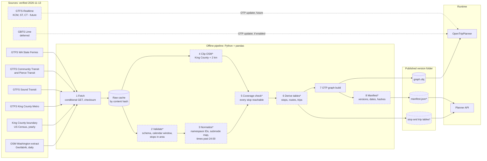

# Multimodal Router: Data Sources

| | |
|---|---|
| **Status** | Research findings and recommendations, pending team review. **No ingestion is implemented by this document** |
| **Verified on** | 2026-11-13, about 18:45–19:00 PST (server `Date` headers 2026-11-14 02:45–03:00 UTC) |
| **Method** | HEAD requests; HTTP **range requests** that read only GTFS zip directories and small files; parsing GTFS-Realtime feed headers; small GBFS JSON reads; reading official agency pages. **No large dataset was downloaded:** about 4 MB fetched in total, the largest single file being Lime's 2.9 MB vehicle list |
| **Inputs** | [product-requirements.md](product-requirements.md) · [architecture.md](architecture.md) · [routing-engine.md](routing-engine.md) · [cities/seattle.yaml](../cities/seattle.yaml) |

### Reading guide

**Verification levels:**

| Label | Meaning |
|---|---|
| ✅ **Verified (live)** | Fetched or inspected during this research; the evidence is listed |
| ☑️ **Verified (listed)** | The official page lists it and the URL responds, but the content wasn't inspected |
| ⚠️ **Not verified** | Couldn't be accessed or wasn't checked. Treat it as unknown |

- **Facts and recommendations are separated:** sections 1–5 report facts; recommendations are marked **Recommendation**.
- **Feed facts are snapshots:** dates, sizes and counts were observed on the date above and will change.

---

## 0. Key findings

1. **🔴 The Puget Sound Consolidated GTFS is being retired at the end of 2026.** This is the feed `cities/seattle.yaml` uses today. Sound Transit says there is no single replacement; consumers must pull **each agency's feed**. The project runs until mid-2027, so the switch must happen before the current feed stops being published.
2. **King County service needs four transit feeds:**
   - King County Metro (Metro bus, Seattle Streetcars, King County Water Taxi, some ST Express);
   - Sound Transit (1 Line, 2 Line, T Line, Sounder N/S);
   - Community Transit and Pierce Transit, which carry the **other ST Express routes**, many of which serve King County.

   Loading King County Metro and Sound Transit together does **not** duplicate Link. The King County Metro feed contains no Link routes, despite older wording on its developer page.
3. **GTFS-Realtime is publicly available and joinable** for King County Metro, Sound Transit and Community Transit. Feed headers were 8–17 s old, and **100% of trip-update trip IDs matched the static `trips.txt`**. Pierce Transit's real-time feed requires credentials. Real-time is still **not** in the MVP (PRD R4); this only makes it a realistic later step.
4. **The OSM extract in use (BBBike "Seattle") doesn't cover King County.** Its box (lon −122.46…−122.01, lat 47.39…47.83) leaves out Kent, Auburn, Federal Way, Vashon and the Snoqualmie Valley. **Recommendation:** Geofabrik's Washington extract, clipped to the King County boundary (resolves analysis risk R1).
5. **Lime is the only active GBFS operator in Seattle,** and it is the only operator SDOT lists.
   - **Live:** 12,672 vehicles, of which 9,769 are e-scooters and 2,922 e-bikes.
   - **Seattle only:** none east of Lake Washington.
   - **Licence unverified:** Lime's terms page blocks automated access, and search snippets suggest an "internal purposes" licence.
   - Bird's Seattle feed still responds but reports **0 vehicles**.
   - **Recommendation:** leave shared mobility out of the first prototype.
6. **Several feeds expire within weeks:**
   - Pierce Transit `feed_end_date` 2026-12-12;
   - Kitsap 2026-12-05;
   - Monorail 2026-11-30;
   - Washington State Ferries calendar ends 2027-01-03.

   Freshness has to be checked automatically, not by hand (§8).
7. **Licence obligations are real and differ by provider** (§12):
   - the King County legend must be shown;
   - Sound Transit's terms ("no changes", pass the terms on, usage metrics on request, no trademarks in the app name);
   - OpenStreetMap ODbL attribution;
   - OpenFreeMap attribution (and its "18+ to integrate" clause);
   - Photon fair use.

---

## 1. Datasets the MVP needs

| Dataset | Needed for (PRD) | MVP priority | Recommended source |
|---|---|---|---|
| **Street and path network** (walk, bike) | Routing, access and egress, direct walk and bike trips (FR-ROUTE-1, MODE-5) | **Must** | OSM: Geofabrik Washington extract clipped to King County (S1) |
| **Transit schedules** | Transit itineraries, stops, headsigns, intermediate stops (FR-ROUTE, ITIN-2/3) | **Must** | GTFS: King County Metro (S3) + Sound Transit (S4) |
| **Other ST Express services into King County** | Complete regional coverage | Should | GTFS: Community Transit (S5) + Pierce Transit (S6) |
| **Ferries serving King County** (Seattle, Fauntleroy, Vashon) | Coverage of Vashon and Bainbridge/Bremerton connections | Should | GTFS: Washington State Ferries (S7) |
| **Seattle Center Monorail** | Small coverage gain | Could | GTFS (S8) |
| **Service-area boundary** (King County polygon) | Out-of-area validation and outline (FR-LOC-5, MAP-2), OSM clipping | **Must** | US Census cartographic boundary, county 53033 (S18) |
| **Geocoding** | Place search and reverse (FR-LOC-1, LOC-4) | **Must** | Photon public instance over OSM (S20). A *service*, not a dataset |
| **Basemap tiles** | Map display (FR-MAP-1) | **Must** | OpenFreeMap (S21). A *service* |
| Real-time transit (GTFS-RT) | Delays, alerts | Future (PRD R4) | S11–S13 |
| Shared bikes and scooters (GBFS) | BIKE_SHARE, SCOOTER_SHARE (PD-2 Should) | **Defer** (§10) | Lime (S16) |
| Fares | Cost estimates (PD-1: future) | Future | Already inside the GTFS feeds (fares v1 and v2 files present; S3, S4) |
| Elevation, traffic, parking | — | Not needed | — |

---

## 2. Source catalogue

### Summary

| # | Source | Kind | MVP role | Verified |
|---|---|---|---|---|
| S1 | Geofabrik Washington OSM extract | Street network | **Use** | ✅ |
| S2 | BBBike "Seattle" OSM extract | Street network | Replace (partial coverage) | ✅ |
| S3 | King County Metro GTFS | Schedule | **Use** | ✅ |
| S4 | Sound Transit GTFS | Schedule | **Use** | ✅ |
| S5 | Community Transit GTFS | Schedule | Should | ✅ |
| S6 | Pierce Transit GTFS | Schedule | Should | ✅ |
| S7 | Washington State Ferries GTFS | Schedule | Should | ✅ |
| S8 | Seattle Center Monorail GTFS | Schedule | Could | ✅ |
| S9 | Kitsap Transit GTFS | Schedule | Not needed for King County (optional fast ferries to Seattle) | ✅ |
| S10 | Puget Sound Consolidated GTFS | Schedule | **Stop using before end of 2026** | ✅ |
| S11 | King County Metro GTFS-RT | Real-time | Future | ✅ |
| S12 | Sound Transit GTFS-RT | Real-time | Future | ✅ |
| S13 | Community Transit GTFS-RT | Real-time | Future | ✅ |
| S14 | Pierce Transit GTFS-RT (Swiftly) | Real-time | Future; credentials needed | ✅ (401 without credentials) |
| S15 | OneBusAway Puget Sound API | Real-time API | Not needed | ☑️ |
| S16 | Lime Seattle GBFS | Shared mobility | Defer | ✅ data / ⚠️ licence |
| S17 | Bird Seattle GBFS | Shared mobility | Exclude (inactive) | ✅ |
| S18 | US Census county boundaries | Boundary | **Use** | ✅ |
| S19 | King County GIS Open Data | Boundary (alternative) | Optional | ☑️ portal only |
| S20 | Photon (komoot public instance) | Geocoding service | **Use** (MVP) | ✅ |
| S21 | OpenFreeMap | Tile service | **Use** (MVP) | ✅ |

### 2.1 Street network

#### S1: OpenStreetMap, Geofabrik Washington extract (recommended)

| Field | Detail |
|---|---|
| Provider | Geofabrik GmbH (extract); data © OpenStreetMap contributors |
| Purpose | Walk, bike (and later car) network; stop-to-street linking; geocoder and basemap use the same source data |
| URL | `https://download.geofabrik.de/north-america/us/washington-latest.osm.pbf` (+ `.md5`, `washington.poly`) |
| Required content | Ways with `highway=*`; access tags (`access`, `foot`, `bicycle`, `motor_vehicle`); `oneway`, `oneway:bicycle`; `sidewalk`, `footway`, `crossing`; `bridge`, `tunnel`, `steps`, `elevator`; `public_transport=platform` / `railway=platform` for linking; nodes with coordinates |
| Format | OSM PBF |
| Update frequency | **Daily**: `Last-Modified` was the same day, 2026-11-14 01:59 UTC |
| Size | 366 MB (Content-Length), statewide |
| Licence / access | ODbL 1.0. Credit "© OpenStreetMap contributors" and make clear the data is under the ODbL. A derived *database* that is shared publicly must also be ODbL. No key needed |
| Integration | Pipeline downloads it (conditional GET), **clips it to the King County polygon + 2 km buffer** (e.g. with `osmium extract`), and OTP builds the graph from the clip |
| Known limitations | Statewide file is larger than needed; sidewalk and crossing tagging varies by neighbourhood; no elevation |
| Verified | ✅ HEAD 200, size, `Last-Modified`, md5 file and `.poly` (108 lines) retrieved |

#### S2: OpenStreetMap, BBBike "Seattle" extract (current repository source)

| Field | Detail |
|---|---|
| Provider | BBBike.org (extract); data © OpenStreetMap contributors |
| URL | `https://download.bbbike.org/osm/bbbike/Seattle/Seattle.osm.pbf` (as in `cities/seattle.yaml`) |
| Coverage | `Seattle.poly`: rectangle lon −122.46…−122.01, lat 47.39…47.83. Includes Seattle, Bellevue, Redmond, Kirkland, Renton, SeaTac, Lynnwood. **Excludes** Kent/Auburn/Federal Way (south of 47.39), Vashon (west of −122.46) and the Snoqualmie Valley (east of −122.01) |
| Format / size / updates | PBF, 69.6 MB; `Last-Modified` 2026-11-07 (roughly weekly) |
| Licence | ODbL (OSM data) |
| Known limitations | **Doesn't match the King County service area (PD-5).** Fine for a Seattle-only first build |
| Verified | ✅ HEAD 200, size, date; `.poly` read |

### 2.2 Transit schedules (GTFS Schedule)

All of the agency feeds below are listed on Sound Transit's [OTD downloads](https://www.soundtransit.org/help-contacts/business-information/open-transit-data-otd/otd-downloads) page. Several `soundtransit.org/GTFS-*` links **redirect** to the agency's own host; the final URLs are shown.

**Fields required from every GTFS feed** (pipeline and OTP):

| File | Fields |
|---|---|
| `agency.txt` | `agency_id`, `agency_name`, `agency_timezone` |
| `stops.txt` | `stop_id`, `stop_name`, `stop_lat`, `stop_lon`, `stop_code`, `location_type`, `parent_station` |
| `routes.txt` | `route_id`, `agency_id`, `route_short_name`, `route_long_name`, `route_type` |
| `trips.txt` | `trip_id`, `route_id`, `service_id`, `trip_headsign`, `direction_id`, `shape_id`, `block_id` |
| `stop_times.txt` | `trip_id`, `arrival_time`, `departure_time`, `stop_id`, `stop_sequence`, `pickup_type`, `drop_off_type` |
| Calendars | `calendar.txt` and/or `calendar_dates.txt` |
| Optional | `transfers.txt`, `shapes.txt`, `frequencies.txt`, `feed_info.txt` (version and validity dates) |

#### S3: King County Metro GTFS

| Field | Detail |
|---|---|
| Provider | King County Metro Transit |
| Purpose | Metro bus; **Seattle Streetcar** (South Lake Union and First Hill; agency "City of Seattle"); **King County Water Taxi** (routes 973, 975, `route_type` 4); ST Express routes Metro operates (**522, 542, 545, 547, 556, 566**); Solid Ground EZ Loop |
| URL | `https://metro.kingcounty.gov/GTFS/google_transit.zip` (the soundtransit.org link redirects here) |
| Observed | 10.8 MB zip; `Last-Modified` 2026-10-29; `feed_info`: version `FAL26-161.5`, valid **2026-10-29 → 2027-03-26**; 142 routes (138 bus, 2 streetcar, 2 ferry); 31,484 trips; `stop_times.txt` 64.7 MB uncompressed; `shapes.txt` present; GTFS-Fares v2 files present; **no `transfers.txt`**; extra non-standard `block_trip.txt` |
| Update frequency | Per service change (the developer page says most agencies change service at least twice a year) plus interim revisions. Current validity ends 2027-03-26 |
| Licence / access | King County **Transit Data Terms of Use** on the [developer page](https://kingcounty.gov/en/dept/metro/rider-tools/mobile-and-web-apps): a limited, revocable licence to use, reproduce and redistribute, including derivative works (where King County holds copyright). **Required legend:** "Transit scheduling, geographic, and real-time data provided by permission of King County". No King County logo or marks. Provided "as is". No key |
| Integration | Pipeline download (conditional GET) → validation → OTP graph build (OTP loads multiple GTFS feeds and namespaces them) |
| Known limitations | The developer page text says the feed includes Link light rail, **but `routes.txt` has no Link routes**. Link is in S4, so there is no duplication. No `transfers.txt`, so transfer times fall back to defaults |
| Verified | ✅ Directory and `agency`, `feed_info`, `routes`, `calendar`, `calendar_dates`, `trips` read via range requests (~0.3 MB fetched) |

#### S4: Sound Transit GTFS

| Field | Detail |
|---|---|
| Provider | Sound Transit |
| Purpose | **1 Line, 2 Line, T Line** (light rail, `route_type` 0); **Sounder N Line and S Line** (`route_type` 2); 2 bus routes (replacement shuttles) |
| URL | `https://www.soundtransit.org/GTFS-rail/40_gtfs.zip` → redirects to `https://gtfs.sound.obaweb.org/prod/40_gtfs.zip` |
| Observed | 3.15 MB zip; `Last-Modified` 2026-11-10; `feed_info`: version `SC-Fall-2026.6`, valid **2026-11-01 → 2027-03-26**; 7 routes; 15,905 trips; `stop_times.txt` 35.3 MB uncompressed; **`transfers.txt` present**; Fares v2; `translations.txt`; areas/stop areas |
| Update frequency | Service changes plus frequent revisions (version suffix `.6`). The OTD page says schedule files are updated manually |
| Licence / access | Sound Transit **[Transit Data Terms of Use](https://www.soundtransit.org/help-contacts/business-information/open-transit-data-otd/transit-data-terms-use)**: limited, revocable licence. Key clauses:<ul><li>usage metrics on request;</li><li>**"not change the Data as published and to use the most current Data available"**;</li><li>give these terms to anyone who receives the data from you;</li><li>provide an email address for notifications;</li><li>**no transit agency names or marks in an app or business name**;</li><li>no warranty.</li></ul>No key needed for file downloads |
| Integration | As S3 |
| Known limitations | ST Express buses are **not** in this feed. They are in the operators' feeds (S3, S5, S6) |
| Verified | ✅ As S3 |

#### S5: Community Transit GTFS

| Field | Detail |
|---|---|
| Provider | Community Transit (Snohomish County) |
| Purpose | CT buses into Seattle and the UW, plus ST Express routes CT operates: **510, 512, 513, 532, 535**, and a "1/2 Line Shuttle" |
| URL | `https://www.soundtransit.org/GTFS-CT/current.zip` → `https://www.communitytransit.org/docs/default-source/open-data/gtfs/current.zip` |
| Observed | 4.7 MB; `Last-Modified` 2026-11-12; valid 2026-11-10 → 2027-03-26; 40 bus routes; 14,810 trips; `transfers.txt` present |
| Licence | Covered by Sound Transit's Transit Data Terms (it names Community Transit). The agency's own [open data page](https://communitytransit.org/OpenData) was not read ⚠️ |
| Integration / limitations | As S3. Most of its service is outside King County. Its value is the routes that reach Seattle and Northgate |
| Verified | ✅ |

#### S6: Pierce Transit GTFS

| Field | Detail |
|---|---|
| Provider | Pierce Transit |
| Purpose | ST Express routes Pierce Transit operates: **560, 574, 577, 578, 590, 592, 594, 595, 596, 597**. Many serve King County (SeaTac, Federal Way, Seattle) |
| URL | `https://www.soundtransit.org/GTFS-PT/gtfs.zip` → `https://prod.piercetransit.org/GTFS/gtfs.zip` |
| Observed | 5.0 MB; `Last-Modified` 2026-11-09; **valid only until 2026-12-12**; 41 routes |
| Licence | Covered by Sound Transit's Transit Data Terms |
| Known limitations | **The validity window ends within a month,** so a new file must arrive and be picked up. No `transfers.txt` |
| Verified | ✅ |

#### S7: Washington State Ferries GTFS

| Field | Detail |
|---|---|
| Provider | Washington State Department of Transportation (Washington State Ferries) |
| Purpose | Ferries touching King County: Seattle–Bainbridge, Seattle–Bremerton, Fauntleroy–Vashon, Fauntleroy–Southworth, Vashon–Southworth, Point Defiance–Tahlequah (Vashon) |
| URL | `https://business.wsdot.wa.gov/Transit/csv_files/wsf/google_transit.zip` |
| Observed | 412 KB; `Last-Modified` **the same day** (2026-11-13); calendar 2026-11-13 → **2027-01-03** (about a 7-week window); 38 routes, including many San Juan routes we don't need; **no `feed_info.txt`** |
| Licence | Covered by Sound Transit's Transit Data Terms (it names Washington State Ferries). WSDOT's own terms were not read ⚠️ |
| Known limitations | Short validity window, so it needs frequent refreshes. No GTFS-RT ("not provided in GTFS format" per the OTD page) |
| Verified | ✅ |

#### S8: Seattle Center Monorail GTFS

| Field | Detail |
|---|---|
| Provider | Seattle Monorail Services (hosted on GitHub) |
| URL | `https://raw.githubusercontent.com/Seattle-Monorail-Services/gtfs/main/96_gtfs.zip` |
| Observed | 30 KB; 1 route (`route_type` 12, monorail); `feed_info` valid until **2026-11-30**, while `calendar.txt` runs to 2027-05-30 (inconsistent) |
| Licence | The OTD terms cover "other transit agencies" generically. The repository's own licence was not checked ⚠️ |
| Known limitations | Inconsistent validity dates; `MONORAIL` is disabled in the example modes response (api-contract), so enabling it is a product choice |
| Verified | ✅ (whole file fetched, 30 KB) |

#### S9: Kitsap Transit GTFS (optional)

| Field | Detail |
|---|---|
| Purpose | Kitsap buses and **passenger fast ferries to downtown Seattle** (8 ferry routes) |
| URL | `https://pride.kitsaptransit.com/gtfs/google_transit.zip` |
| Observed | 4.1 MB; `Last-Modified` 2026-09-10; **valid until 2026-12-05** |
| Licence | Not named in Sound Transit's terms; listed on the OTD page. Not checked ⚠️ |
| Recommendation | Not needed for King County trips. Add only if Seattle–Kitsap ferry trips become a use case |
| Verified | ✅ |

#### S10: Puget Sound Consolidated GTFS (in use today; being retired)

| Field | Detail |
|---|---|
| URL | `https://gtfs.sound.obaweb.org/prod/gtfs_puget_sound_consolidated.zip` (in `cities/seattle.yaml`) |
| Observed | 35.3 MB; `Last-Modified` 2026-11-10; 12 agencies (adds Intercity, Everett, Kitsap, Amtrak, Washington State Ferries, Monorail); 391 routes; `stop_times.txt` 184 MB uncompressed |
| Status | **To be decommissioned at the end of 2026** ([notice](https://www.soundtransit.org/help-contacts/business-information/open-transit-data-otd/consolidated-schedule-decommissioning)). Conflicting IDs are prefixed with the agency number, and *"those trips will not match real time data without modification"* |
| Recommendation | Switch to S3 + S4 (+ S5, S6, S7) before January 2027. OTP accepts multiple feeds and namespaces their IDs, so no custom merging is needed for OTP |
| Verified | ✅ |

### 2.3 Real-time transit (GTFS-Realtime)

**What was checked, for each feed:**
1. Fetched it.
2. Parsed it as a GTFS-RT `FeedMessage` (protobuf).
3. Compared `header.timestamp` with the HTTP `Date` header.
4. For trip updates, checked the trip IDs against the agency's static `trips.txt`.

All feeds below reported `gtfs_realtime_version` 2.0.

**Required fields if adopted later:**

| Message | Fields |
|---|---|
| `FeedHeader` | `timestamp` |
| `TripUpdate` | `trip.trip_id`, `trip.schedule_relationship`, `stop_time_update[]` (`stop_sequence`/`stop_id`, `arrival`/`departure` delay or time, `schedule_relationship`) |
| `VehiclePosition` | `trip`, `position`, `timestamp` |
| `Alert` | `informed_entity[]`, `active_period[]`, `cause`, `effect`, `header_text`, `description_text` |

| # | Feed | URL (from official pages) | Observed at check | Access / licence | Verified |
|---|---|---|---|---|---|
| S11 | King County Metro: trip updates | `https://s3.amazonaws.com/kcm-alerts-realtime-prod/tripupdates.pb` | 1.03 MB, 1,040 entities, **header 9 s old**, trip IDs **1,040/1,040** match static | Public, no key; King County terms + legend | ✅ live |
| S11 | King County Metro: vehicle positions | `…/vehiclepositions.pb` | 534 vehicles, 8 s old | Same | ✅ live |
| S11 | King County Metro: alerts | `…/alerts.pb` | 67 alerts, 8 s old | Same | ✅ live |
| S11 | King County Metro: JSON variants | `…/tripupdates_pb.json`, `…_enhanced.json` (and the same for the other two feeds) | Listed on the developer page | Same | ☑️ listed |
| S12 | Sound Transit: trip updates | `https://feeds.sound-transit.continuousgtfs.io/trip_updates.pb` | 51 entities, 10 s old, **51/51** match static | Sound Transit terms | ✅ live |
| S12 | Sound Transit: vehicle positions | `https://feeds.sound-transit.continuousgtfs.io/vehicle_positions.pb` | 45 vehicles, 10 s old | Same | ✅ live |
| S12 | Sound Transit: alerts (1, 2, N, S, T Lines) | `https://s3.amazonaws.com/st-service-alerts-prod/alerts.pb` (JSON: `alerts_pb.json`) | 8 alerts, 12 s old | Same | ✅ live |
| S13 | Community Transit: trip updates / vehicle positions | `https://s3.amazonaws.com/commtrans-realtime-prod/tripupdates.pb`, `…/vehiclepositions.pb` (+ `alerts.pb`) | 245 entities, 16 s old, **245/245** match; 119 vehicles | Sound Transit terms | ✅ live (alerts ☑️) |
| S14 | Pierce Transit (Swiftly) | `https://api.goswift.ly/real-time/pierce-transit/gtfs-rt-trip-updates` (+ vehicle positions) | **HTTP 401 "Invalid Credentials"** | Requires credentials; how to obtain them was not found ⚠️ | ✅ (needs auth) |
| S15 | OneBusAway Puget Sound API | `https://api.pugetsound.onebusaway.org/api/gtfs_realtime/…-for-agency/{id}.pb` | Responded `200` without a key at check time | **The documented process requires an API key** (email `oba_api_key@soundtransit.org`, allow about 20 business days). Don't rely on keyless access | ☑️ |

**Limitations:**
- These are snapshots of a Friday evening. Update intervals and uptime were not measured.
- Trip updates cover only trips currently in service.
- There is no GTFS-RT for Washington State Ferries or the Monorail.
- Conflicting trip IDs in the *consolidated* static feed (S10) don't match real-time IDs. The **per-agency** static feeds do, as verified above.

### 2.4 Shared bikes and scooters (GBFS)

#### S16: Lime Seattle

| Field | Detail |
|---|---|
| Provider | Lime (Neutron Holdings, Inc.) under SDOT's Shared Micromobility Permit. SDOT requires permitted operators to publish a GBFS feed ([SDOT data page](https://www.seattle.gov/transportation/projects-and-programs/programs/bike-program/bike-share)) |
| URLs | **v2.2:** `https://data.lime.bike/api/partners/v2/gbfs/seattle/gbfs.json` (used in this repository; also in MobilityData's catalogue). **v1.0:** `…/partners/v1/gbfs/seattle/gbfs.json` (the version SDOT lists). Both live |
| Feeds offered (v2.2) | `system_information`, `station_information`, `station_status`, `free_bike_status`, `vehicle_types`. **No `geofencing_zones`, no `system_regions`, no pricing plans** |
| Observed | `free_bike_status`: 2.9 MB, **12,672–12,691 vehicles** (9,769 e-scooters, 2,922 e-assist bikes), `ttl` 60 s, `last_updated` age about 0 s. Vehicle fields: `bike_id`, `lat`, `lon`, `is_reserved`, `is_disabled`, `vehicle_type_id`, `current_range_meters`, `last_reported`. **All vehicles inside Seattle** (lat 47.52–47.73, lon −122.40…−122.27; 0 east of Lake Washington). 1 "station" (free-floating system) |
| Required fields | `system_information.timezone`, `license_url`; `vehicle_types` (`form_factor`, `propulsion_type`, `max_range_meters`); `free_bike_status` vehicle fields above |
| Format / updates | JSON over HTTPS; changes continuously (`ttl` 60). OTP's GBFS updater is configured to poll every minute (in this repository) |
| Licence / access | `license_url` = `https://www.li.me/gbfs-terms`. **⚠️ Not verified:** the page returns a bot challenge or `403` to automated clients. Search-result snippets describe a licence *"solely for your internal purposes"* that Lime can amend or terminate. A team member must read the terms in a browser before any public use |
| Integration | OTP `vehicle-rental` updater (implemented in `scripts/fetch_data.py`). The API doesn't poll GBFS itself (architecture §3.2) |
| Known limitations | **Seattle-only coverage;** no geofencing data (parking and no-ride rules unknown); no pricing feed; the README's known issues (startup timeout, Ship Canal scooter fallback); vehicle IDs may rotate (GBFS privacy practice) |
| Verified | ✅ data live · ⚠️ licence |

#### S17: Bird Seattle (inactive)

| Field | Detail |
|---|---|
| URL | `https://mds.bird.co/gbfs/v2/public/seattle-washington/gbfs.json` (listed in [MobilityData systems.csv](https://github.com/MobilityData/gbfs/blob/master/systems.csv)) |
| Observed | Discovery file `200` (v2.3, includes `geofencing_zones`), but `free_bike_status` has **0 vehicles** and `last_updated` is effectively 0. SDOT's page lists only Lime |
| Recommendation | Exclude |
| Verified | ✅ |

### 2.5 Service-area boundary

#### S18: US Census Bureau cartographic boundary file, counties (recommended)

| Field | Detail |
|---|---|
| Purpose | King County polygon (state FIPS 53, county 033) for the service area (PD-5), OSM clipping, and the out-of-area check |
| URL | `https://www2.census.gov/geo/tiger/GENZ2024/shp/cb_2024_us_county_500k.zip` |
| Observed | 11.6 MB (all US counties); `Last-Modified` 2025-04-10. The 2023 edition is also present |
| Format | Shapefile (1:500k generalised) |
| Licence | US federal government work; public domain in the US |
| Integration | One-time pipeline step: filter to county 53033, simplify, buffer, and write `cities/seattle.geojson` (architecture §3.3) |
| Limitations | Generalised coastline. The 500k version includes water area, so pair it with the routing network rather than using it for precise shoreline rendering |
| Verified | ✅ HEAD 200 and size |

#### S19: King County GIS Open Data (alternative)

| Field | Detail |
|---|---|
| URL | `https://gis-kingcounty.opendata.arcgis.com/` |
| Status | ☑️ Portal reachable (200). A specific county-boundary dataset and its licence were **not** verified ⚠️ |

### 2.6 Services used by the web app

#### S20: Photon geocoder (komoot public instance)

| Field | Detail |
|---|---|
| URL | `https://photon.komoot.io/api` and `/reverse` (in the repository today) |
| Data | OSM, "minutely up to date" per the site |
| Terms | *"You can use the API for your project, but please be fair — extensive usage will be throttled. We do not guarantee for the availability"* |
| Integration | Proxied by `/api/v1/places/*` with caching (api-contract §7, architecture §10.1) |
| Limitations | No SLA; fair-use throttling; results must be filtered to the service area server-side |
| Verified | ✅ |

#### S21: OpenFreeMap (vector tiles)

| Field | Detail |
|---|---|
| URL | `https://tiles.openfreemap.org/styles/positron` (and `dark`), which the web app uses today. The style responds `200`, `application/json`, `Cache-Control: max-age=86400` |
| Terms ([ToS](https://openfreemap.org/tos/), last updated 2026-10-14) | <ul><li>Free; "no limits on the number of map views or requests"; no registration or API key.</li><li>**Attribution required** (MapLibre adds it automatically): "OpenFreeMap © OpenMapTiles, Data from OpenStreetMap".</li><li>No warranty; may be discontinued without notice.</li><li>Offline downloads ≤ 3,000 tiles / 50 MB.</li><li>**Whoever integrates the service must be 18 or older** (end users can be any age).</li></ul> |
| Limitations | No SLA. Self-hosting is the fallback (weekly planet downloads are offered) |
| Verified | ✅ |

### 2.7 Not used

| Source | Why |
|---|---|
| Everett Transit, Intercity Transit (GTFS and GTFS-RT on the OTD page) | Outside King County |
| Amtrak (only in the consolidated feed) | Out of scope; not a regional commuter service |
| WSDOT ferries API (non-GTFS) | GTFS covers schedules; real-time not needed |
| Bird Seattle GBFS | Inactive (S17) |

---

## 3. GTFS Schedule vs. GTFS-Realtime

| | **GTFS Schedule** (static) | **GTFS-Realtime** |
|---|---|---|
| What it describes | The **planned** service: stops, routes, trips, timetables, calendars, shapes, fares, transfers | **Deviations and live state:** predicted arrivals and departures (trip updates), vehicle locations (vehicle positions), disruptions (service alerts) |
| Format | A zip of CSV text files | Protocol Buffers (`FeedMessage`), fetched by HTTP polling. Some agencies also offer JSON |
| Size and cadence | MBs; republished at service changes and corrections (weeks to months) | KB–MB; regenerated every few seconds (headers were 8–17 s old) |
| Identity | Defines `trip_id`, `stop_id`, `route_id` | **References** the static IDs. A real-time feed is useless without the matching static feed (King County says so explicitly) |
| Validity | `feed_info` start and end dates; calendars | Only "now" |
| Use in the MVP | **Yes**: the basis of all itineraries (`time_basis: SCHEDULED`) | **No** (PRD R4). Later: alerts first (lowest risk), then trip updates via OTP's real-time updaters |
| Main risk | Expired calendars; ID collisions when combining feeds | Stale or empty feeds; trip IDs that don't match static data (true of the consolidated feed); polling load |

---

## 4. GBFS resources and limitations

**The GBFS file set** (v2.x names; v3 renames some):

| File | Purpose | Needed? | Lime Seattle |
|---|---|---|---|
| `gbfs.json` | Auto-discovery list of feeds | Required | ✅ |
| `system_information.json` | Operator, timezone, **licence URL** | Required | ✅ (`license_url` only) |
| `vehicle_types.json` | Form factor (bicycle or scooter), propulsion, range | Needed for e-bike vs. scooter | ✅ |
| `free_bike_status.json` (v3: `vehicle_status`) | Positions of free-floating vehicles | Required for free-floating systems | ✅ 12.7k vehicles |
| `station_information` / `station_status` | Docks | Docked systems only | Present, 1 station |
| `geofencing_zones.json` | No-ride, no-park and speed zones | Important for correct drop-offs | ❌ not offered |
| `system_pricing_plans.json` | Prices | Needed for cost estimates | ❌ not offered |
| `system_regions.json`, `system_alerts.json` | Regions, outages | Optional | ❌ |

**Limitations that affect us:**

| Limitation | Effect |
|---|---|
| Free-floating availability changes by the minute | Routing results are snapshots. A vehicle shown may be gone by the time the user arrives |
| No geofencing in Lime's feed | We can't know where parking is allowed, so drop-off points may be invalid |
| No pricing feed | Cost estimates would be modelled (PD-1 keeps cost hidden anyway) |
| Coverage | Seattle only, while the service area is King County |
| Licence | Unverified and possibly internal-use only (S16) |
| GBFS version spread | SDOT lists v1.0, the repository uses v2.2, and other operators may publish v3. OTP's updater handles v1/v2; v3 support should be checked per OTP version ⚠️ |
| Operator churn | Bird's feed still resolves but is empty. Every discovery URL needs an "is it alive and non-empty?" check |

---

## 5. How the street and transit networks are combined

1. **One coordinate system and one timezone:**
   - every source is WGS 84 (EPSG:4326);
   - every agency declares `agency_timezone = America/Los_Angeles` (verified);
   - the service day and the GTFS "past 24:00" times are interpreted in that zone (routing-engine §2).
2. **Coverage alignment:** the street network must contain every stop in the service area plus a buffer. Clipping OSM to King County + 2 km and checking that *every* GTFS stop inside the polygon snaps to a walkable OSM edge within, say, 150 m (pipeline coverage check, PRD DATA-3) prevents "stop with no way to reach it" failures.
3. **Linking:** each stop (or station entrance, when `location_type`/`parent_station` data exists) is connected to the nearest suitable street edge. OTP does this during its graph build in the MVP. In Phase 2+ our pipeline produces stop→street links and footpaths (routing-engine §1.1).
4. **Namespacing:** feeds reuse IDs. Sound Transit warns that stop IDs collide most often and that "an overlapping stop ID is not a shared stop".
   - **OTP:** loading each feed separately gives it a feed ID automatically.
   - **Our tables:** every ID becomes `<feed_id>:<id>`.
5. **Transfers between agencies:** agency feeds don't describe transfers to *other* agencies' stops. Walking transfers come from the street network (OTP) or from footpaths we generate (routing-engine §1.1). Where they exist, `transfers.txt` rules (S4, S5, S9) apply within a feed.
6. **Live layers on top:** OTP updaters attach GBFS vehicles (and later GTFS-RT) to the built graph at runtime. The pipeline only writes their URLs into `router-config.json` (implemented).

---

## 6. Ingestion and normalisation pipeline

**Recommendation.** This extends what `scripts/fetch_data.py` already does. The stages follow architecture §8, with the specifics this research found.

| Stage | What happens | Tool | Fails the run if… | Status |
|---|---|---|---|---|
| 1 Fetch | Conditional GET (`If-None-Match` / `If-Modified-Since`) per source; store under a content hash; record URL, final URL (after redirects), ETag, `Last-Modified`, size | Python `urllib` / `httpx` | A **Must** source has no usable copy (§9) | Partial (`fetch_data.py` downloads but doesn't do conditional GETs) |
| 2 Validate | Required files and fields present (§2.2); `feed_info` / calendar covers **≥ 14 days ahead**; `stop_times` times parse (allowing > 24:00); every `route_type` maps to a `TransitSubmode`; stops inside the polygon + buffer; no duplicate IDs within a feed. *Optional:* run MobilityData's GTFS validator for a deeper report | pandas | Fatal errors, or < 14 days of validity on a Must feed | Planned (only the required-file check exists today) |
| 3 Normalise | Prefix IDs with the feed ID in our tables; map `route_type` + agency → submode (e.g. 0 → `LIGHT_RAIL` for Sound Transit and `STREETCAR` for City of Seattle; 4 → `FERRY`; 12 → `MONORAIL`); expand calendars to a per-day service table | pandas | Unmapped route type with no `OTHER` fallback | Planned |
| 4 Clip OSM | Cut the statewide PBF to King County + 2 km | `osmium extract` (CLI) | Clip output empty or far smaller than expected | Planned |
| 5 Coverage | Every in-area stop is within ~150 m of a walkable OSM way | pandas + spatial index (e.g. `shapely` / `geopandas`, an added dependency) | Stops with no reachable street > threshold | Planned |
| 6 Derive | `stops`, `routes`, `trips` tables (Parquet or CSV) used by the API for names and headsigns (architecture §3.2) | pandas | — | Planned |
| 7 Build | OTP builds the graph from the clipped PBF + the **original, unmodified** GTFS zips + config | OTP 2.10 | Build error | Implemented (`otp.sh`) |
| 8 Manifest | `data_version`; per-source URL, hash, `Last-Modified`, feed version, validity dates; boundary version | Python | — | Planned |

**Licence-driven choice:** OTP is given the **original GTFS files**, not edited copies. Sound Transit's terms say not to change the data as published (§12). Our normalised tables are internal lookups derived from those files. They are not republished, and **raw or derived GTFS should not be committed to the public repository** unless course staff confirm that's fine (open question D2).

---

## 7. Freshness requirements and update frequencies

| Source | Provider cadence (observed) | Our check | Rebuild trigger | Freshness requirement |
|---|---|---|---|---|
| GTFS: King County Metro, Sound Transit, Community Transit, Pierce Transit, Washington State Ferries | Service changes at least twice a year, plus revisions (ST version `.6`; WSF changed the same day) | **Daily** conditional GET | Any feed changed, **or** any feed's validity ends within 14 days | Every Must feed valid ≥ 14 days ahead; data ≤ 4 weeks behind the latest published version (PRD DQ-2) |
| GTFS: Pierce Transit, Kitsap, Monorail | Validity ends 2026-12-12 / 12-05 / 11-30 | Daily | As above | Watch closely: these will expire soon |
| OSM (Geofabrik) | Daily | **Weekly** | Monthly, or when a mapping issue is fixed | ≤ 1 month old |
| Boundary (Census) | Yearly editions | Yearly | New edition | — |
| GBFS (if enabled) | Continuous (`ttl` 60 s) | OTP polls every 60 s | — | `last_updated` ≤ 5 min, otherwise treat as unavailable |
| GTFS-RT (future) | Seconds (header age 8–17 s) | OTP updater every 15–30 s | — | Header ≤ 2 min old, otherwise ignore |
| Photon, OpenFreeMap | Live services | Health of the proxy / tile errors | — | — |

---

## 8. Caching and invalidation

| Layer | What is cached | Key | Invalidated by |
|---|---|---|---|
| Fetch | Raw files | URL + ETag / `Last-Modified`; stored by content hash | A changed ETag or hash. Unchanged sources are skipped (conditional GET returns 304) |
| Build | Graph, tables, manifest | **`data_version`** = hash of every input hash + config + OTP version | Any input hash changes |
| Serve: OTP | Graph in memory | `data_version` (same folder as the API, architecture §8) | Switching folders and restarting OTP |
| Serve: API | OTP responses, geocodes (architecture §10.1) | Includes `data_version` | Automatic when the version changes; TTLs: 15 min for scheduled results, ≤ 60 s for anything involving rentals |
| Live feeds | GBFS / GTFS-RT state | Inside OTP | The feed's `ttl` / polling interval. Never cache past `ttl` |
| Browser | Tiles, `/service-info`, `/transport/modes` | HTTP `Cache-Control` | Tile max-age 86,400 s (provider); our metadata 1 h |

No database or extra cache server is justified for the MVP. Files, versioned folders and in-process caches cover every need (architecture §9).

---

## 9. Failure handling when data is missing or outdated

**Principle:** keep the **last known-good copy for each source**, publish a new version only when it is valid, and make degradation visible in `manifest.json`, `/health` and response warnings. Never fail silently.

| Failure | Detected by | Behaviour |
|---|---|---|
| A source is unreachable (timeout, 5xx, DNS) | Fetch | Use that source's last known-good copy if it is still valid for ≥ 14 days. Log, and mark the source `STALE` in the manifest |
| A **Must** GTFS feed (King County Metro or Sound Transit) has no valid copy (expired, or fails validation) | Validate | **Don't publish.** Keep the previous `data_version` live. Alert the team. `/health`: `transit_data` = `DEGRADED`, or `DOWN` once the live data expires |
| A **Should** feed (Community Transit, Pierce Transit, Washington State Ferries) is invalid | Validate | Publish without it, keeping the last good copy while it is still valid. Show the loss in the manifest; add the response warning `DATA_NEAR_EXPIRY` / the source status in `data.sources` |
| Feed validity ends within 7 days | Daily check | Warning `DATA_NEAR_EXPIRY` (api-contract §4.3.6); team alert |
| Query date outside every feed's window | API validation | `422 TIME_OUTSIDE_SERVICE_WINDOW` |
| URL starts redirecting, or moves (the soundtransit.org links already redirect) | Fetch records the final URL | Follow redirects but log changes. If the content type isn't a zip, treat the source as unreachable |
| Feed decommissioned (the consolidated feed) | Provider notice; 404 | Already planned: migrate before end of 2026 (§11) |
| OSM clip or coverage check fails | Stages 4–5 | Don't publish; keep the previous graph |
| GBFS stale, empty or failing (as Bird is) | OTP updater / pipeline liveness check | Leave out rental options. Warning `SHARED_MOBILITY_UNAVAILABLE`. Never route on vehicles older than 5 min |
| GTFS-RT stale (future) | Header age > 2 min | Ignore real-time and fall back to schedule (`time_basis: SCHEDULED`) |
| Geocoder or tiles down | API / browser errors | `503 GEOCODING_UNAVAILABLE` with map picking still available; tiles: plain background (FR-ERR-3) |
| A licence changes or is revoked | Manual review (terms are checked each quarter) | Disable the source by configuration |

---

## 10. Which modes are feasible to support first

| Mode | Data | Feasible now? | Notes |
|---|---|---|---|
| **Walk** | OSM | ✅ Yes | Sidewalk tagging varies |
| **Transit: bus** | GTFS (King County Metro, Sound Transit, Community Transit, Pierce Transit) | ✅ Yes | ST Express spread across operator feeds (§2.2) |
| **Transit: light rail** (1, 2, T Lines) | GTFS (Sound Transit) | ✅ Yes | |
| **Transit: streetcar** | GTFS (King County Metro, agency "City of Seattle") | ✅ Yes | Needs the submode mapping (`route_type` 0 is shared with light rail) |
| **Transit: commuter rail** (Sounder N/S) | GTFS (Sound Transit) | ✅ Yes | Peak-oriented service |
| **Transit: ferry / water taxi** | GTFS (King County Metro 973/975; Washington State Ferries) | ✅ Yes (Water Taxi); Should (WSF) | WSF needs frequent refreshes |
| **Transit: monorail** | GTFS (S8) | ⚠️ Could | Inconsistent validity dates |
| **Own bike** | OSM bike tags | ✅ Yes | Bike-to-station-and-park in the MVP; bikes on board later |
| **Bike share / scooter share** | GBFS (Lime) | ⚠️ **Not for the first prototype** | Seattle-only coverage, unverified licence, no geofencing data, known OTP issues. Revisit once the licence is confirmed (PD-2 "Should") |
| Car / park & ride | OSM (car network, lots) | Future | PD-2 |
| Taxi / ride-hail | None (no open data) | Future | |
| Real-time adjustments | GTFS-RT (King County Metro, Sound Transit, Community Transit) | Future | Technically ready: feeds are live and join cleanly |

---

## 11. Minimal feed set for the first working prototype

**Recommendation:**

| # | Source | Why it is in the minimal set |
|---|---|---|
| 1 | **OSM**: Geofabrik Washington, clipped to King County + 2 km (S1). *For the first week, the existing BBBike extract (S2) is acceptable if the prototype stays inside its box* | Walk and bike network; required by OTP |
| 2 | **GTFS King County Metro** (S3) | Most bus service, streetcar, Water Taxi, part of ST Express |
| 3 | **GTFS Sound Transit** (S4) | Link light rail and Sounder |
| 4 | **King County boundary**: US Census (S18) | Service-area polygon, clipping, validation |
| 5 | **Photon** (S20) and **OpenFreeMap** (S21) | Search and basemap (already integrated) |

**Add next (still MVP):**
- Community Transit (S5) and Pierce Transit (S6), for the remaining ST Express routes into King County;
- Washington State Ferries (S7), for Vashon and the downtown ferries.

**Deliberately left out:** GTFS-RT, GBFS, the Monorail, Kitsap, and the **consolidated feed**.

**Change to plan in the repository (not made here):** replace the `data.gtfs` entry and the OSM URL in `cities/seattle.yaml` with the sources above, and remove the `gbfs` entry until shared mobility is enabled. Deadline: before the consolidated feed's end-of-2026 retirement.

**Sizes for planning** (verified `stop_times.txt`, uncompressed):

| Feed | Size |
|---|---|
| King County Metro | 64.7 MB |
| Sound Transit | 35.3 MB |
| Community Transit | 36.2 MB |
| Pierce Transit | 22.5 MB |
| Washington State Ferries | 2.5 MB |
| **Total** | **≈ 161 MB** |

That compares with 184 MB for the consolidated feed. These numbers feed into routing-engine R2.

---

## 12. Licensing and attribution obligations

| Source | What we must do | Where it shows up |
|---|---|---|
| King County Metro (S3, S11) | Display **"Transit scheduling, geographic, and real-time data provided by permission of King County"** prominently. Don't use the King County logo or marks | `data.sources[].attribution` → results footer (api-contract §4.3.7) |
| Sound Transit Transit Data Terms (S4–S7, S12, S13) | <ul><li>Accept the terms.</li><li>Provide an email address to Sound Transit for change notices.</li><li>Provide usage metrics on request.</li><li>Don't change the data as published; use the most current data.</li><li>Give the terms to anyone who receives the data from us.</li><li>**Don't use agency names or marks in the app name.**</li></ul>Data may be described as provided "AS IS" by the named agencies | "About / data sources" page linking the terms; the app name stays generic ("Multimodal Router" is compliant) |
| OpenStreetMap (S1, S2; also behind Photon and OpenFreeMap) | Credit "© OpenStreetMap contributors" and make clear the data is under the ODbL (link to openstreetmap.org/copyright). A derived database shared publicly must use the ODbL | Map attribution (MapLibre) + about page |
| OpenFreeMap (S21) | "OpenFreeMap © OpenMapTiles, Data from OpenStreetMap" (MapLibre adds it automatically). Whoever integrates the service must be 18+ | Map attribution |
| Photon (S20) | Fair use; no availability guarantee | Caching and rate limiting in our proxy |
| Lime (S16) | ⚠️ Unknown until the terms are read by a person | — |
| US Census (S18) | None required (public domain); citing the source is good practice | About page |

---

## 13. Open questions

| # | Question | Owner | Default |
|---|---|---|---|
| D1 | What exactly do Lime's GBFS terms allow? Is showing rental options in a public student app permitted? | A team member reads `li.me/gbfs-terms` in a browser; if unclear, ask SDOT or Lime | Shared mobility stays disabled |
| D2 | How should Sound Transit's "not change the Data as published" clause be read for our derived tables, and for committing GTFS subsets to a public repository? | Course staff / Sound Transit OTD (`open_transit_data@soundtransit.org`) | Use the original files for OTP; don't commit raw or derived GTFS |
| D3 | Who registers the team's contact email with Sound Transit and tracks usage metrics? | Team | Data owner |
| D4 | Should the OneBusAway API key be requested now (about 20 business days) as a fallback for real-time? | Team | Not needed: the direct GTFS-RT feeds work without a key |
| D5 | How can Pierce Transit's Swiftly real-time credentials be obtained? | Team (if real-time is pursued) | Not needed for the MVP |
| D6 | Can every team member who integrates OpenFreeMap meet its 18+ clause, or should tiles be self-hosted? | Team | Probably fine for university students; confirm |
| D7 | Is a 2 km clip buffer enough for trips that leave and re-enter King County (e.g. the Snohomish-border corridors)? | Data owner | 2 km; revisit after the coverage check |
| D8 | Monorail: include despite its inconsistent validity dates? | Product | Exclude until the feed is fixed |

---

## Appendix A: Verification log (2026-11-13, PST)

| Check | Result |
|---|---|
| HEAD: consolidated GTFS, BBBike PBF, Geofabrik PBF, Lime `gbfs.json` | 200 / 200 / 200 (via 307) / 200 |
| Sound Transit OTD downloads page parsed | 9 agencies' static feeds + real-time links extracted; consolidated retirement notice found |
| Sound Transit decommissioning page | "decommissioned at the end of 2026"; per-agency content listed |
| King County developer page | GTFS + 3 GTFS-RT feeds (pb / JSON / enhanced JSON); terms of use text read |
| Sound Transit Transit Data Terms | Full text read (clauses in §12) |
| Range inspection: King County Metro, Sound Transit, Community Transit, Pierce Transit, Kitsap, consolidated GTFS | Directories, `agency`, `feed_info`, `routes`, `calendar`(`_dates`), `trips` read; ≈ 70–250 KB fetched per feed |
| Full fetch (small): Monorail (30 KB), Washington State Ferries (412 KB) | Contents read |
| GTFS-RT parsing: King County Metro (3 feeds), Sound Transit (3), Community Transit (2), Kitsap (1), OneBusAway (1) | All live; header age 4–17 s; trip-ID join 100% for King County Metro, Sound Transit, Community Transit |
| GTFS-RT: Pierce Transit (Swiftly) | 401 Invalid Credentials |
| GBFS Lime v1 + v2 | Live; licence URL; vehicle types; 12.7k vehicles; spatial spread computed |
| GBFS Bird | Discovery 200; 0 vehicles |
| MobilityData `systems.csv` | Seattle: Lime, Bird |
| SDOT bike-share page | Lists Lime only; GBFS is a permit requirement |
| BBBike `Seattle.poly`; Geofabrik `washington.poly` | Read |
| Census `cb_2024/2023_us_county_500k.zip` | HEAD 200 (11.6 MB) |
| OSM copyright, OpenFreeMap ToS, Photon page | Read |
| Lime GBFS terms | ⚠️ Bot challenge / 403: **not verified** |

## Appendix B: Source pages consulted

- Sound Transit: [OTD downloads](https://www.soundtransit.org/help-contacts/business-information/open-transit-data-otd/otd-downloads) · [Developer resources](https://www.soundtransit.org/help-contacts/business-information/open-transit-data-otd) · [Consolidated schedule decommissioning](https://www.soundtransit.org/help-contacts/business-information/open-transit-data-otd/consolidated-schedule-decommissioning) · [Transit Data Terms of Use](https://www.soundtransit.org/help-contacts/business-information/open-transit-data-otd/transit-data-terms-use)
- King County Metro: [Mobile and web apps / Developer resources and terms](https://kingcounty.gov/en/dept/metro/rider-tools/mobile-and-web-apps)
- SDOT: [Scooter and Bike Share: data and permit information](https://www.seattle.gov/transportation/projects-and-programs/programs/bike-program/bike-share)
- MobilityData: [GBFS systems catalogue](https://github.com/MobilityData/gbfs/blob/master/systems.csv) · [Mobility Database: King County Metro](https://mobilitydatabase.org/feeds/mdb-267)
- OpenStreetMap: [Copyright and licence](https://www.openstreetmap.org/copyright) · Geofabrik: [Washington extract](https://download.geofabrik.de/north-america/us/washington.html) · BBBike: [Seattle extract](https://download.bbbike.org/osm/bbbike/Seattle/)
- US Census: [Cartographic boundary files](https://www2.census.gov/geo/tiger/GENZ2024/shp/) · King County GIS: [Open Data portal](https://gis-kingcounty.opendata.arcgis.com/)
- Services: [Photon](https://photon.komoot.io/) · [OpenFreeMap](https://openfreemap.org/) · [OpenFreeMap ToS](https://openfreemap.org/tos/)
- Lime: [Public GBFS Terms](https://www.li.me/gbfs-terms) (not retrievable automatically)
