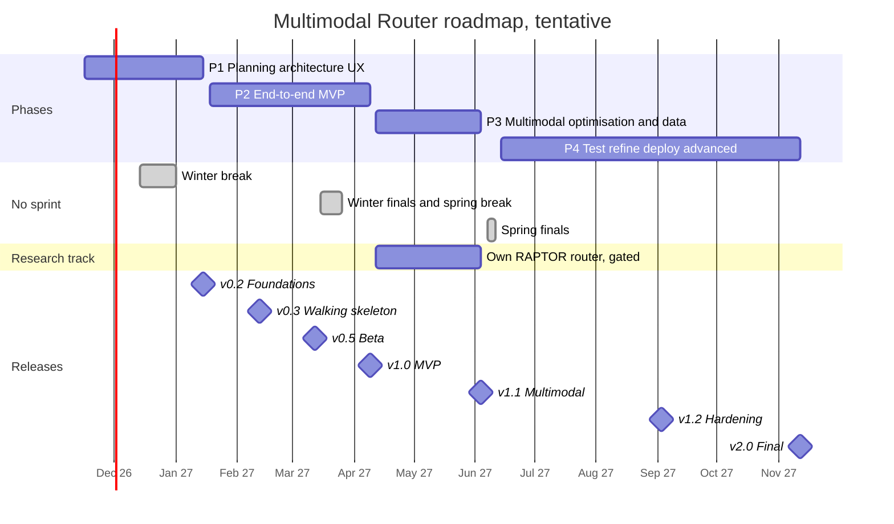
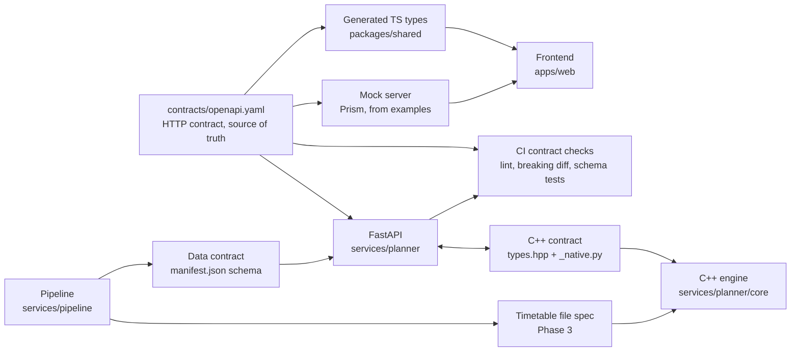

# Multimodal Router: 12-Month Engineering Roadmap

| | |
|---|---|
| **Status** | Draft v0.1, **for team approval**. No GitHub issues have been created and no code has been changed |
| **Date** | 2026-11-16 |
| **Period** | Sprint 0 (Mon 16 Nov 2026) → Sprint 22 (Fri 12 Nov 2027) |
| **Inputs** | [repository-analysis](repository-analysis.md) · [product-requirements](product-requirements.md) (PRD) · [architecture](architecture.md) · [api-contract](api-contract.md) · [routing-engine](routing-engine.md) · [data-sources](data-sources.md) · [user-flows](user-flows.md) · [design-system](design-system.md) |
| **Decisions needed** | §14: eight roadmap decisions (RM-1 to RM-8) |

> **UI v2 note (2026-11-16).** The frontend tasks in this plan were written against the v1 flows. [user-flows.md](user-flows.md) now describes UI v2. Before starting a frontend issue, re-scope it against v2:
> - mode **tabs** on the results instead of mode chips in a form;
> - the search runs when a destination is picked, instead of a "Find routes" form;
> - a bottom sheet (mobile) and a 420 px floating panel (web) instead of step-based map heights and the 448 px panel;
> - no "Update routes" banner.
>
> v2 also *proposes* accounts, a mobile app and navigation. Those stay out of the backlog until approved (§12.4).

### Reading guide

- **Part 1** is the plan:
  - §0 summary;
  - §1 assumptions and capacity;
  - §2 the four phases;
  - §3–§10 how the team works;
  - §11 MVP definition of done;
  - §12 stretch goals;
  - §13 risks;
  - §14 decisions.
- **Part 2** is the proposed GitHub backlog: 94 issues in 7 milestones. It is ready to create once the plan is approved.
- IDs from the other docs are used unchanged:
  - PD-*, AD-*, API-*, UX-* and DS-* are decisions;
  - D*, A*, E* and R* are findings in repository-analysis;
  - FR codes such as WAY-1 and ROUTE-3 are PRD requirements;
  - Q* are open questions.
- **Sizes:** S ≈ 4 h, M ≈ 10 h, L ≈ 20 h of one person's time (≈ one person-sprint). Nothing is bigger than L; bigger work is split.
- **Dates** follow the UW 2026–27 quarter calendar as best known today. Confirm them against the official academic calendar (RM-2).

---

# Part 1: The plan

## 0. Summary

**Build a working planner first, then make it smarter.** The repository already has a working prototype, but it is on a side branch (`main` holds only the initial commit), has no CI, and depends on a transit feed that is **retired at the end of 2026**. The year runs in four phases:

| Phase | Sprints | Dates | Goal | Ends with |
|---|---|---|---|---|
| **1 · Planning, architecture, UX** | S0–S2 | 16 Nov 2026 → 15 Jan 2027 | One protected baseline with CI. Decisions recorded. Real routing on per-agency data. Contracts and design approved, so people can work in parallel | **v0.2 Foundations** |
| **2 · End-to-end MVP** | S3–S7 | 18 Jan → 9 Apr 2027 | Walk, transit and bike trip planning with up to 5 distinct routes, full itinerary detail, transfer points and **1 stopover**, on a hosted staging site, tested with real users | **v0.3** walking skeleton (12 Feb) → **v0.5** beta (12 Mar) → **v1.0 MVP** (9 Apr) |
| **3 · Multimodal optimisation and data** | S8–S11 | 12 Apr → 4 Jun 2027 | Up to 3 stopovers within the latency targets; bike + transit; all regional feeds with automated freshness; complete mobile behaviour; our own RAPTOR router built as a gated research track | **v1.1 Multimodal** |
| **4 · Test, refine, deploy, advanced** | S12–S22 | 14 Jun → 12 Nov 2027 | Production-grade hosting, audits and evaluation. Then 2–3 advanced features chosen at a gate. AI is last, optional, and gated | **v1.2 Hardening** (3 Sep) → **v2.0 Final** (12 Nov) |



**Five things that shape this plan:**

1. **The data deadline comes first.** The Puget Sound consolidated GTFS feed in `cities/seattle.yaml` stops being published at the end of 2026 (data-sources finding 1). Switching to per-agency feeds is due **11 Dec 2026** (issue FND-11).
2. **Contracts before code.** `contracts/openapi.yaml`, the C++ binding contract and the data manifest are frozen early (Phase 1). Then frontend, backend, C++ and data work proceed in parallel against mocks and fakes (§4).
3. **A walking skeleton by week 4 of Winter (v0.3).** Thin but real end-to-end flow (UI → API → OTP → C++ ranking → UI on staging) before anyone builds depth. Integration problems surface in February, not in March.
4. **One stopover is MVP; three is v1.1.** This follows the PRD (WAY-1: 1 Must, up to 3 Should) and keeps Phase 2, the tightest phase, achievable.
5. **No AI until the planner is proven.** A natural-language feature is the last stretch item (FIN-07). It can start only when the PRD §6.2 criteria hold (§12.3).

---

## 1. Planning assumptions and capacity

### 1.1 Assumptions (confirm in RM-1 to RM-4)

| # | Assumption | If wrong |
|---|---|---|
| A-1 | **6 developers × ~10 h/week** during quarters. Summer is opt-in at ~5 h/week. Breaks are 0 h (PRD AS-8 says 4–6, unconfirmed) | §1.4 shows the 4- and 5-person versions |
| A-2 | Building on OpenTripPlanner is acceptable to the course (PRD Q1, PD-6) | The RAPTOR track becomes a Must starting in Phase 1, and Phase 2 drops Should items (§13, R-2) |
| A-3 | A ≥ 16 GB VM is available for staging by mid-December (PRD Q4) | Staging slips; usability testing and the MVP gate are at risk |
| A-4 | Usability sessions with UW students are allowed (PRD Q3) | Peer testing only; the usability metrics become indicative |
| A-5 | MVP scope follows the PRD: web first (PD-4), no accounts (PD-9), no cost display (PD-1), shared mobility deferred (data-sources §10). UI v2 (2026-11-16) *proposes* accounts, a mobile app and navigation (PD-4, PD-9, PD-12 revisions) | Until the team approves them, they stay out of the backlog (§12.4). If approved, issues get added after this plan's approval (RM-8) |

### 1.2 Sprint calendar

Two-week sprints, Monday to Friday. Releases fall on sprint-end Fridays.

| Sprint | Dates | Phase | Capacity note | Release |
|---|---|---|---|---|
| S0 | 16 Nov – 27 Nov 2026 | 1 | Thanksgiving (26 Nov) | v0.1 baseline (internal) |
| S1 | 30 Nov – 11 Dec | 1 | Autumn finals (7–11 Dec): reduced | Data switch due |
| — | 14 Dec – 1 Jan | — | **Winter break, no sprint** | — |
| S2 | 4 Jan – 15 Jan 2027 | 1 | | **v0.2 Foundations** |
| S3 | 18 Jan – 29 Jan | 2 | MLK Day (18 Jan) | — |
| S4 | 1 Feb – 12 Feb | 2 | | **v0.3 Walking skeleton** |
| S5 | 15 Feb – 26 Feb | 2 | Presidents' Day (15 Feb) | — |
| S6 | 1 Mar – 12 Mar | 2 | Feature freeze at sprint end | **v0.5 Beta** |
| — | 15 Mar – 26 Mar | — | **Winter finals + spring break.** Optional bug bash only | — |
| S7 | 29 Mar – 9 Apr | 2 | Usability round 1 | **v1.0 MVP** |
| S8 | 12 Apr – 23 Apr | 3 | | — |
| S9 | 26 Apr – 7 May | 3 | | — |
| S10 | 10 May – 21 May | 3 | | — |
| S11 | 24 May – 4 Jun | 3 | Memorial Day (31 May) | **v1.1 Multimodal** |
| — | 7 Jun – 11 Jun | — | **Spring finals, no sprint** | — |
| S12–S18 | 14 Jun – 17 Sep | 4 | **Summer, opt-in, reduced** | **v1.2 Hardening** at the end of S17 (3 Sep) |
| S19 | 20 Sep – 1 Oct | 4 | Autumn quarter starts; re-onboarding | — |
| S20 | 4 Oct – 15 Oct | 4 | | — |
| S21 | 18 Oct – 29 Oct | 4 | Feature freeze at sprint end | — |
| S22 | 1 Nov – 12 Nov 2027 | 4 | Veterans Day (11 Nov) | **v2.0 Final** |

### 1.3 Capacity vs. planned work

Planned load is **70% of raw hours**, which leaves room for meetings, reviews and surprises. A normal quarter sprint is 6 people × 20 h × 0.7 ≈ **84 h**.

| Phase | Available (planned) | Backlog in Part 2 | Load | Comment |
|---|---|---|---|---|
| 1 | ≈ 204 h (S0 70 · S1 50 · S2 84) | 184 h (FND) | 90% | Fits. The data switch has a hard deadline |
| 2 | ≈ 420 h (S3–S7) | 414 h (SKL 170 · BETA 168 · MVP 76) | **99%** | **Tightest phase.** Use the cut line in §2.2 if the S5 checkpoint is behind |
| 3 | ≈ 330 h (S8–S11) | 208 h (MM) | 63% | Slack absorbs v1.0 bugs, tech debt and the research track's uncertainty |
| 4 | ≈ 508 h (summer ≈ 196 · autumn ≈ 312) | 214 h (HRD 96 · FIN 118) | 42% | The rest goes to advanced features chosen at the Phase 4 gate (§12) |

Sizes are first guesses. Re-estimate during backlog refinement every sprint.

### 1.4 If the team is smaller

| Team | What changes |
|---|---|
| **5** | Platform/QA rotates weekly instead of being one person's job. The Phase 3 research track starts one sprint later. Phase 2 cut line items 1–2 move to v1.1 up front |
| **4** | One frontend developer. Backend and platform are combined. The research track becomes optional (or Must only if Q1 requires it). v1.1 drops station search and map drag. Phase 4 picks one advanced feature instead of two or three |

---

## 2. Phases

### 2.1 Phase 1: Planning, architecture and UX (S0–S2, 16 Nov 2026 → 15 Jan 2027)

**Objectives**
1. One shared, protected `main` with CI that runs the existing test suites.
2. Record the decisions in the existing docs, and get the instructor answers that change scope: Q1 (own router required?), Q3 (usability testing allowed?), Q4 (hosting).
3. Real routing on **per-agency** data on a shared staging VM, before the consolidated feed retires.
4. Freeze enough of the three contracts that four workstreams can start in parallel.
5. Approve the hi-fi design system and finish the remaining MVP frames.

**Deliverables**
- `main` holds the prototype and all docs, protected and with CI v1 (FND-01 to FND-05).
- Fixed Docker and Compose setup, with a fake-router profile for frontend developers (FND-06). Outage errors (FND-07).
- `cities/seattle.yaml` on King County Metro + Sound Transit GTFS and a King County OSM extract, plus a service-area polygon (FND-11, FND-12).
- Pipeline skeleton with versioned data folders and `manifest.json` v0 (FND-13).
- Staging VM over HTTPS (FND-16), with OTP sizing measured (FND-14).
- Approved `contracts/openapi.yaml` v1, generated TS types and a mock server (FND-17, FND-18).
- C++ Phase 0: contract v2 spec, utilities, oracle and benchmark harnesses (FND-19).
- Benchmark origin–destination set and runner (FND-20).
- Signed-off design system, tokens in CSS, base UI primitives (FND-21, FND-22).
- A decision log and the licence and attribution obligations (FND-09, FND-23).

**Technical dependencies**
- Java 21 and OTP 2.10.
- A ≥ 16 GB VM (Q4).
- GitHub Actions (free for public repositories).
- Geofabrik, US Census and agency GTFS downloads.
- Figma access.
- An instructor answer on Q1 before S2 planning.

| Workstream | Tasks | Issues | When |
|---|---|---|---|
| **Frontend** | Park the Expo app. Generated TS types + Prism mock. Design tokens as CSS variables, fonts, base primitives (Button, Icon, Link Button, Select). Review the hi-fi design and spike a MapLibre style using the `map/*` tokens | FND-08, FND-18, FND-22, FND-21 | S0–S2 |
| **Backend** | Fix D1/D6 and add a fake-mode Compose profile. Distinguish an outage from "no route" (D2). OTP GraphQL field spike (AS-4). Review and lint contract v1. Benchmark runner | FND-06, FND-07, FND-15, FND-17, FND-20 | S0–S2 |
| **C++** | routing-engine Phase 0: contract v2 spec, integer time and strong-ID utilities, brute-force oracle harness, counter-based benchmark harness, sanitizer CI job | FND-19 | S1–S2 |
| **Data** | Per-agency GTFS + King County OSM (**due 11 Dec**). Service-area polygon. Pipeline skeleton + manifest v0. OTP build sizing on a shared machine. Licence obligations (Sound Transit contact, attribution text, Lime terms) | FND-11, FND-12, FND-13, FND-14, FND-23 | S0–S2 |
| **Platform/QA** | Toolchain pinning and lockfiles. CI v1. Linters. Staging VM. Benchmark origin–destination set | FND-03, FND-04, FND-05, FND-16, FND-20 | S0–S2 |
| **Product/EM** | Merge the baseline. Repo scaffolding. Decision log + instructor questions. Competitive review + 5 interviews. Design sign-off | FND-01, FND-02, FND-09, FND-10, FND-21 | S0–S2 |

**Integration checkpoints**

| ID | When | Demo |
|---|---|---|
| IC-1.1 | End of S0 | The baseline is on `main`, CI is green, and every developer runs the stack in fake mode |
| IC-1.2 | End of S1 (11 Dec) | Staging serves real routes built from per-agency feeds; the consolidated feed is gone from the config |
| IC-1.3 | Middle of S2 | The frontend renders Plan → Routes against the Prism mock of contract v1 |
| IC-1.4 | End of S2 | The C++ harness runs in CI and the API owner has approved contract v2 |

**Acceptance criteria (gate G1 → v0.2)**
- [ ] `main` is protected, and CI v1 is required and green on 5 consecutive working days.
- [ ] The decision log records PD-1…11, UX-1…8, AD-1…8, API-1…12 and DS-1…11 as approved or changed. Q1, Q3 and Q4 are answered, or an explicit default is recorded.
- [ ] The consolidated feed is removed. OTP builds from the per-agency feeds plus the King County OSM extract, and the build memory and time are recorded.
- [ ] Staging is reachable over HTTPS, and OTP is not publicly reachable.
- [ ] Frontend and backend owners have approved `contracts/openapi.yaml` v1. CI fails when the generated TS types are out of date.
- [ ] C++ contract v2 is approved. The oracle and benchmark harnesses run in CI with sanitizers.
- [ ] Hi-fi frames are approved for Plan, Routes, Route details and the error states.
- [ ] A team member who didn't write the setup docs runs the fake-mode stack from the README in ≤ 30 min (MAINT-3).

**Risks**

| Risk | L / I | Mitigation | Owner |
|---|---|---|---|
| The consolidated feed disappears before the switch | M / H | FND-11 is scheduled first, with a hard deadline of 11 Dec. Keep a local copy of the last consolidated zip for development only | Data |
| Q1: the course requires an original router | M / H | Ask in week 1. If yes, promote the research track (MM-11 to MM-14) into Phases 1–2 and cut Should items (§13) | EM |
| No VM budget by mid-December | M / H | Ask in week 1. Fallback: a member's 16 GB machine for staging during Winter, with a public tunnel for demos only | EM / Platform |
| Holiday break stalls momentum | H / M | S2 starts with a 1-day re-sync. No deliverables are due over the break | EM |
| Laptops can't build the OTP graph (E3) | H / L | Only the data and platform owners build graphs. Everyone else uses fake mode or staging | Platform |

---

### 2.2 Phase 2: Functional end-to-end MVP (S3–S7, 18 Jan → 9 Apr 2027)

**Objectives**
1. Implement API contract v1 end to end: Plan → Routes → Route details, on staging, with real data.
2. Deliver PRD MVP items 1–8:
   - service area;
   - search and map picks;
   - Walk, Transit and Bike;
   - up to 5 distinct alternatives ranked by time, transfers and walking;
   - full itinerary detail;
   - transfer points;
   - **1 stopover** with stay time;
   - clear error states.
3. Build the hi-fi UI for desktop, and a responsive layout down to 360 px.
4. Pass usability round 1 and the **MVP definition of done** (§11).

**Deliverables**
- **v0.3 Walking skeleton** (end of S4): the new `/api/v1` endpoints serve real OTP results through C++ `rank_v2`, and the web app shows the Plan and Routes views on staging.
- **v0.5 Beta** (end of S6): transfer points, Route details timeline, 1 stopover, no-route handling, warnings, attributions, caching and logging. Feature freeze.
- **v1.0 MVP** (end of S7): usability round 1, then fixes, performance and accessibility passes, traceability audit, runbook.

**Technical dependencies**
- Contract v1 (FND-17).
- OTP field availability (FND-15). If fields are missing, the fallback is the pipeline stop table (SKL-08).
- C++ harness (FND-19).
- Staging (FND-16).
- Design tokens (FND-22).
- Q3 approval before usability round 1.

| Workstream | Tasks | Issues | Sprints |
|---|---|---|---|
| **Frontend** | App shell with map and service-area outline. Plan view (location inputs, suggestions, Locate, swap, mode chips, time). API client (generated types, AbortController, error mapping). Routes view (summary bar, cards, mode strip, sort, skeletons, map drawing). Stopover UI. Route details timeline + markers + legend. Seattle time and US units. Known limitations. Accessibility pass | SKL-09, SKL-10, SKL-11, BETA-01, BETA-05, BETA-06, BETA-09, MVP-03, MVP-06 | S3–S7 |
| **Backend** | `/api/v1` endpoints + Problem Details + request IDs. Domain validation and error codes. MVP modes and feature flags. Richer OTP query and leg model. Places proxy. Transfer-point builder. Waypoints (segmenter + composition). No-route and warnings. Caching, deadlines and logs. Performance | SKL-01 to SKL-05, BETA-02, BETA-04, BETA-07, BETA-10, MVP-04 | S3–S7 |
| **C++** | `rank_v2`: Pareto over duration, transfers and walking, plus route-level distinctness and labels. Integration via `_native.py`, freezing the Python copy as an oracle (AD-8). `compose_step` for stopovers | SKL-06, SKL-07, BETA-03 | S3–S6 |
| **Data** | Validation, normalisation, sub-mode mapping, derived stop/route/trip tables, manifest v1. Community Transit, Pierce Transit and WSF feeds + OSM clip + coverage check. Schedule spot check (DQ-1). Data notice and attributions | SKL-08, BETA-13, MVP-05, BETA-08 | S3–S7 |
| **Platform/QA** | Staging deploys from `main`. End-to-end + axe tests in CI. Benchmark runs on staging. Runbook. Traceability audit | SKL-12, BETA-11, BETA-12, MVP-07, MVP-08 | S3–S7 |
| **Product** | Usability round 1 and triage. Time-boxed blocker fixes. Release | MVP-01, MVP-02, MVP-09 | S7 |

**Integration checkpoints**

| ID | When | Demo |
|---|---|---|
| IC-2.1 | End of S3 | `/api/v1/routes/plan` returns contract-valid responses from both FakeRouter and OTP. The frontend switches from the mock to the real API in development |
| IC-2.2 | End of S4 (**v0.3**) | Plan → Routes in the hi-fi UI on staging with real data and `rank_v2`. Up to 5 distinct routes for UW ↔ Capitol Hill |
| IC-2.3 | End of S5 | Transfer rows and the Route details view work. One stopover goes through the API with `compose_step` (behind a flag) |
| IC-2.4 | End of S6 (**v0.5**) | Feature freeze. Benchmark run ≥ 95% valid with 0 constraint violations. End-to-end suite green |
| IC-2.5 | End of S7 (**v1.0**) | Usability round done and "blocks task" issues fixed. MVP definition of done checked item by item |

**Cut line**, used at the S5 checkpoint if the team is behind. Cut in this order (PRD AS-8: drop Should items first):
1. Community Transit, Pierce Transit and WSF feeds (BETA-13) move to v1.1. The app states the coverage limit.
2. Reverse-geocoded names for map picks are already planned for v1.1 (MM-06). Keep it there.
3. The out-of-date banner (part of BETA-07) is replaced by clearing results on edit.
4. Sorting is reduced to the server's default order.
5. **Never cut:** 1 stopover, transfer points, itinerary detail, error states, attributions, accessibility basics.

**Acceptance criteria (gate → v1.0):** the MVP definition of done in §11.

**Risks**

| Risk | L / I | Mitigation | Owner |
|---|---|---|---|
| OTP doesn't return intermediate stops or headsigns (AS-4) | M / H | Spike in Phase 1 (FND-15). Fallback: fill them from the pipeline's stop and trip tables (SKL-08) | Backend |
| Stopover latency exceeds 10 s p95 (PERF-2) | M / M | Beam 2–3, segment cache, skip shapes that returned nothing, 1-stopover cap in v1.0 | C++ / Backend |
| Integration crunch at the end of Winter | M / H | Walking skeleton by S4. Mocks from S2. Weekly integration sync. Feature freeze at S6 | EM |
| Midterms reduce capacity in S5–S6 | H / M | Plan at 70%. Use the cut line. No new scope after S5 | EM |
| Frontend is the bottleneck (largest backlog) | M / M | Backend and C++ help with frontend testing and accessibility work in S6. Design tokens and primitives are done in Phase 1 | EM |
| Usability approval (Q3) is late | M / M | Ask in Phase 1. Fallback: peer testing; report metrics as indicative | Product |

---

### 2.3 Phase 3: Multimodal optimisation and data integration (S8–S11, 12 Apr → 4 Jun 2027)

**Objectives**
1. **Optimisation:** up to 3 stopovers within PERF-2 (p95 ≤ 20 s). Bike + transit (ride to a station and park). Transit sub-mode exclusion.
2. **Data integration:** all MVP feeds, with daily freshness checks, automatic rebuild triggers and rollback to the previous data version. Station search from the stop table.
3. **Product completeness:**
   - mobile behaviour from UX-1 (step-based map heights, full-screen map, full-screen search);
   - shareable URLs;
   - a map-click chooser and marker drag;
   - hover previews.
4. **Research track:** our own RAPTOR transit router (routing-engine Phase 2), compared with OTP in shadow mode against the switch-over gate. It is **not user-facing** in this phase.
5. Usability round 2 with ≥ 8 participants and a SUS score.

**Deliverables:** **v1.1 Multimodal** (end of S11), the RAPTOR shadow-mode report, the usability round 2 report, and the data refresh runbook.

**Technical dependencies**
- v1.0 is stable.
- The pipeline's derived tables (SKL-08) exist.
- The C++ harness exists (FND-19).
- The staging VM has memory for a second OTP during data releases (or a short outage is accepted).
- Lime's licence terms decide whether shared mobility goes ahead (data-sources D1).

| Workstream | Tasks | Issues | Sprints |
|---|---|---|---|
| **Frontend** | Mobile behaviour. Shareable URL state + Back/Forward. Map chooser popover + drag. Hover preview. Transit options. Bike styling. Usability round 2 fixes | MM-04, MM-05, MM-06, MM-07, MM-03, MM-02, MM-16 | S8–S11 |
| **Backend** | 3 stopovers with segment caching. Bike + transit shapes and the park-bike transfer kind. Sub-mode exclusion. Reverse geocoding. Station search. CppTransitRouter wiring for shadow mode | MM-01, MM-02, MM-03, MM-06, MM-08, MM-14 | S8–S11 |
| **C++** | Beam tuning for 3 stopovers. RAPTOR over the pipeline timetable. Time-expanded Dijkstra oracle + differential tests. CppTransitRouter + shadow report | MM-01, MM-12, MM-13, MM-14 | S8–S11 |
| **Data** | Timetable build (calendars, pattern splitting, footpaths) + file spec. Freshness automation, rebuild trigger and rollback. Station search table. Shared-mobility decision | MM-11, MM-09, MM-08, MM-15 | S8–S11 |
| **Platform/QA** | Nightly OTP fixture-graph integration test. Benchmark at 0/1/3 stopovers. Data-release automation with Data | MM-10, MM-09 | S8–S11 |
| **Product** | Usability round 2 + SUS. Release | MM-16, MM-17 | S10–S11 |

**Integration checkpoints**

| ID | When | Demo |
|---|---|---|
| IC-3.1 | End of S8 | 3-stopover journeys on staging with segment caching. Benchmark Q-waypoint p95 is reported |
| IC-3.2 | End of S9 | The timetable file written by the pipeline loads in the C++ loader, and the contract test passes |
| IC-3.3 | End of S10 | Shadow-mode report v1, with disagreements listed and explained. A data release with rollback has been rehearsed on staging |
| IC-3.4 | End of S11 (**v1.1**) | Usability round 2 is done. Release notes. Gate decision recorded for the own router |

**Acceptance criteria (gate → v1.1)**
- [ ] 0/1/3-stopover p95 ≤ 5/10/20 s on staging (PERF-1/2). 0 waypoint-order or permitted-mode violations on the benchmark and Q-waypoint sets.
- [ ] Bike + transit itineraries are returned for the bike benchmark pairs (e.g. Redmond ↔ South Lake Union), and the timeline shows the park-bike step.
- [ ] King County Metro, Sound Transit, Community Transit, Pierce Transit and WSF are loaded.
  - The daily freshness job alerts when any Must feed has < 14 days of validity.
  - Rollback to the previous data version takes ≤ 10 min, following the runbook.
- [ ] Mobile behaviour matches UX-1 and IR-18. No gesture is the only way to do anything (UXA-9).
- [ ] The shadow-mode report exists, and the switch-over gate (routing-engine §7) is recorded as pass or fail. **Passing it isn't required for v1.1.**
- [ ] Usability round 2: ≥ 8 participants. Task success and SUS are measured against the PRD §11 targets.

**Risks**

| Risk | L / I | Mitigation | Owner |
|---|---|---|---|
| RAPTOR correctness (calendars, overnight trips, pattern splitting) takes longer than planned | H / M | The research track is gated and not user-facing. The oracle comes first. Scope is transit-only shapes. A slip costs nothing user-facing | C++ |
| A feed changes or expires (spring service change, short-validity feeds) | H / M | Automated freshness (MM-09). Data versions with rollback | Data |
| The Lime licence is unclear | H / L | Shared mobility stays off by default (MM-15 is conditional) | Data |
| End-of-year crunch (spring finals) | M / M | v1.1 ships on 4 Jun, before finals week. Nothing is due in finals week | EM |
| People leave over summer | M / H | Handoff notes at the end of each sprint in S10–S11. Every area has a secondary owner (§3) | EM |

---

### 2.4 Phase 4: Testing, refinement, deployment and advanced features (S12–S22, 14 Jun → 12 Nov 2027)

**Objectives**
1. **Deployment:** a production environment separate from staging, with monitoring, zero-downtime data releases, and security and load testing.
2. **Testing and refinement:** a full WCAG 2.1 AA audit with screen-reader tests, plus dependency and OTP upgrades with regression benchmarks.
3. **Advanced features:** choose 2–3 from the stretch menu (§12) at the Phase 4 gate (HRD-01), based on measured v1.1 quality and remaining capacity.
4. **Evaluation and handoff:**
   - measure and report the PRD §11 metrics;
   - write the as-built docs and run the onboarding dry run;
   - archive the data obligations.

**Deliverables**
- **v1.2 Hardening** (end of S17, 3 Sep): production, monitoring, security, audits, plus up to two advanced features. Summer capacity is opt-in.
- **v2.0 Final** (end of S22, 12 Nov): the selected advanced features, the final evaluation report and the handoff package.

**Technical dependencies**
- Hosting budget for production (it can be the staging VM promoted, with a second, smaller staging environment).
- Sourced fares if time-vs-cost is chosen (PD-1 must change).
- GTFS-RT feeds (verified available for King County Metro, Sound Transit and Community Transit) if real-time is chosen.
- The research gate result for FIN-03.

| Workstream | Tasks | Issues |
|---|---|---|
| **Frontend** | WCAG audit fixes. Advanced options: time-vs-cost UI (`Trip Duration` cost variants already designed), real-time labels, first-run tutorial, dark mode, waypoint-order toggle | HRD-06, HRD-08, HRD-09, FIN-02, FIN-04, FIN-05 |
| **Backend** | Security hardening. Fares (PUBLISHED_FARE) and the cost feature flag. GTFS-RT time basis + warnings. Optional natural-language request parsing (gated) | HRD-03, HRD-08, HRD-09, FIN-07 |
| **C++** | Cost as a criterion in `rank_v2` (if chosen). Waypoint order optimisation. Own router to production for transit-only shapes, if the gate passed; otherwise McRAPTOR or street A* | HRD-08, FIN-02, FIN-03 |
| **Data** | Blue/green data release. GTFS-RT updaters in OTP. Accessible-routing data study | HRD-04, HRD-09, FIN-06 |
| **Platform/QA** | Production + monitoring. Load and soak tests. Dependency and OTP upgrades. Final evaluation runs | HRD-02, HRD-05, HRD-07, FIN-08 |
| **Product/EM** | Phase 4 gate. Re-onboarding. Final evaluation. Handoff | HRD-01, FIN-01, FIN-08, FIN-09 |

**Integration checkpoints**

| ID | When | Demo |
|---|---|---|
| IC-4.1 | S12 (first week) | **Phase 4 gate:** pick the advanced features and record why (HRD-01) |
| IC-4.2 | End of S14 | Production is live with uptime checks and alerts. Staging is separate |
| IC-4.3 | End of S17 (**v1.2**) | Security review and WCAG audit are closed. Chosen summer features are behind flags |
| IC-4.4 | End of S19 | Autumn re-onboarding is done. Every area has a primary and a secondary owner again |
| IC-4.5 | End of S21 | Feature freeze for v2.0. Final evaluation runs start |
| IC-4.6 | End of S22 (**v2.0**) | Final demo, evaluation report, handoff dry run |

**Acceptance criteria (gate → v2.0)**
- [ ] Production has health checks and alerting. Server errors are < 2% of plan requests during test periods (PRD §11). Demo failures: 0.
- [ ] WCAG 2.1 AA audit: 0 serious or critical axe violations, and manual VoiceOver and NVDA passes of the core flows (UXA-6).
- [ ] The PRD §11 metrics are measured and published in the final evaluation report, including the ones that missed their targets.
- [ ] Each chosen advanced feature:
  - meets its own acceptance criteria;
  - is behind a feature flag;
  - has its limits stated in the app.
- [ ] Handoff: someone outside the team runs the stack from the README in ≤ 30 min. The runbooks and the as-built architecture doc are current.

**Risks**

| Risk | L / I | Mitigation | Owner |
|---|---|---|---|
| Little summer participation | H / M | Summer plans only maintenance plus one feature. Nothing critical depends on summer | EM |
| Knowledge lost over summer | M / H | Re-onboarding sprint (S19). Docs-as-done. Pairing | EM |
| Scope creep: AI, accounts, live navigation | M / H | §12 gate rules. PRD changes require a decision (PD-9, ITIN-6, PD-10) | EM / Product |
| Dependency drift (OTP, React, Node) | M / M | Upgrades in HRD-07 with regression benchmarks. Pinned versions | Platform |
| Autumn service change (September) breaks data | M / M | Freshness automation and rollback are already in place (MM-09) | Data |
| Hosting cost grows | L / M | One VM. Measure memory. Shrink OTP heap or service area if needed | Platform |

---

## 3. Workstreams and ownership

### 3.1 Workstreams

| Workstream | Owns (paths) | Hands off through | Primary / secondary (6 people) |
|---|---|---|---|
| **FE · Frontend** | `apps/web`; UI-facing code in `packages/shared`; design tokens in CSS | Generated types from `contracts/openapi.yaml` (consumer); Figma | FE-1 / FE-2 |
| **BE · API/backend** | `services/planner/planner` (except algorithms in C++); `cities/*.yaml` feature flags; co-owns `contracts/openapi.yaml` | OpenAPI (producer) to FE; `_native.py` to C++ | BE-1 / ALG-1 |
| **ALG · C++ algorithms** | `services/planner/core` (rank, compose, constraints, later transit and street modules); co-owns `planner/_native.py` | `types.hpp` + `_native.py` + `CONTRACT_VERSION`; timetable file spec (with Data) | ALG-1 / BE-1 (Phase 3 research pair: ALG-1 + DATA-1) |
| **DATA · Data pipeline** | `services/pipeline` (new, per architecture §3.3); `scripts/fetch_data.py`, `scripts/otp.sh`, `services/otp/*`; `cities/*.geojson`; licence obligations | Versioned `data/<city>/<version>/` + `manifest.json` (JSON Schema) | DATA-1 / OPS-1 |
| **OPS · Platform/QA** | `.github/`, `docker-compose.yml`, Dockerfiles, proxy config, staging and production, end-to-end harness, benchmark runner, release tooling | CI status, environments, benchmark reports | OPS-1 / DATA-1 |
| **PROD · Product/UX** (a role one person holds alongside development) | PRD, user flows, design system, Figma, usability studies | Approved designs, acceptance criteria | FE-2 (role) / EM |
| **EM · Tech lead / engineering manager** (one person; may rotate per quarter) | Sprint process, decision log, architecture docs, release management, risk register | Sprint goals, decisions | EM / BE-1 |

- **Bus factor ≥ 2:** every area has a secondary owner who reviews its PRs and can take over during exams or illness.
- **Pairing:** each primary/secondary pair has one pairing hour per sprint.

### 3.2 Cross-cutting responsibilities

| Activity | Responsible | Approves | Consulted |
|---|---|---|---|
| HTTP contract change | BE | FE + BE owners (both required) | ALG, PROD |
| C++ contract change | ALG | ALG + BE owners | — |
| Data manifest or timetable spec change | DATA | DATA + each consumer | ALG, BE |
| Release (tag, notes, deploy) | Release captain (rotating) | EM | All |
| Data release to staging or production | DATA | OPS | BE |
| Staging incident during demo or usability weeks | On-call (rotating) | — | Owner of the failing area |
| Accessibility sign-off | FE | PROD | — |
| Privacy and licence compliance | DATA (feeds) / BE (logs) | EM | — |

### 3.3 Proposed CODEOWNERS (to add in FND-02)

```text
/apps/web/                      @fe-1 @fe-2
/packages/shared/               @fe-1 @be-1
/contracts/openapi.yaml         @be-1 @fe-1          # both must approve (§6)
/services/planner/planner/      @be-1 @alg-1
/services/planner/planner/_native.py  @alg-1 @be-1
/services/planner/core/         @alg-1 @be-1
/services/pipeline/  /scripts/  /services/otp/  /cities/   @data-1 @ops-1
/.github/  /docker-compose.yml  **/Dockerfile        @ops-1 @data-1
/docs/                          @em @prod
```

Handles are placeholders until owners are assigned (RM-1).

---

## 4. API-first collaboration

### 4.1 Three contracts, one rule

**Nothing crosses a boundary until it is in the contract on `main`.**



| Contract | File(s) | Producer → consumer | Checked by |
|---|---|---|---|
| **HTTP** | `contracts/openapi.yaml` (API-12) | BE → FE | Spectral lint; `oasdiff` breaking-change check against `main`; FastAPI's `/openapi.json` compared with the contract; Schemathesis against FakeRouter; generated types up to date |
| **C++ binding** | `core/include/mmr/types.hpp`, `planner/_native.py`, `CONTRACT_VERSION` | ALG → BE | Contract tests CT-* (routing-engine §9.5); oracle and property tests |
| **Data** | `manifest.json` JSON Schema; timetable file spec (Phase 3) | DATA → BE, ALG, OTP | Schema validation in pipeline tests and at API start-up; loader contract test |

### 4.2 Workflow for an HTTP contract change

1. **Proposal:** an issue labelled `contract`, with example requests and responses and the PRD requirement it serves.
2. **Contract PR:** it changes **only** `contracts/openapi.yaml` (with examples) and the regenerated TS types. It needs approval from **both** the frontend and backend owners (§6).
3. **Build in parallel:**
   - the frontend codes against the Prism mock and uses MSW handlers built from the examples in its tests;
   - the backend implements the change behind FakeRouter first, then OTP;
   - C++ and data work is unaffected unless their own contract changes.
4. **Conformance:** CI checks that the live schema matches the contract. Merging the implementation is blocked until it does.
5. **Switch:** the frontend points at the real API in development. The feature flag is removed once the end-to-end test passes.

### 4.3 Compatibility rules

- **Within v1, additive changes only:** new optional request fields, new response fields, new enum values. Clients already have to ignore unknown response fields and handle unknown enum values (api-contract §2.8, API-11).
- **Breaking changes** need a new path version (`/api/v2`). We plan to avoid that this year.
- The C++ `CONTRACT_VERSION` changes on any breaking binding change. `_native.py` refuses to load a mismatched module.
- `data_version` appears in every plan response (api-contract §4.3.7), so a bug report can be traced to a data build.

### 4.4 Contract freeze points

| Date | What freezes |
|---|---|
| 15 Jan (G1) | API v1 core (plan without waypoints, health, service-info, modes, places). C++ contract v2. Manifest v0 |
| 12 Feb (v0.3) | Waypoint fields, `transfer_points`, `segments`, `waypoint_visits`, `no_route` (they are already in the v1 draft; their shape locks here) |
| 12 Mar (v0.5) | Everything the MVP uses. Changes after this date go to v1.1 unless they fix a bug |
| 23 Apr (S8) | Timetable file spec v1 (research track) |

---

## 5. GitHub branching conventions

**Model: trunk-based development with short-lived branches.**

| Rule | Detail |
|---|---|
| `main` | Always deployable; deploys to staging automatically. Protected: PR required, required checks, ≥ 1 approval (2 for contracts), linear history, no force-push, branch must be up to date |
| Branch names | `<type>/<issue#>-<short-slug>`. Types: `feat`, `fix`, `chore`, `docs`, `test`, `refactor`, `perf`, `data`, `ci`, `spike`. Example: `feat/142-stopover-row` |
| Branch lifetime | Aim for ≤ 3 working days; at most one sprint. Larger work merges in slices behind a feature flag (`features` in `/service-info`, flags in `cities/*.yaml`) |
| Syncing | Rebase or merge `main` at least daily. Open a **draft PR** on day 1 for visibility |
| Commits | [Conventional Commits](https://www.conventionalcommits.org): `feat(web): add stopover reorder buttons`. Scopes: `web`, `shared`, `api`, `core`, `pipeline`, `infra`, `ci`, `docs`, `contract` |
| Merging | **Squash merge**; the PR title becomes the commit message. The one exception is the baseline import (FND-01), which uses a merge commit to keep the prototype's history |
| Releases | Tag `vX.Y.Z` on `main`. During a freeze (S6 → S7, S10 → S11, S21 → S22) cut `release/X.Y` from `main`. Only fixes go in, made on `main` first and then cherry-picked |
| Hotfixes | `hotfix/<issue#>-<slug>` from the release tag → PR into `release/X.Y` and into `main` |
| Spikes | `spike/*` branches are never merged. Findings go into a doc or issue comment |
| Never commit | Raw or derived GTFS and OSM files (licence, data-sources D2; `data/` stays git-ignored), secrets, `.env` files, build outputs |
| Existing branches | `seattle-first-draft` and `Draft-Planning` are merged into `main` in FND-01, tagged `archive/<name>`, then deleted |

---

## 6. Pull-request review requirements

### 6.1 Approvals by area

| Touches | Required approvals |
|---|---|
| Any code | 1 CODEOWNER of each touched area (not the author) |
| `contracts/openapi.yaml` | **2:** a frontend owner **and** a backend owner |
| `types.hpp`, `_native.py`, `CONTRACT_VERSION` | ALG owner **and** BE owner |
| C++ algorithms | ALG owner. The PR must add or extend oracle or property tests |
| Pipeline, `cities/*`, feed URLs | DATA owner. Note licence implications in the PR |
| CI, Docker, proxy, deploy | OPS owner |
| Release PRs and tags | EM |

### 6.2 The PR itself

- **Template** (added in FND-02):
  - linked issue (`Closes #…`);
  - what and why;
  - how it was tested (commands and results);
  - screenshots or a short video for UI changes at 1440 and 390 px;
  - accessibility checklist (keyboard path, focus, labels, contrast);
  - contract impact;
  - data or licence impact;
  - feature flag;
  - rollback note.
- **Size:** aim for < 400 changed lines, excluding generated files and fixtures. Split anything bigger.
- **CI:** all required checks must be green before review is requested. A red check is the author's job to fix.
- **Review time:** first response within **1 working day**. The reviewer approves, requests changes or says when they'll review. Team norm: *review before starting new work.*
- **Merging:** the author squash-merges after approval and green CI. Self-approval and admin bypass aren't allowed, except for documented incidents (EM approval).
- **Reviewer checklist:**
  - correctness and edge cases;
  - tests at the right layer (§8);
  - contract conformance;
  - accessibility for UI;
  - privacy (no precise coordinates in logs, PRIV-1);
  - licence (attribution, no committed feeds);
  - docs updated;
  - no new TODO without an issue.

---

## 7. CI/CD expectations

### 7.1 Workflows

| Workflow | Trigger | Jobs | Time budget | From |
|---|---|---|---|---|
| `ci.yml` | Every PR; push to `main` | **python:** ruff lint and format check; pytest in pure-Python and native (`mmr_core`) modes; coverage report<br>**cpp:** CMake Release + ctest; Debug + ASan/UBSan + ctest<br>**web:** ESLint, `tsc`, Vitest, Vite build<br>**shared:** Node or Vitest tests<br>**contract:** Spectral, `oasdiff` against `main`, generated types up to date, live schema vs contract<br>**pipeline:** pytest on synthetic GTFS fixtures<br>**docker:** build the API image, start it in fake mode, `GET /api/v1/health` returns 200 | ≤ 12 min wall clock (parallel jobs, pip/npm/ccache caching; Catch2 cached to avoid E6) | Phase 1 (pipeline and contract jobs as soon as those folders exist) |
| `e2e.yml` | Every PR (smoke); nightly (full) | Compose stack in fake mode + Playwright core flows + axe-core | ≤ 8 min (smoke) | Phase 2 (BETA-11) |
| `nightly.yml` | Daily schedule | OTP fixture-graph integration test (MM-10); benchmark set against staging with quality and latency assertions (BETA-12); `pip-audit` and `npm audit`; extended property-test seeds | — | Phase 2–3 |
| `data-freshness.yml` | Daily schedule | Conditional GET on every feed; alert if a Must feed has < 14 days of validity or changed; open an issue automatically | — | Phase 3 (MM-09) |
| `deploy-staging.yml` | Push to `main` after `ci` passes | Build images → push to GHCR → SSH deploy with `docker compose pull && up -d` → smoke test → post status | ≤ 10 min | Phase 2 (SKL-12) |
| `deploy-prod.yml` | Tag `v*.*.*` | Manual approval (GitHub environment protection) → deploy → smoke → rollback instructions in the job summary | — | Phase 4 (HRD-02) |
| `data-release.yml` | Manual, or triggered by the freshness job | Run the pipeline. Build the OTP graph on the VM, or on a runner with enough memory (the FND-14 measurement decides). Publish a new data version. Blue/green switch (Phase 4) | — | Phase 3–4 |

### 7.2 Required checks on `main`

`python`, `cpp`, `web`, `shared`, `contract`, `pipeline`, `docker`; from v0.3 also `e2e-smoke`. Nightly failures open an issue and get triaged within a working day. They don't block merges.

### 7.3 Environments

| Environment | Routing | How | Who |
|---|---|---|---|
| Local, fake | FakeRouter | `docker compose --profile fake up` + `npm run web`. No C++ or Java toolchain needed | Everyone, especially frontend |
| Local, full | Local OTP | Planner venv + `npm run core:build` + `scripts/otp.sh` | Backend, C++, data |
| CI | FakeRouter + fixtures; tiny OTP graph nightly | GitHub Actions | — |
| Staging | OTP on current data | One VM, Compose, Caddy (architecture §10.4); auto-deploy from `main` | Team demos, usability tests |
| Production (Phase 4) | OTP | Same topology, separate VM or stack; deploy from tags only | Public testers |

Secrets (SSH deploy key, alert webhooks) live in GitHub environment secrets. The application needs no secrets today (architecture §11).

---

## 8. Unit and integration testing strategy

### 8.1 Test layers

| Layer | What is tested | Tools | Runs | Owner | Target |
|---|---|---|---|---|---|
| **C++ unit + oracle** | `rank_v2`, `compose_step`, constraints, later RAPTOR; brute-force oracles; invariants (routing-engine §11.3) | Catch2, ASan/UBSan | Every PR | ALG | ≥ 85% line coverage of new modules |
| **C++ property/differential** | Seeded random inputs against oracles; later RAPTOR vs time-expanded Dijkstra | Catch2 generators | PR (few seeds), nightly (many) | ALG | 0 disagreements |
| **C++ contract** | Binding round-trips, version check, GIL release (CT-*) | pytest + `mmr_core` | Every PR | ALG + BE | All pass |
| **Python domain** | Validation, segmenter, transfer builder, error mapping, caching keys, time zone handling | pytest | Every PR | BE | ≥ 80% line coverage of planner domain (MAINT-2) |
| **Router contract** | Any `Router` implementation (Fake, OTP, later CppTransitRouter) satisfies the same behaviour tests | pytest, parametrised | Every PR (Fake), nightly (OTP) | BE | All pass |
| **OTP client** | GraphQL query building and response mapping with **recorded** responses | pytest + JSON fixtures | Every PR | BE | — |
| **API** | Endpoint behaviour; every error code in api-contract §10.2; responses valid against the contract | FastAPI TestClient, Schemathesis | Every PR | BE | Every documented code has a test |
| **Pipeline** | Each validation rule, normalisation, sub-mode mapping, manifest; failure modes (expired feed, missing file, unmapped route type) | pytest + handcrafted synthetic GTFS | Every PR; nightly on real feeds | DATA | Every rule has a pass and a fail case |
| **Frontend units** | Components (roles, states, keyboard), formatters (Seattle time, mi/ft, "+1"), API client error mapping | Vitest, Testing Library, MSW | Every PR | FE | Every error code mapped (user-flows §7) |
| **End-to-end** | Plan → Routes → Details; add, reorder and remove a stopover; no route; 503 retry; keyboard-only path; axe on each view | Playwright + axe-core on Compose fake | PR (smoke), nightly (full) | FE + OPS | 0 serious or critical axe issues |
| **Integration with real OTP** | Tiny OSM + synthetic GTFS fixture graph; a plan request through the real OTP container | pytest + OTP Docker | Nightly | BE + OPS | Pass |
| **System quality** | PRD benchmark set (30–50 pairs + 10 stopover journeys): ≥ 1 valid itinerary, 0 mode or waypoint violations, p95 latency | Benchmark runner (FND-20) | Nightly on staging; each release | OPS + BE | PRD §11 targets |
| **Load** | 20 concurrent plan requests (CAP-1), soak | k6 or Locust | Each release from v1.0 | OPS | No errors; p95 within PERF |
| **Manual** | Usability rounds; schedule spot checks (20+ legs, DQ-1); bug bash before releases; browser and device matrix (COMP-1) | Scripts and checklists | Each release | PROD + QA | Logged in the release notes |

### 8.2 Policies

- **Test data:** synthetic GTFS and OSM fixtures only in the repository. Real feeds are fetched at test time (licence, data-sources D2; routing-engine R3).
- **Every bug fix adds a regression test** at the lowest layer that reproduces it.
- **Flaky tests** are quarantined within 24 h with a linked issue and fixed within a sprint. A quarantined test still runs nightly.
- **Acceptance tests:** every Must requirement maps to at least one automated or scripted test in `docs/traceability.md` (created in MVP-08). The MVP needs 100% (PRD §11).
- **Python oracles:** the frozen Python copies of ranking and pricing are used only as test oracles (AD-8). Production code uses C++.

---

## 9. Two-week sprint structure

### 9.1 Cadence

| When | Ceremony | Length | Who | Output |
|---|---|---|---|---|
| Mon, week 1 | **Sprint planning** | 60 min | All | Sprint goal (one sentence); issues pulled from the milestone; each person states their hours |
| Every day by 11:00 | **Async stand-up** (thread: done / next / blocked) | 5 min | All | Blockers raised early |
| Tue + Thu | **Live sync** | 15 min | All | Unblock, set up pairing |
| Wed, week 1 | **Integration sync** | 30 min | Workstream primaries + EM | Contract changes, cross-team dependencies, integration checkpoint status |
| Thu, week 1 | **Backlog refinement** for the next sprint | 45 min | EM, PROD, primaries | Issues meet the definition of ready, with sizes |
| Mon, week 2 | **Mid-sprint check** | 15 min | All | Re-scope if needed (drop, don't extend) |
| Thu, week 2, 12:00 | **Merge cut-off** → staging deploy | — | Release captain | A stable staging build for the demo |
| Fri, week 2 | **Sprint review / demo on staging** | 45 min | All (instructor invited) | Shown working on staging, not on slides |
| Fri, week 2 | **Retrospective** | 30 min | All | At most two action items, each with an owner |

**Rotating roles (per sprint):**
- **facilitator** runs the ceremonies;
- **release captain** owns the cut-off, staging health and release notes;
- **on-call** watches staging during demo and usability weeks.

### 9.2 Board and limits

- **Columns:** Backlog → Ready → In progress → In review → Done.
- **WIP limit:** 2 issues in progress per person.
- **Bug budget:** 20% of planned capacity is reserved for bugs and tech debt. Unused budget pulls the next Ready issue.
- **Exam weeks:** capacity is declared at planning. No releases are scheduled in finals weeks.

### 9.3 Definition of ready (issue)

An issue is ready when it has:
- a description;
- acceptance criteria;
- an owner role;
- a size of L or smaller;
- dependencies merged, **or** mocked through a contract on `main`;
- Figma frames linked (UI);
- contract fields on `main` (API).

### 9.4 Definition of done (issue)

An issue is done when:
- [ ] the acceptance criteria have been verified by someone other than the author;
- [ ] tests were added at the right layer and CI is green;
- [ ] docs, contract and runbook are updated where affected;
- [ ] it is merged, deployed to staging and smoke-checked;
- [ ] (UI) it works by keyboard, has screen-reader labels, works at 1440 and 390 px, and adds no new axe violations;
- [ ] (data) licence and attribution are checked.

---

## 10. Release milestones

| Release | Date | Sprint | Scope | Audience | Exit criteria |
|---|---|---|---|---|---|
| v0.1 Baseline | 27 Nov 2026 | S0 | Prototype + docs on `main`, CI v1, D1/D2/D6 fixed | Team | IC-1.1 |
| **v0.2 Foundations** | 15 Jan 2027 | S2 | Phase 1 deliverables | Team, instructor | Gate G1 (§2.1) |
| **v0.3 Walking skeleton** | 12 Feb | S4 | `/api/v1` + Plan → Routes on staging with real data and `rank_v2` | Team, instructor demo | IC-2.2 |
| **v0.5 Beta** | 12 Mar | S6 | All MVP features, 1 stopover; feature freeze | Team, bug bash | IC-2.4 |
| **v1.0 MVP** | 9 Apr | S7 | Usability fixes, accessibility, performance, traceability | Usability participants, demo | §11 |
| **v1.1 Multimodal** | 4 Jun | S11 | 3 stopovers, bike + transit, all feeds, mobile UX, URLs; research report | Public beta (UW testers) | §2.3 gate |
| **v1.2 Hardening** | 3 Sep | S17 | Production, monitoring, security, WCAG audit, up to 2 advanced features | Public | IC-4.3 |
| **v2.0 Final** | 12 Nov 2027 | S22 | Chosen advanced features, final evaluation, handoff | Public, course | §2.4 gate |

**Versioning**
- **App:** SemVer git tags. Minor versions add features; patch versions are fixes.
- **API:** path version `/api/v1`, with no breaking change this year.
- **Data:** `data_version`, date-based (`2027-01-12.1`), in the manifest and in every response.
- **C++:** integer `CONTRACT_VERSION`.

**Release checklist (release captain)**
1. Freeze and cut `release/X.Y`.
2. Benchmark and end-to-end runs green on staging.
3. Bug bash (≥ 1 h, everyone).
4. Release notes: features, known limitations, data version, metrics.
5. Tag `vX.Y.0`.
6. Deploy (staging, plus production from v1.2).
7. Smoke test, then announce.
8. 48-hour watch by on-call.

---

## 11. MVP definition of done (v1.0, 9 Apr 2027)

v1.0 ships only when **every** box is checked. This combines PRD §5.5 with the engineering requirements above.

**Product**
- [ ] Every **Must** requirement in PRD §7 is implemented and has a passing acceptance test listed in `docs/traceability.md`. That includes:
  - MAP-1, 3, 4, 5, 8;
  - LOC-1, 5;
  - MODE-1, 2, 3, 5, 7;
  - TIME-1, 2, 4;
  - ROUTE-1, 2, 3, 5;
  - WAY-1 (1 stopover), 2, 4, 5, 6, 7;
  - RES-1, 2, 4, 5, 6, 7;
  - ITIN-1, 2, 3, 4;
  - XFER-1, 2, 3, 5;
  - ERR-1, 2;
  - API Musts.
- [ ] No cost or price appears anywhere (PD-1, UXA-14). Out-of-MVP modes are hidden (MODE-7).
- [ ] Known limitations are stated in the app: scheduled times only, service area, stopover limit, data date.

**Quality (on the benchmark set, on staging)**
- [ ] ≥ 95% of benchmark pairs return ≥ 1 valid itinerary during service hours.
- [ ] 0 itineraries violate permitted modes or skip or misorder a stopover.
- [ ] ≥ 95% of 20+ spot-checked transit legs match published schedules (DQ-1).

**Performance and reliability (staging)**
- [ ] p95 plan latency ≤ 5 s without stopovers and ≤ 10 s with 1 (PERF-1/2).
- [ ] 20 concurrent requests without errors (CAP-1).
- [ ] Every upstream call has a timeout. No request exceeds 30 s. Outages show the specific error messages (REL-1, ERR-2).

**Accessibility**
- [ ] 0 serious or critical axe violations on Plan, Routes and Route details (ACC-1).
- [ ] The core flow (plan → compare → select → inspect → edit) can be completed by keyboard alone and with one screen reader (UXA-6).
- [ ] Nothing is conveyed by colour alone (ACC-2). Touch targets ≥ 44 px on mobile (RESP-1).

**Usability**
- [ ] Round 1 is complete with ≥ 5 participants (or peer testing if Q3 says no, labelled as such).
- [ ] Every issue rated "blocks task" is fixed.
- [ ] Task success is recorded against the targets (≥ 80% plan and say where to transfer; ≥ 70% add a stopover).

**Operations**
- [ ] Staging runs over HTTPS with OTP private. Data is ≤ 4 weeks old and the data date is shown (DQ-2).
- [ ] The runbook covers deploy, data refresh, restart and demo checklist, and has been rehearsed once (REL-2).

**Engineering**
- [ ] CI was green on `main` on ≥ 95% of days over the last month.
- [ ] Planner domain coverage ≥ 80% (MAINT-2).
- [ ] Contract checks pass. No open High-severity bugs.
- [ ] README quick start works in ≤ 30 min in fake mode (MAINT-3).

**Privacy and licensing**
- [ ] No accounts. No stored journey requests. Coordinates in logs are rounded to about 100 m (PRIV-1).
- [ ] Location is used only on explicit action (PRIV-2). A privacy note names the geocoder and tile server (PRIV-3).
- [ ] The King County legend, Sound Transit terms link, ODbL and OpenFreeMap attributions are shown (data-sources §12).

**Not in the MVP (on purpose):**
- 2–3 stopovers (v1.1);
- shared bikes and scooters;
- cost;
- real-time data;
- accounts;
- turn-by-turn navigation;
- the native app;
- AI.

---

## 12. Stretch goals for the remaining year

### 12.1 How stretch work is chosen

At the **Phase 4 gate** (HRD-01, first week of S12), the team picks 2–3 items from §12.2. The rules:
1. **v1.1 must be healthy first:** benchmark ≥ 95% valid, PERF targets met, no open High bugs. If it isn't, Phase 4 starts with fixes.
2. Prefer items that build on finished foundations and have a clear acceptance test.
3. Each item ships **behind a feature flag**, with its limits stated in the app.
4. Anything that changes a PRD decision (PD-1, PD-2, PD-9, PD-10, ITIN-6) needs that decision updated first.

### 12.2 Menu (in suggested priority order)

| # | Feature | User value | Builds on | Effort | Risk | Earliest | Issue |
|---|---|---|---|---|---|---|---|
| 1 | **Time-vs-cost with published fares** (un-hide cost; "about $3.00 · Estimate") | Compare cheaper vs faster | `Trip Duration` cost variants (design), `PriceBasis` in the API, existing C++ pricing; **needs PD-1 changed and fares sourced** | L + M | Fare rules (transfers, reduced fares) | S12 | HRD-08 |
| 2 | **Real-time delays** (GTFS-RT in OTP; "live" vs "scheduled" labels) | Trust in departure times | Feeds verified for King County Metro, Sound Transit and Community Transit (data-sources finding 3); `TimeBasis.REALTIME` | L | Feed outages; must fall back to scheduled | S12 | HRD-09 |
| 3 | **Waypoint order optimisation** ("best order" toggle; small time-dependent TSP in C++) | Errand chains | `compose_step`, 3-stopover support | L | Latency with many permutations (cap at 4–5 stops) | S19 | FIN-02 |
| 4 | **Own router in production for transit-only shapes** (if the research gate passed), otherwise McRAPTOR or street Dijkstra/A* | Engineering depth; fewer OTP calls | MM-11 to MM-14 | L × 2 | Edge cases in production; canary behind a flag | S19 | FIN-03 |
| 5 | **First-run tutorial** (Figma frames 08–09) | Onboarding | Hi-fi components | M | Low | S19 | FIN-04 |
| 6 | **Dark mode** (Dark mode in the `Color` collection; the code already follows `prefers-color-scheme`) | Comfort, battery | Semantic tokens (DS-10) | M | Contrast regressions | S19 | FIN-05 |
| 7 | **Shared bikes and scooters (GBFS)** | More options in Seattle | MM-15 decision; Lime licence | M | Licence; known OTP issues (R5) | S12 | (MM-15 follow-up) |
| 8 | **Accessible-routing study** (step-free data quality, OTP settings) | Inclusion | Pipeline stop table | M (study) | Must not claim guarantees (PRD §12) | S19 | FIN-06 |
| 9 | **Bike on board / park & ride** | Longer multimodal trips | OTP config; **PD-2 change** | M each | Data quality | S19 | — |
| 10 | **Natural-language trip entry** (AI, optional) | Faster entry for some users | A proven planner; §12.3 gate | L | Privacy, correctness, cost | **S20 at the earliest** | FIN-07 |

### 12.3 The AI gate (from PRD §6.2), required before FIN-07 starts

- [ ] User research shows real input friction that natural language would solve.
- [ ] v1.1 or later meets the PRD §11 quality targets.
- [ ] The design keeps AI **outside** route generation:
  - the model only turns text into a `PlanRequest`;
  - Pydantic validates it;
  - the user confirms the parsed fields;
  - the deterministic planner produces every route, time and price.
- [ ] Privacy review: what text and locations leave the server, consent, retention. It's off by default.
- [ ] An evaluation set of ≥ 100 phrasings with ≥ 95% exact-field accuracy before it's exposed to testers. A cost cap and a kill switch.

### 12.4 Not planned this year unless the PRD changes

| Item | Why | Status in Figma |
|---|---|---|
| Accounts, sign-in, saved places | PD-9 (revision proposed for UI v2); needs an architecture review (auth, database, AD-4) | Designed in Wireframes v2 (rows B and F) |
| Step-by-step navigation (scheduled times) | PD-12 / ITIN-6 (proposed for UI v2). Real-time tracking stays out (PRD §12) | Designed in Wireframes v2 (row E) |
| Native iOS and Android app | PD-4 (revision proposed: after the web core) | Designed in Wireframes v2 (mobile section). Expo app parked (FND-08) |
| Ticketing, payments, ORCA integration | PRD §12 | — |
| Other regions | PRD §12, Year 2 | — |

---

## 13. Consolidated risk register (top 12)

| # | Risk | L / I | Phase | Mitigation | Owner |
|---|---|---|---|---|---|
| R-1 | The consolidated GTFS feed retires before the switch | M / H | 1 | FND-11 is due 11 Dec, before any feature work | Data |
| R-2 | The course requires an original router (Q1) | M / H | 1–3 | Ask in week 1. If yes, start the research track in Phase 1 with a 2-person pair; drop Should items in Phase 2; the own router becomes the transit-only MVP path once it passes the gate | EM |
| R-3 | OTP memory and hosting cost exceed the budget | M / H | 1 | Measure in FND-14. Smaller area or bigger VM. Decide by S1 | Platform |
| R-4 | OTP lacks leg fields (AS-4) | M / H | 1–2 | FND-15 spike; pipeline tables as fallback | Backend |
| R-5 | Stopover fan-out pushes latency over PERF-2 | M / M | 2–3 | Beam, caching, cap of 1 in v1.0 | C++ |
| R-6 | Student availability (exams, summer, turnover) | H / M | All | 70% planning, reduced sprints, secondary owners, docs-as-done, re-onboarding sprint | EM |
| R-7 | Late integration | M / H | 2 | Contracts and mocks from Phase 1, walking skeleton at S4, weekly integration sync | EM |
| R-8 | Public Photon or OpenFreeMap throttling | M / M | 2+ | API-side caching and rate limiting (BETA-10); self-host fallback documented | Backend |
| R-9 | Feed changes or expiry break builds | H / M | 2+ | Validation gates (SKL-08), freshness automation and rollback (MM-09) | Data |
| R-10 | Scope creep from concept frames or AI | M / H | 3–4 | §12.1 rules; PRD decision required; backlog changes only at refinement | EM / Product |
| R-11 | Licence non-compliance (Sound Transit terms, ODbL, King County legend) | L / H | All | FND-23 checklist; attribution in the UI (BETA-08); feeds never committed | Data |
| R-12 | Only one person understands an area | M / H | All | Secondary owners, pairing hour, reviews required from the secondary | EM |

---

## 14. Decisions needed to approve this plan

| ID | Decision | Recommendation | Needed by |
|---|---|---|---|
| **RM-1** | Team size, weekly hours and who owns which workstream | 6 people at ~10 h/week; fill the primary/secondary table in §3.1 | S0 planning |
| **RM-2** | Calendar | Start S0 on Mon 16 Nov 2026; confirm break and finals dates against the UW calendar; align the final demo with S22 | S0 |
| **RM-3** | Hosting and budget (PRD Q4) | One ≥ 16 GB VM for staging from S1; production in Phase 4 | S1 |
| **RM-4** | Instructor answers: Q1 (own router?), Q3 (usability approval) | Ask in week 1; this plan assumes OTP is acceptable and testing is allowed | S1 |
| **RM-5** | MVP scope | 1 stopover in v1.0, up to 3 in v1.1; cost hidden; shared mobility deferred; accounts, mobile app and navigation not planned unless the UI v2 proposals are approved (§12.4) | S0 |
| **RM-6** | Tooling | `uv` for Python locking; Vitest + Testing Library + MSW; Playwright + axe-core; Prism; Spectral + `oasdiff`; Schemathesis; GHCR; Caddy | S0–S1 |
| **RM-7** | Design-system decisions DS-1 to DS-11 (design-system.md §0) | Approve as proposed, including DS-2 (retire paper and signal red). **DS-8 is superseded** by the UI v2 top bar (user-flows UX-9); decide it together with the PD-9 revision (§12.4) | S1 |
| **RM-8** | GitHub setup | After approval, create the labels, the 7 milestones and the 94 issues in Part 2 (scriptable with `gh`); one project board | After approval |

**How this maps to the PRD milestones:** PRD M0 is Phase 1 (v0.2). PRD M1 is v0.3 plus part of v0.5. PRD M2 is v0.5 and v1.0, with 1 stopover; up to 3 move to v1.1, because WAY-1 makes them a Should. PRD M3 is Phase 3 plus Phase 4. The routing-engine research track starts in April (Phase 3), not February, to protect the MVP. It moves earlier only if Q1 requires it.

---

# Part 2: Proposed GitHub issues (not created)

**Format:** ID · title. Then owner role, size, labels and dependencies, a description, and acceptance criteria.
- **Owner roles:** FE, BE, ALG (C++), DATA, OPS (platform/QA), PROD (product/UX), EM (tech lead), RC (release captain).
- **Labels:** `type:{feature, bug, chore, spike, docs, test}`, `area:{web, shared, api, core, pipeline, infra, design, product}`, `contract`, `size:{S, M, L}`, `good first issue`.

| Milestone (GitHub) | Due | Sprints | Issues | Planned h |
|---|---|---|---|---|
| **v0.2 Foundations** | 15 Jan 2027 | S0–S2 | FND-01 … FND-23 | 184 |
| **v0.3 Walking skeleton** | 12 Feb 2027 | S3–S4 | SKL-01 … SKL-12 | 170 |
| **v0.5 Beta** | 12 Mar 2027 | S5–S6 | BETA-01 … BETA-13 | 168 |
| **v1.0 MVP** | 9 Apr 2027 | S7 | MVP-01 … MVP-09 | 76 |
| **v1.1 Multimodal** | 4 Jun 2027 | S8–S11 | MM-01 … MM-17 | 208 |
| **v1.2 Hardening** | 3 Sep 2027 | S12–S17 | HRD-01 … HRD-10 | 96 |
| **v2.0 Final** | 12 Nov 2027 | S18–S22 | FIN-01 … FIN-10 | 118 |

---

## Milestone v0.2 Foundations (S0–S2)

#### FND-01 · Merge the baseline into `main` and protect it
**Owner:** EM · **Size:** S · `type:chore` `area:infra` · **Depends on:** —
`main` holds only the initial commit. The prototype is on `seattle-first-draft` and the docs are on `Draft-Planning`. Import both through reviewed PRs.
- [ ] `main` contains the prototype and every file in `docs/`. The prototype's history is kept (merge commit for this one import).
- [ ] Branch protection is on: PR required, 1 approval, no force-push (required checks are added in FND-04).
- [ ] Old branches are tagged `archive/seattle-first-draft` and `archive/Draft-Planning`, then deleted.

#### FND-02 · Add contribution scaffolding
**Owner:** EM · **Size:** S · `type:chore` `area:infra` · **Depends on:** FND-01
CONTRIBUTING (branching, commits, PR rules from §5–§6), PR and issue templates, CODEOWNERS (§3.3), labels, milestones and a project board.
- [ ] The PR template has every field in §6.2. Issue templates exist for feature, bug and spike.
- [ ] CODEOWNERS names real handles. The board has columns and WIP limits (§9.2).
- [ ] The 7 milestones from Part 2 exist with due dates.

#### FND-03 · Pin toolchains and lock dependencies
**Owner:** OPS · **Size:** S · `type:chore` `area:infra` · **Depends on:** FND-01
Fixes E1, E2 and E5: the wrong Python version, Node versions that can't run the TS tests, and no lockfile.
- [ ] `.python-version` (3.12), `.nvmrc` + `engines` (Node 22 LTS), and the Java 21 note in the README.
- [ ] A Python lockfile (`uv.lock`, RM-6). `pytest` moved to dev dependencies.
- [ ] The README quick start uses `python3.12` and works on a clean machine.

#### FND-04 · CI v1 on GitHub Actions
**Owner:** OPS · **Size:** M · `type:chore` `area:infra` · **Depends on:** FND-01, FND-03
Run the suites that already exist (repository-analysis §5.1) on every PR.
- [ ] Jobs: pytest (pure and native), ctest, shared TS tests, typecheck. Caching for pip, npm and ccache. Catch2 fetch cached (E6).
- [ ] Runs in ≤ 12 min. Required on `main`. A status badge is in the README.

#### FND-05 · Linters, formatters and pre-commit
**Owner:** OPS · **Size:** S · `type:chore` `area:infra` · **Depends on:** FND-04
- [ ] ruff (lint + format) for Python; ESLint + Prettier for TS; clang-format for C++.
- [ ] Optional pre-commit hooks. CI fails on lint errors. The existing code is formatted in one PR.

#### FND-06 · Fix Docker and Compose (D1, D6) and add a fake-mode profile
**Owner:** BE · **Size:** M · `type:bug` `area:infra` · **Depends on:** FND-01
The planner image crashes on import (D1). Compose rebuilds the OTP graph on every start and uses a 4 GB heap (D6).
- [ ] The API image starts and `/health` returns 200 in fake mode, with a CI smoke test.
- [ ] OTP in Compose uses `--load --serve` and a configurable heap.
- [ ] `docker compose --profile fake up` gives frontend developers a working API without a C++ or Java toolchain (architecture §10.4).

#### FND-07 · Return an error when routing is unavailable (D2)
**Owner:** BE · **Size:** S · `type:bug` `area:api` · **Depends on:** FND-01
When every OTP call fails, the API returns an empty list and the UI says "no routes".
- [ ] All-router failure returns 503 with a clear message. Partial failure is logged.
- [ ] The web app shows "Route planning is temporarily unavailable" with Try again.
- [ ] A test covers both cases with a failing fake router.

#### FND-08 · Park the Expo mobile app (PD-4)
**Owner:** FE · **Size:** S · `type:chore` `area:web` · **Depends on:** FND-01
- [ ] `apps/mobile` is excluded from workspace builds and CI, and marked "parked" in the README. Nothing is deleted.
- [ ] `npm install` and `npm run typecheck` no longer touch it.

#### FND-09 · Decision log and instructor questions
**Owner:** EM · **Size:** S · `type:docs` `area:product` · **Depends on:** —
- [ ] `docs/decisions.md` records each PD, UX, AD, API and DS decision as approved, changed or deferred, with the date and who decided.
- [ ] Q1 (own router), Q3 (usability approval) and Q4 (hosting) are sent to course staff in week 1. Answers or chosen defaults are recorded.
- [ ] RM-1 to RM-7 are decided.

#### FND-10 · Competitive review and user interviews
**Owner:** PROD · **Size:** M · `type:docs` `area:product` · **Depends on:** FND-09 (Q3 if needed)
PRD M0: check the differentiation claims (§1.3) and the problem hypotheses (§1.2).
- [ ] Review of ≥ 4 products, including stopover and waypoint behaviour in transit mode, with screenshots and dates.
- [ ] ≥ 5 interviews (mostly UW students). Findings summarised, with PRD and user-flows updates proposed.

#### FND-11 · Switch to per-agency GTFS and a King County OSM extract (deadline 11 Dec)
**Owner:** DATA · **Size:** M · `type:feature` `area:pipeline` · **Depends on:** FND-01
The consolidated feed retires at the end of 2026, and the BBBike extract doesn't cover King County (data-sources findings 1 and 4).
- [ ] `cities/seattle.yaml` uses King County Metro + Sound Transit GTFS and the Geofabrik Washington extract. The `gbfs` entry is removed (data-sources §11).
- [ ] `fetch_data.py` downloads them. The OTP graph builds. A plan between UW and Capitol Hill returns transit itineraries.
- [ ] The README data section is updated. Done by **11 Dec 2026**.

#### FND-12 · Service-area polygon
**Owner:** DATA · **Size:** S · `type:feature` `area:pipeline` · **Depends on:** —
- [ ] `cities/seattle.geojson` holds King County from the US Census cartographic boundary file, with the source and edition noted (PD-5).
- [ ] The buffer distance is configurable (default 2 km, data-sources D7).

#### FND-13 · Pipeline skeleton: fetch, cache, versioned folders, manifest v0
**Owner:** DATA · **Size:** M · `type:feature` `area:pipeline` · **Depends on:** FND-11
- [ ] `services/pipeline/` package with a CLI. Conditional GET, content-hash cache, and output in `data/<city>/<version>/`.
- [ ] `manifest.json` v0 (data_version; each source's URL, hash, `Last-Modified`), with a JSON Schema committed.
- [ ] Unit tests with synthetic fixtures run in CI.

#### FND-14 · Verify the real OTP path and measure sizing
**Owner:** DATA + OPS · **Size:** M · `type:spike` `area:pipeline` · **Depends on:** FND-11
Settles R2, E3 and AS-3.
- [ ] Recorded: graph build time and peak memory for King County, OTP load time, and `/v1/plan` latency for 10 benchmark pairs.
- [ ] A VM size recommendation, and whether a GitHub-hosted runner can build the graph.

#### FND-15 · OTP GraphQL field spike (AS-4)
**Owner:** BE · **Size:** S · `type:spike` `area:api` · **Depends on:** FND-11
- [ ] Confirms whether OTP 2.10 returns headsign, agency, stop IDs, intermediate stops with times, and sub-mode, using the exact query.
- [ ] For every missing field, the fallback is named (pipeline tables) and the contract is adjusted if needed.

#### FND-16 · Staging VM
**Owner:** OPS · **Size:** M · `type:chore` `area:infra` · **Depends on:** FND-06, FND-09 (Q4)
- [ ] A ≥ 16 GB VM with Docker Compose, Caddy and HTTPS. OTP is reachable only on the internal network (architecture §10.4).
- [ ] The current app is deployed manually, with a written deploy procedure. Access is shared with OPS and EM.

#### FND-17 · Approve API contract v1 and lint it in CI
**Owner:** BE + FE · **Size:** S · `type:docs` `area:api` `contract` · **Depends on:** FND-04, FND-15
- [ ] A review session approves `contracts/openapi.yaml` v1, with any FND-15 changes. Both frontend and backend owners approve the PR.
- [ ] CI runs Spectral lint and an `oasdiff` breaking-change check against `main`.

#### FND-18 · Generated TS types and a mock server
**Owner:** FE · **Size:** M · `type:feature` `area:shared` `contract` · **Depends on:** FND-17
Fixes A3: the hand-written TS types.
- [ ] `openapi-typescript` writes types into `packages/shared`. CI fails if they are out of date. The hand-written `types.ts` is retired.
- [ ] `npm run mock` serves the contract's examples (Prism). The frontend can build against it with no backend running.

#### FND-19 · C++ Phase 0: contract v2, utilities, oracle and benchmark harnesses
**Owner:** ALG · **Size:** L · `type:feature` `area:core` · **Depends on:** FND-04
routing-engine §7, Phase 0.
- [ ] Contract v2 spec (`types.hpp` + `_native.py` + `CONTRACT_VERSION`), approved by the backend owner.
- [ ] `util/` (integer seconds, service day, strong IDs) with tests.
- [ ] A brute-force oracle harness and counter-based micro-benchmarks run in CI. Debug ASan/UBSan job.

#### FND-20 · Benchmark origin–destination set and runner
**Owner:** OPS + PROD · **Size:** M · `type:test` `area:infra` · **Depends on:** FND-14
PRD §11.2.
- [ ] 30–50 pairs + 10 stopover journeys × 4 time slots, committed as JSON, covering the personas and the illustrative pairs.
- [ ] A runner records: share with ≥ 1 itinerary, mode and waypoint violations, p50/p95 latency. Output is a JSON artifact and a Markdown summary.

#### FND-21 · Hi-fi design sign-off and the remaining MVP frames
**Owner:** PROD · **Size:** L · `type:docs` `area:design` · **Depends on:** FND-09
- [ ] DS-1 to DS-11 are decided (RM-7).
- [ ] Hi-fi frames exist for Route details, the loading, no-route, invalid-location and unavailable states, and the mobile search overlay, using the existing components.
- [ ] Each frame is linked from `docs/design-system.md`.

#### FND-22 · Design tokens and base UI primitives in the web app
**Owner:** FE · **Size:** M · `type:feature` `area:web` · **Depends on:** FND-21 (tokens approved), FND-05
- [ ] CSS variables generated or copied from the Figma variables with the names in design-system §7. Old `--bg`, `--accent` and similar variables are mapped.
- [ ] Primitives: Button (all states), Icon Button, Link Button, Select, Icon set. Each has unit tests and keyboard and focus-ring checks.

#### FND-23 · Licence and data obligations
**Owner:** DATA + EM · **Size:** S · `type:docs` `area:product` · **Depends on:** FND-11
data-sources §12 and D1–D3, D6.
- [ ] A project `LICENSE` is chosen (LIC-1).
- [ ] A team contact is registered with Sound Transit, and the usage-metrics duty is assigned.
- [ ] The required attribution texts are recorded in one config file. Lime's terms have been read by a person, with a yes/no recorded.

---

## Milestone v0.3 Walking skeleton (S3–S4)

#### SKL-01 · Implement the `/api/v1` endpoints (without waypoints)
**Owner:** BE · **Size:** L · `type:feature` `area:api` `contract` · **Depends on:** FND-17, FND-06
- [ ] `POST /api/v1/routes/plan` (no waypoints yet), `GET /health`, `/service-info` and `/transport/modes`, matching the contract. The old `/v1/*` paths are removed (api-contract §1.3).
- [ ] RFC 9457 Problem Details with `code`, `request_id` and `retryable`. A request ID header is echoed.
- [ ] The CI contract check (live schema vs `contracts/openapi.yaml`) passes.

#### SKL-02 · Domain validation and error codes
**Owner:** BE · **Size:** M · `type:feature` `area:api` · **Depends on:** SKL-01, FND-12
- [ ] Coordinates, service-area polygon, origin ≠ destination, time window, and allowed modes are validated, using the codes in api-contract §9–10.
- [ ] One test per error code. Field errors point at the right field.

#### SKL-03 · MVP modes and feature flags
**Owner:** BE · **Size:** M · `type:feature` `area:api` · **Depends on:** SKL-01
- [ ] Only WALK, TRANSIT and BIKE are enabled. Car, taxi, park & ride and shared modes are hidden by config (MODE-7, PD-2). `cost` is `null` (PD-1).
- [ ] `/transport/modes` and `/service-info.features` reflect the flags. Trip shapes are generated for the MVP modes only.

#### SKL-04 · Richer OTP query and leg model
**Owner:** BE · **Size:** M · `type:feature` `area:api` · **Depends on:** FND-15, SKL-01
- [ ] Legs carry sub-mode, route name, headsign, agency, board and alight stops with times, intermediate stops, and `time_basis: SCHEDULED` (ITIN-2/3, MODE-3).
- [ ] Recorded-response tests cover a bus leg, a light-rail leg and a walk leg.

#### SKL-05 · Places search and reverse-geocode proxy
**Owner:** BE · **Size:** M · `type:feature` `area:api` · **Depends on:** SKL-01, FND-12
- [ ] `/places/search` and `/places/reverse` call Photon, filter to the service area, map categories and include attribution (LOC-1).
- [ ] Responses are cached with a TTL. A geocoder outage returns `GEOCODING_UNAVAILABLE`.

#### SKL-06 · C++ `rank_v2`: Pareto ranking, distinctness and labels
**Owner:** ALG · **Size:** L · `type:feature` `area:core` · **Depends on:** FND-19
routing-engine §3.6–3.7.
- [ ] Pareto set over (duration, transfers, walking). Distinctness by route sequence (PD-7). Up to 5 results. FASTEST, FEWEST_TRANSFERS and LEAST_WALKING labels.
- [ ] Oracle and property tests pass. B1 benchmark p95 ≤ 1 ms at 60 candidates.

#### SKL-07 · Integrate `rank_v2` and freeze the Python copy
**Owner:** ALG + BE · **Size:** M · `type:feature` `area:api` · **Depends on:** SKL-06, SKL-04
- [ ] The planner ranks through `_native.py`. The Python ranking moves to a test-oracle module (AD-8).
- [ ] Three different routes in → three out (the case from the analysis). Contract tests pass.

#### SKL-08 · Pipeline: validate, normalise, derive tables, manifest v1
**Owner:** DATA · **Size:** L · `type:feature` `area:pipeline` · **Depends on:** FND-13
data-sources §6, stages 2, 3, 6 and 8.
- [ ] Validation rules (required files, ≥ 14 days of validity, times after 24:00, stops in the area). The run fails on fatal errors and keeps the previous version.
- [ ] Sub-mode mapping (streetcar vs light rail, ferry, monorail). Derived `stops`, `routes` and `trips` tables. Manifest v1 with feed dates.
- [ ] Every rule has a passing and a failing fixture test.

#### SKL-09 · Web app shell, map and service-area outline
**Owner:** FE · **Size:** L · `type:feature` `area:web` · **Depends on:** FND-22, FND-18
- [ ] Desktop panel (448 px) with the map. Stacked layout under 900 px, usable from 360 px (RESP-1). Header from the design system.
- [ ] MapLibre style tuned to the `map/*` tokens. The service area comes from `/service-info`, with no hard-coded Seattle (A5).
- [ ] Map controls (zoom, my location) and attribution.

#### SKL-10 · Plan view
**Owner:** FE · **Size:** L · `type:feature` `area:web` · **Depends on:** SKL-09, SKL-05 (can start on the mock)
- [ ] Location Input combobox with suggestions (≥ 3 characters, 250 ms delay), ↑/↓/Enter/Esc. Picking moves focus to the next field (IR-1).
- [ ] Locate (explicit action only), swap, and a map click that sets the next empty field. Mode chips from `/transport/modes`. Time control with Seattle-time label.
- [ ] Find routes is disabled with the reason shown until the form is valid.

#### SKL-11 · API client: generated types, cancellation and error mapping
**Owner:** FE · **Size:** M · `type:feature` `area:shared` · **Depends on:** FND-18
- [ ] A typed client for all endpoints. AbortController: a newer search cancels the older one (ERR-4).
- [ ] Each error code maps to the message in user-flows §7, with unit tests using MSW.

#### SKL-12 · Staging deploys from `main`, with a smoke test
**Owner:** OPS · **Size:** M · `type:chore` `area:infra` · **Depends on:** FND-16, FND-04
- [ ] After CI passes on `main`: build images, push to GHCR, deploy to staging, run a smoke test (health + one plan request).
- [ ] A failed deploy leaves the previous version running. The status shows in the job summary.

---

## Milestone v0.5 Beta (S5–S6)

#### BETA-01 · Routes view
**Owner:** FE · **Size:** L · `type:feature` `area:web` · **Depends on:** SKL-09, SKL-11, SKL-07
- [ ] Trip summary bar with Edit (IR-13). "N routes" with Seattle time. Client-side sort (IR-8).
- [ ] Route cards: duration, labels, times, mode strip with a text alternative (RES-5), facts, flags. Skeleton loading with a live region (ERR-1).
- [ ] Selecting a card draws the route in mode styles (walk dotted, transit solid) and fits the map (MAP-4, MAP-6).

#### BETA-02 · Transfer-point builder
**Owner:** BE · **Size:** M · `type:feature` `area:api` · **Depends on:** SKL-04
- [ ] `transfer_points[]` comes from the legs: board, change and alight with walk distance, walk time and wait. Origin, destination and waypoints are excluded (XFER-1/3, WAY-6).
- [ ] TIGHT_TRANSFER (< 3 min) and LONG_WAIT (> 20 min) warnings. Transfer count = boardings − 1 (XFER-5).

#### BETA-03 · C++ `compose_step` for stopovers
**Owner:** ALG · **Size:** L · `type:feature` `area:core` · **Depends on:** SKL-06
routing-engine §3.8 and §4.3.
- [ ] Label propagation across segments with mode state and beam *B*. Exact for earliest arrival (property test).
- [ ] Oracle tests on hand-built fixtures. B2 benchmark p95 ≤ 5 ms in the worst MVP case.

#### BETA-04 · Waypoints in the API
**Owner:** BE · **Size:** L · `type:feature` `area:api` `contract` · **Depends on:** BETA-03, SKL-02
- [ ] `waypoints[]` with dwell. A segmenter chains per-segment router calls (each departs at the previous arrival + dwell) through `compose_step`.
- [ ] `segments[]` and `waypoint_visits[]` in the response. WAY-4/5/7/8 validation. The limit comes from `service-info` (1 in v1.0).
- [ ] Benchmark stopover journeys: 0 order violations.

#### BETA-05 · Stopover UI
**Owner:** FE · **Size:** L · `type:feature` `area:web` · **Depends on:** SKL-10, BETA-04 (can start on the mock)
- [ ] Add, reorder (↑/↓ with announcements) and remove stopovers. Stay select (0–240 min). Numbered markers stay in sync (IR-4).
- [ ] Limit and Arrive-by exclusivity with the reason shown (WAY-7, IR-5). Focus behaviour per user-flows §9.

#### BETA-06 · Route details timeline, markers and legend
**Owner:** FE · **Size:** L · `type:feature` `area:web` · **Depends on:** BETA-01, BETA-02
- [ ] Timeline: segment headers, leg rows (badge, headsign, agency, board and alight), "N stops" disclosure, transfer rows, stopover rows (ITIN-1…4).
- [ ] Map markers by shape (origin, destination, numbered stopovers, transfer diamonds, stops) and a legend (MAP-5). Selecting a row highlights it on the map (IR-10).
- [ ] Back returns focus to the card.

#### BETA-07 · No-route outcome, warnings and out-of-date banner
**Owner:** BE + FE · **Size:** M · `type:feature` `area:api` `area:web` · **Depends on:** SKL-01, BETA-04
- [ ] `outcome: NO_ROUTE` with a reason and suggestions (API-3). The UI No-route panel has one button per suggestion and names the failing segment (WAY-5).
- [ ] Response-warning banners (user-flows §7). Changes on the Routes screen re-run the search straight away; the trip editor uses "Find routes" (UX-4, v2).

#### BETA-08 · Data notice, attributions, and About & data
**Owner:** FE + DATA · **Size:** S · `type:feature` `area:web` · **Depends on:** SKL-08, FND-23
- [ ] "Scheduled times, not live · Data from <date>" plus attributions from `data.sources` on Routes and Route details (RES-6, MAP-8).
- [ ] An About & data page with the King County legend, a link to the Sound Transit terms, ODbL, OpenFreeMap, and the privacy note (PRIV-3).

#### BETA-09 · Seattle time and US units
**Owner:** FE · **Size:** S · `type:feature` `area:web` · **Depends on:** SKL-11
- [ ] All times shown in `America/Los_Angeles`, with "+1" after midnight and a device-timezone note (TIME-4). Distances in mi/ft (PD-11).
- [ ] Unit tests cover the DST changeover and midnight crossings.

#### BETA-10 · Caching, deadlines, concurrency limits, structured logs
**Owner:** BE · **Size:** M · `type:feature` `area:api` · **Depends on:** SKL-01
- [ ] Plan and geocode caches keyed by request hash and `data_version`. A per-request deadline (≤ 30 s), upstream timeouts and a concurrency limit (REL-1).
- [ ] JSON logs with the request ID and per-upstream latency. Coordinates are rounded to 3 decimals (PRIV-1, OBS-1).

#### BETA-11 · End-to-end and accessibility tests in CI
**Owner:** OPS + FE · **Size:** M · `type:test` `area:infra` · **Depends on:** SKL-10, SKL-12
- [ ] Playwright on Compose fake mode: plan → routes → details, stopover add and reorder, no route, 503 retry, keyboard-only path.
- [ ] axe-core on each view. The smoke subset is a required check. The full suite runs nightly.

#### BETA-12 · Benchmark run on staging, with a report
**Owner:** OPS + BE · **Size:** M · `type:test` `area:infra` · **Depends on:** FND-20, SKL-12
- [ ] A nightly run against staging publishes the PRD §11 quality and latency metrics as a CI artifact and a summary.
- [ ] Assertions fail the run on any mode or waypoint violation.

#### BETA-13 · Add the Community Transit, Pierce Transit and WSF feeds, OSM clip and coverage check
**Owner:** DATA · **Size:** M · `type:feature` `area:pipeline` · **Depends on:** SKL-08
data-sources §11, "add next".
- [ ] All five feeds load. The OSM extract is clipped to King County + buffer (`osmium`). Coverage check: every in-area stop is within ~150 m of a walkable way.
- [ ] ST Express routes into King County appear in results. The feeds and their validity dates are in the manifest.

---

## Milestone v1.0 MVP (S7)

#### MVP-01 · Usability round 1
**Owner:** PROD · **Size:** M · `type:test` `area:product` · **Depends on:** BETA-01…13, FND-09 (Q3)
- [ ] ≥ 5 participants. PRD §11 tasks (plan and say where to transfer; add a stopover; time to first itinerary).
- [ ] Report with task success, issues rated "blocks task / slows / cosmetic", and recordings stored according to course policy.

#### MVP-02 · Fix blocking usability issues (time-boxed)
**Owner:** FE + BE · **Size:** L · `type:bug` `area:web` · **Depends on:** MVP-01
- [ ] Every "blocks task" issue is fixed and re-checked with at least one participant or a peer. Others are triaged into v1.1.

#### MVP-03 · Accessibility pass
**Owner:** FE · **Size:** M · `type:feature` `area:web` · **Depends on:** BETA-06
- [ ] Keyboard-only and screen-reader walkthrough of the core flow (user-flows §10 acceptance checks). Focus management per user-flows §9. Live-region announcements.
- [ ] 0 serious or critical axe violations. Text zoom at 200% and a 320 px width work with no horizontal scrolling.

#### MVP-04 · Performance and load test
**Owner:** BE + OPS · **Size:** M · `type:test` `area:api` · **Depends on:** BETA-12, BETA-10
- [ ] p95 ≤ 5 s with no stopovers and ≤ 10 s with 1, on staging (PERF-1/2). 20 concurrent requests with no errors (CAP-1).
- [ ] Any fixes (cache tuning, beam, fan-out caps) are documented with before/after numbers.

#### MVP-05 · Schedule spot check (DQ-1)
**Owner:** DATA · **Size:** S · `type:test` `area:pipeline` · **Depends on:** BETA-13
- [ ] ≥ 20 transit legs compared with published agency schedules. ≥ 95% match. Discrepancies are explained.

#### MVP-06 · Known limitations and privacy note in the app
**Owner:** FE + PROD · **Size:** S · `type:feature` `area:web` · **Depends on:** BETA-08
- [ ] Scheduled times only, service area, stopover limit and the data date are visible where they matter. The privacy note names the third parties (PRIV-3).

#### MVP-07 · Runbook and demo checklist
**Owner:** OPS · **Size:** S · `type:docs` `area:infra` · **Depends on:** SKL-12
- [ ] Deploy, data refresh, restart, rollback and the incident checklist, rehearsed once (REL-2).

#### MVP-08 · Traceability table and acceptance audit
**Owner:** EM · **Size:** M · `type:docs` `area:product` · **Depends on:** BETA-11
- [ ] `docs/traceability.md` maps every Must requirement to its test(s). 100% are covered and passing. Gaps become blocker issues.

#### MVP-09 · Release v1.0
**Owner:** RC · **Size:** S · `type:chore` `area:infra` · **Depends on:** MVP-01…08
- [ ] Every item in §11 is checked. `release/1.0` is cut, tagged `v1.0.0`, and has release notes and a demo.

---

## Milestone v1.1 Multimodal (S8–S11)

#### MM-01 · Up to 3 stopovers within PERF-2
**Owner:** BE + ALG · **Size:** L · `type:feature` `area:api` `area:core` · **Depends on:** MVP-09
- [ ] The limit is raised to 3 in `service-info`. Segment-result caching. Beam tuned with the Q-waypoint benchmark.
- [ ] p95 ≤ 20 s with 3 stopovers on staging. 0 order violations.

#### MM-02 · Bike + transit (ride to a station and park)
**Owner:** BE + FE · **Size:** M · `type:feature` `area:api` `area:web` · **Depends on:** MVP-09
- [ ] The BICYCLE_PARKING shape returns bike → transit itineraries (MODE-5). `BIKE_PARK` transfer kind. Dashed bike styling on the map and in the timeline.
- [ ] The bike benchmark pairs (e.g. Redmond ↔ South Lake Union) return ≥ 1 bike + transit option where one is feasible.

#### MM-03 · Transit options: exclude sub-modes (MODE-4)
**Owner:** FE + BE · **Size:** M · `type:feature` `area:web` `area:api` · **Depends on:** MVP-09
- [ ] Checkboxes for Bus, Light rail, Streetcar, Commuter rail and Ferry map to `transit_submodes_excluded`. The last checked box can't be unchecked, and a hint explains why.

#### MM-04 · Mobile behaviour (UX-1, IR-18)
**Owner:** FE · **Size:** L · `type:feature` `area:web` · **Depends on:** MVP-09
- [ ] Map height by view (35/40/50%). Full-screen map toggle with a "Show steps" bar. Full-screen search overlay with Use my location and Choose on map.
- [ ] No gesture is the only way to do anything (UXA-9). No sticky element covers the focused control at 360 × 800 (UXA-10).

#### MM-05 · Shareable URL state and Back/Forward
**Owner:** FE · **Size:** M · `type:feature` `area:web` · **Depends on:** MVP-09
- [ ] The trip request lives in the URL (RES-9, UX-8). Reload, Back and Forward restore the view (IR-14). Nothing about places is stored on the device.

#### MM-06 · Map chooser popover, marker drag, reverse-geocoded names
**Owner:** FE + BE · **Size:** M · `type:feature` `area:web` · **Depends on:** SKL-05
- [ ] With both points set, a map click opens From / To / Add stopover (MAP-3, IR-2). Markers can be dragged. "Dropped pin" is replaced by the reverse-geocoded name (LOC-4).

#### MM-07 · Hover and focus route preview on the map (MAP-7)
**Owner:** FE · **Size:** S · `type:feature` `area:web` · **Depends on:** BETA-01
- [ ] Hovering or focusing a card draws a lighter preview, removed on leave (UX-5). Works with the keyboard.

#### MM-08 · Station search from the stop table (LOC-6)
**Owner:** BE + DATA · **Size:** M · `type:feature` `area:api` · **Depends on:** SKL-08, SKL-05
- [ ] `/places/search` returns `TRANSIT_STOP` results from the pipeline tables, merged with geocoder results. "U District Station" ranks first for "u district st".

#### MM-09 · Automated data freshness, rebuild trigger and rollback
**Owner:** DATA + OPS · **Size:** M · `type:feature` `area:pipeline` · **Depends on:** BETA-13, FND-16
- [ ] A daily job checks every feed. It alerts and opens an issue if a Must feed has < 14 days of validity or has changed. A data release can be triggered manually.
- [ ] The previous data version is kept. Rollback takes ≤ 10 min, following the runbook (rehearsed).

#### MM-10 · OTP integration test on a fixture graph (nightly)
**Owner:** OPS + BE · **Size:** M · `type:test` `area:infra` · **Depends on:** SKL-04
- [ ] A tiny synthetic OSM + GTFS fixture builds an OTP graph in CI. One plan request runs through the real OTP container and the leg mapping is asserted.

#### MM-11 · Research: timetable build and file spec
**Owner:** DATA + ALG · **Size:** L · `type:feature` `area:pipeline` `area:core` · **Depends on:** SKL-08, FND-19
routing-engine §9.4.
- [ ] The pipeline writes the timetable file: calendars, FIFO pattern splitting, footpaths and transfers. Spec v1 is reviewed by ALG.
- [ ] Validation tests on fixtures, and sizes recorded for King County.

#### MM-12 · Research: memory-mapped loader and RAPTOR
**Owner:** ALG · **Size:** L · `type:feature` `area:core` · **Depends on:** MM-11
- [ ] Loader with validation (B4 ≤ 2 s). RAPTOR with Pareto on arrival and transfers for transit-only queries.
- [ ] Unit tests on hand-built timetables. B3 benchmark recorded.

#### MM-13 · Research: time-expanded Dijkstra oracle and differential tests
**Owner:** ALG · **Size:** M · `type:test` `area:core` · **Depends on:** MM-11
- [ ] An obviously correct oracle on small timetables. Seeded differential tests against RAPTOR, with 0 disagreements.

#### MM-14 · Research: CppTransitRouter and shadow-mode report (gate)
**Owner:** ALG + BE · **Size:** M · `type:feature` `area:core` `area:api` · **Depends on:** MM-12, MM-13
- [ ] `CppTransitRouter` implements the `Router` port for WALK+TRANSIT+WALK shapes. Shadow mode runs it alongside OTP on staging without affecting responses.
- [ ] The routing-engine §12.4 report is produced, and the switch-over gate is recorded as pass or fail.

#### MM-15 · Shared mobility decision, and a flag if allowed
**Owner:** DATA + BE · **Size:** M · `type:feature` `area:pipeline` · **Depends on:** FND-23
- [ ] The decision is recorded from Lime's terms (data-sources D1). **If allowed:** the OTP GBFS updater is behind a flag, with a `SHARED_MOBILITY_UNAVAILABLE` warning and staleness handling. **If not:** close with the reason.

#### MM-16 · Usability round 2 (≥ 8 participants, SUS) and fixes
**Owner:** PROD + FE · **Size:** L · `type:test` `area:product` · **Depends on:** MM-01…05
- [ ] ≥ 8 participants. Task success, time to first itinerary and SUS are measured against PRD §11. "Blocks task" issues are fixed before v1.1.

#### MM-17 · Release v1.1
**Owner:** RC · **Size:** S · `type:chore` `area:infra` · **Depends on:** MM-01…16
- [ ] The §2.3 gate is checked. Tagged `v1.1.0`. Release notes include the research report summary.

---

## Milestone v1.2 Hardening (S12–S17, summer, reduced capacity)

#### HRD-01 · Phase 4 gate: choose the advanced features
**Owner:** EM + PROD · **Size:** S · `type:docs` `area:product` · **Depends on:** MM-17
- [ ] v1.1 health has been checked (§12.1). 2–3 items are chosen from §12.2, with reasons recorded in the decision log. The PRD is updated where a decision changes (e.g. PD-1 for fares).

#### HRD-02 · Production environment and monitoring
**Owner:** OPS · **Size:** M · `type:chore` `area:infra` · **Depends on:** MM-17
- [ ] Production is separate from staging and deploys only from tags with approval. Uptime checks and alerts. Error tracking without personal data.

#### HRD-03 · Security review and hardening
**Owner:** OPS + BE · **Size:** M · `type:chore` `area:infra` · **Depends on:** HRD-02
- [ ] Threat model. Rate limiting at the proxy. Security headers. CORS limited to our origin. Body size limits. `pip-audit` and `npm audit` clean or explained (SEC-1).

#### HRD-04 · Zero-downtime data release (blue/green OTP)
**Owner:** OPS + DATA · **Size:** M · `type:feature` `area:infra` · **Depends on:** MM-09
- [ ] A second OTP loads the new data version. The proxy switches after a health check. The old version stays available for instant rollback.

#### HRD-05 · Load and soak tests, and a capacity plan
**Owner:** OPS · **Size:** S · `type:test` `area:infra` · **Depends on:** HRD-02
- [ ] A 1-hour soak at the expected peak. Worker count and OTP heap are tuned. Results are recorded.

#### HRD-06 · WCAG 2.1 AA audit and screen-reader testing
**Owner:** FE + PROD · **Size:** M · `type:test` `area:web` · **Depends on:** MVP-03
- [ ] A full audit, including the WCAG 2.2 criteria the user-flows doc recommends (2.4.11, 2.5.7, 2.5.8). VoiceOver and NVDA passes of the core flows. Issues fixed or ticketed.

#### HRD-07 · Dependency and OTP upgrades with a regression run
**Owner:** OPS · **Size:** S · `type:chore` `area:infra` · **Depends on:** MM-10
- [ ] Upgrades to the latest supported OTP, React, Vite and Python packages, run through the benchmark and end-to-end suites with no regressions.

#### HRD-08 · Advanced A: time-vs-cost with published fares (if chosen)
**Owner:** BE + ALG + FE · **Size:** L · `type:feature` `area:api` `area:core` `area:web` · **Depends on:** HRD-01 (PD-1 changed)
- [ ] Fares come from sourced agency rules, recorded with their source. `cost.basis = PUBLISHED_FARE`, and `PLACEHOLDER` is never shown (api-contract §4.3.5).
- [ ] The `Trip Duration` cost variants show "about $X · Estimate". Cost is a ranking criterion behind a flag, and a "Cheapest" label is added.

#### HRD-09 · Advanced B: real-time delays via GTFS-RT (if chosen)
**Owner:** DATA + BE + FE · **Size:** L · `type:feature` `area:pipeline` `area:api` `area:web` · **Depends on:** HRD-01
- [ ] OTP GTFS-RT updaters for King County Metro, Sound Transit and Community Transit. `time_basis: REALTIME` per leg. The UI labels live vs scheduled times.
- [ ] If a feed header is > 2 min old, the system falls back to scheduled times with a notice (data-sources §7).

#### HRD-10 · Release v1.2
**Owner:** RC · **Size:** S · `type:chore` `area:infra` · **Depends on:** HRD-02…07 (+ any chosen features)
- [ ] IC-4.3 is met. Tagged `v1.2.0` and deployed to production.

---

## Milestone v2.0 Final (S18–S22)

#### FIN-01 · Autumn re-onboarding and knowledge transfer
**Owner:** EM · **Size:** S · `type:docs` `area:product` · **Depends on:** HRD-10
- [ ] Every area has a primary and a secondary owner again. Each primary runs a 30-minute walkthrough. New members complete the onboarding dry run.

#### FIN-02 · Advanced C: waypoint order optimisation (if chosen)
**Owner:** ALG + BE + FE · **Size:** L · `type:feature` `area:core` · **Depends on:** HRD-01, MM-01
- [ ] A "Best order" option for up to 4–5 stopovers. C++ time-dependent search with an exact solution for small cases, checked against brute force.
- [ ] Latency stays within PERF-2 + 5 s. The UI shows the chosen order and allows undo.

#### FIN-03 · Advanced D: own router in production, or a research extension
**Owner:** ALG · **Size:** L · `type:feature` `area:core` · **Depends on:** MM-14
- [ ] **If the gate passed:** CppTransitRouter serves transit-only shapes behind a flag, with a canary percentage and automatic fallback to OTP.
- [ ] **Otherwise:** one extension (McRAPTOR or street Dijkstra/A*), with its benchmark and an updated report.

#### FIN-04 · Advanced E: first-run tutorial (if chosen)
**Owner:** FE · **Size:** M · `type:feature` `area:web` · **Depends on:** HRD-01
- [ ] Built from Figma frames 08–09. It can be skipped, replayed from Help, focus is trapped correctly, and it shows only on the first visit. The "seen" flag is stored locally only.

#### FIN-05 · Advanced F: dark mode (if chosen)
**Owner:** FE + PROD · **Size:** M · `type:feature` `area:web` `area:design` · **Depends on:** HRD-01
- [ ] A Dark mode is added to the `Color` collection and to the CSS variables, following `prefers-color-scheme`. All contrast pairs in design-system §3.11 are re-checked in dark.

#### FIN-06 · Advanced G: accessible-routing study (if chosen)
**Owner:** DATA + BE · **Size:** M · `type:spike` `area:pipeline` · **Depends on:** HRD-01
- [ ] A report on GTFS wheelchair data quality in King County and on OTP's accessibility settings. A recommendation, with no user-facing claims unless the data supports them (PRD §12).

#### FIN-07 · Advanced H (optional, gated): natural-language trip entry
**Owner:** BE + FE · **Size:** L · `type:feature` `area:api` `area:web` · **Depends on:** HRD-01 + every item in §12.3
- [ ] Text becomes a `PlanRequest` only. The user confirms the parsed fields. The planner generates every route.
- [ ] Evaluation set ≥ 100 phrasings with ≥ 95% exact-field accuracy. Off by default. Privacy review approved. Cost cap and kill switch.

#### FIN-08 · Final evaluation report
**Owner:** PROD + OPS · **Size:** M · `type:docs` `area:product` · **Depends on:** chosen features complete
- [ ] Every PRD §11 metric is measured, including the ones that missed. Benchmark, usability (round 3 if run) and reliability results. Lessons learned.

#### FIN-09 · Handoff package
**Owner:** EM · **Size:** M · `type:docs` `area:product` · **Depends on:** FIN-08
- [ ] As-built architecture, current runbooks, the data obligations list, and open issues triaged for a future team.
- [ ] Onboarding dry run by someone outside the team in ≤ 30 min (MAINT-3).

#### FIN-10 · Release v2.0 and final demo
**Owner:** RC · **Size:** S · `type:chore` `area:infra` · **Depends on:** FIN-01…09
- [ ] The §2.4 gate is checked. Tagged `v2.0.0`. Final demo given. The repository is left in a clean, documented state.
