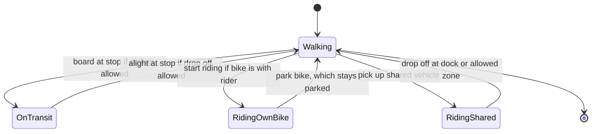
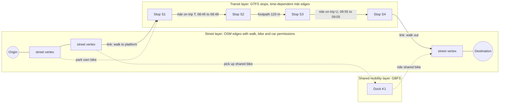
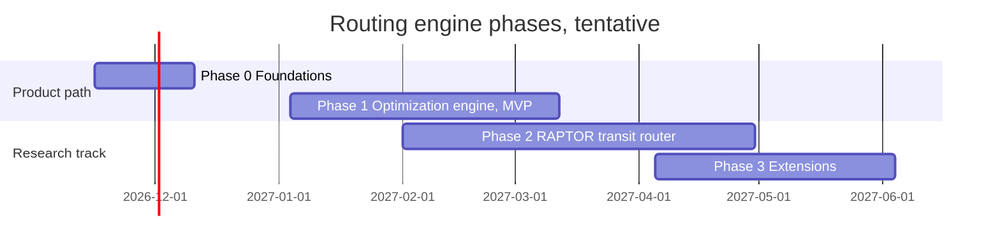
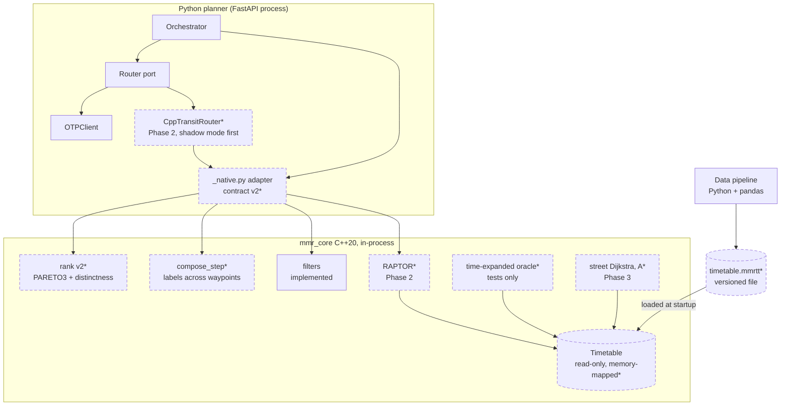

# Multimodal Router: Routing Engine Design (C++20)

| | |
|---|---|
| **Status** | Design proposal, pending team approval. **Nothing in this document is implemented yet**, except where marked *Implemented* |
| **Date** | 2026-11-13 |
| **Inputs** | [product-requirements.md](product-requirements.md) · [architecture.md](architecture.md) · [api-contract.md](api-contract.md) · C++ core at `services/planner/core` (commit `de33c1f`) |
| **Scope** | How the network is modelled, which algorithms to use, the C++ data structures and interfaces, the Python ↔ C++ boundary, testing and benchmarks, and a phased plan |
| **Not in scope** | Writing the engine, or changing the existing C++ sources. Every new file named here is a *proposal* |

### Reading guide

**Status labels:**

| Label | Meaning |
|---|---|
| **Implemented** | In the repository today (fares, cost model, filters, 2-criteria Pareto, polylines) |
| **Phase 1 / 2 / 3** | Planned, in the phase where it would be built (§7) |
| **Research** | Optional; built only if a decision gate is passed |

**Other conventions:**
- Complexities use *n* = vertices or stops, *m* = edges or footpaths, *C* = connections (consecutive stop pairs of trips), *K* = maximum rounds (transfers + 1), *R* = routes.
- Numbers marked *estimate* must be measured before anyone relies on them.

---

## 0. Summary and recommendation

**Recommendation: Approach B now, growing towards a hybrid.** OpenTripPlanner (OTP) keeps producing feasible candidate routes. Our C++20 engine owns everything we add on top of them. Step by step, we also build our own transit router behind the existing `Router` interface and switch to it only after it proves itself.

| Phase | When | What C++ does | Why it matters |
|---|---|---|---|
| **Phase 1 (MVP)** | Winter 2027 | Multi-criteria Pareto ranking over (duration, transfers, walking) with route-level distinctness; **waypoint journey composition** as label propagation across segments; constraint checks | Ships the PRD's MVP on schedule. Ranking and composition are real multi-criteria algorithms |
| **Phase 2 (research track)** | Winter to Spring | A **RAPTOR** transit router over the GTFS timetable built by our pipeline, checked against a simple, obviously correct oracle (time-expanded Dijkstra), and run in **shadow mode** against OTP | This is the core "graph algorithms" learning. It doesn't put the MVP at risk |
| **Phase 3 (stretch)** | Spring | Pick one or two: McRAPTOR (adds walking as a criterion), our own walking graph with Dijkstra/A* for access and egress, waypoint order optimisation, range queries | Depth, chosen by the team's capacity |

**Why not build everything ourselves (Approach A) first?**
- It means re-creating street routing, timetable handling, calendars, transfers and rentals before a single useful route reaches users.
- That is several person-months of high-risk work for a part-time student team (§6).

**What does not work: plain Dijkstra on a static graph.** It cannot answer schedule-based transit questions. Departures are discrete, waiting is part of the trip, and "best" has more than one criterion (§2). The design uses time-dependent and round-based algorithms instead.

**One open question changes the plan:** PRD Q1 asks whether the course requires an original routing algorithm. If it does, Phase 2 becomes a Must and starts in M0. Nothing else in this design changes.

---

## 1. Modelling a multimodal network as a graph

### 1.1 Three layers and the links between them

A multimodal network is best modelled as **layers** joined by **transition edges**. It is not one flat graph.

| Layer | Source | Vertices | Edges | Edge weight |
|---|---|---|---|---|
| **Street** | OpenStreetMap | Intersections and shape points (OSM nodes kept after simplification) | Street segments, with a per-mode permission mask (walk / bike / car) | Static time = length ÷ mode speed (+ penalties) |
| **Transit** | GTFS | Stops (platforms), grouped under stations (`parent_station`) | **Ride** edges (a trip goes from stop *i* to stop *i+1*), **footpaths** (stop to stop) | **Time-dependent**: the next departure at or after the current time, plus the ride time |
| **Shared mobility** | GBFS | Docks and free-floating vehicle positions | Pickup and drop-off transitions | Fixed handling time; availability changes over time |
| **Links** | Built by the pipeline | — | Stop ↔ nearest street vertex; dock ↔ street vertex | Walking time of the connector |

### 1.2 Definitions

| Concept | Definition used by the engine |
|---|---|
| **Vertex** | A place where a decision can be made: a street vertex, a stop, a dock. In timetable-based algorithms (RAPTOR, CSA), the stop is the only transit vertex; trips are read from arrays, not stored as edges |
| **Edge** | A way to move between two vertices with one mode: a street segment (static), a ride between consecutive stops of a trip (scheduled), a footpath (static), or a **transition** (board, alight, park a bike, pick up or drop off a vehicle) |
| **Transportation mode** | `WALK`, `BIKE` (own), `BIKE_SHARE`, `SCOOTER_SHARE`, `TRANSIT` (with submodes), `CAR`, `TAXI`: the same enum as the [API contract](api-contract.md#3-enumerations). Each street edge carries a permission bitmask; each transit route carries a submode |
| **Travel time** | Integer seconds. Walk and bike: length ÷ speed (defaults 1.33 m/s and 4.5 m/s, configurable). Transit: `arr(trip, j) − dep(trip, i)` for the ride, plus **waiting** `dep(trip, i) − ready_time`. Transitions: fixed handling times (e.g. 60 s to pick up a rental) |
| **Monetary cost** | Integer cents. Street and rental costs add up edge by edge. **Transit fares do not.** A transfer inside a 120-minute window is free, so a fare depends on the *path*, not on single edges. That breaks the "best sub-path" property shortest-path algorithms rely on, so fares are either applied after the search (today's approach, hidden in the MVP per PD-1) or carried as extra label state (§3.6, future) |
| **Transfer** | One more transit boarding after the first: `transfers = boardings − 1`, counted within each segment (PRD XFER-5). Changing between walking or biking and transit is a *mode change*, not a transfer. In RAPTOR, *round k* means "at most k trips taken" |
| **Transfer edge** | A footpath or same-stop change that lets a rider reach the next boarding. It must respect the minimum change time and GTFS `transfers.txt` (§5) |
| **Label** | The state of a partial journey at a vertex, e.g. `(arrival, transfers, walk_m, mode_state, waypoints_visited, parent)`. Multi-criteria algorithms keep a set of labels per vertex instead of one distance |
| **Dominance** | Label *a* dominates *b* if *a* is no worse on every criterion and strictly better on at least one, **and** *a*'s state allows everything *b*'s does (e.g. a bike still with the rider beats a bike left parked) |

### 1.3 Mode state: why a "vertex" alone is not enough

The same street corner means different things depending on whether the rider still has their bike, is on a rental, or has already parked. The engine therefore searches over **(vertex, mode state)** pairs, the product of the graph and a small state machine:



| State variable | Values | Why it is needed |
|---|---|---|
| `bike` | `NONE`, `WITH_RIDER`, `PARKED` | An own bike parked at a station can't be ridden later in the journey, even across waypoints (§4) |
| `rental` | `NONE`, `IN_USE` | A shared vehicle must be dropped off before boarding transit |
| `car` (future) | `NONE`, `WITH_DRIVER`, `PARKED` | Park & ride |
| `layer` | 0 … number of waypoints | Ordered waypoints (§4.1) |

The state space stays small: at most a few states × (waypoints + 1) layers per vertex.

### Diagram 1: Layered multimodal graph (illustrative)



### 1.4 Three ways to represent scheduled transit

| Model | Vertices | Edges | Algorithm | Pros | Cons | Our use |
|---|---|---|---|---|---|---|
| **Time-expanded** | One per *event* (a departure or arrival at a stop at a time) | Ride, wait (next event at the same stop) and transfer edges | Plain Dijkstra (weights are static) | Conceptually simple; easy to show it is correct | Large: about 2 × the number of stop times per day; slow | **Test oracle** (Phase 2) |
| **Time-dependent** | One per stop (or route-stop) | Edges carry an arrival function *f(t)* | Time-dependent Dijkstra (needs FIFO, §3.3) | Compact; reuses Dijkstra's structure | Multi-criteria and transfer counting are awkward; trip continuity must be modelled carefully | Teaching aid, and a second oracle |
| **Timetable-based** (no explicit graph) | Stops | Routes and trips held in arrays; footpaths | **RAPTOR**, CSA | The state of the art for public transit; handles transfers naturally; fast, cache-friendly scans | More specialised data preparation (patterns, FIFO splitting) | **Engine** (Phase 2) |

---

## 2. How scheduled transit differs from road routing

| Aspect | Road network | Scheduled transit |
|---|---|---|
| When you can travel | Any time | Only at scheduled departures, so waiting is part of the cost |
| Edge weight | Static (or a slowly varying traffic profile) | Depends on the time you arrive at the stop |
| Optimality criteria | Usually one (time) | Naturally several: arrival time vs. **number of transfers** (vs. walking, vs. fare) |
| Calendar | — | Trips run only on certain days (`calendar.txt`, `calendar_dates.txt`); holidays add or remove service |
| Time of day | Wall clock | GTFS times can be **≥ 24:00:00**: trips after midnight belong to the previous *service day* |
| Continuity | Any edge can follow any other | Staying on a trip is free; changing trips needs a minimum change time; some changes are forbidden (`transfers.txt` type 3) |
| Boarding rules | — | Some stops are drop-off-only or pickup-only (`pickup_type`, `drop_off_type`) |
| Overtaking | Not applicable | An express can overtake a local on the same stop sequence. Algorithms that assume first-in-first-out (FIFO) need routes split so that this never happens |
| Questions asked | "Shortest path at time *t*" | Also "all best journeys departing between 8:00 and 9:00" (profile or range queries) |
| Change over time | Traffic | Delays, cancellations (GTFS-Realtime, future) |

### Why plain Dijkstra is not enough

1. **Static weights cannot encode timetables.** The cost of a ride edge depends on when you arrive at the stop: miss the 8:45 and you wait for the 8:55. You need either time-dependent edges (time-dependent Dijkstra with FIFO) or a time-expanded graph.
2. **One distance per vertex is the wrong state.** Arriving at 8:50 with 2 transfers isn't comparable to arriving at 8:52 with 0 transfers. Users want both. A single-criterion algorithm silently throws one away. You need a *Pareto set* of labels per stop.
3. **Trip continuity and transfer rules** (minimum change times, forbidden transfers, pickup and drop-off restrictions) depend on how you arrived. That is state on the label, not a property of the vertex.
4. **Calendars and service days** decide whether an edge exists at all on the query date.

Dijkstra is still the right tool for the **street** parts: access and egress walks, footpath generation and direct bike trips (§3.1).

---

## 3. Algorithms

Each algorithm below has the idea, pseudocode, its complexity and **where it fits in Multimodal Router**. A summary table follows at §3.10.

### 3.1 Dijkstra (1959)

**Idea:** settle vertices in increasing order of distance using a priority queue. Correct when all edge weights are non-negative and static.

```text
DIJKSTRA(G, sources: list of (vertex, initial_time), limit)
  dist[v] ← ∞ for all v ;  parent[v] ← ⊥
  for (s, t0) in sources: dist[s] ← t0 ; PQ.push(s, t0)
  while PQ not empty:
    (u, d) ← PQ.pop_min()
    if d > dist[u]: continue                  # stale entry (lazy deletion)
    if d > limit: break                       # e.g. max walking time reached
    for each edge e = (u, v) allowed for the current mode:
      nd ← d + w(e)
      if nd < dist[v] or (nd = dist[v] and u < parent_vertex(v)):   # deterministic tie-break
        dist[v] ← nd ; parent[v] ← (u, e) ; PQ.push(v, nd)
  return dist, parent
```

**Complexity:** O((n + m) log n) with a binary heap. Weights are integer seconds, so a radix or bucket heap gives O(m + n log C) for a maximum edge weight C.

**Role in the application:**

| Use | Phase |
|---|---|
| **One-to-many access and egress:** walking or biking time from the origin to every stop within the walking limit (and the reverse from the destination). This feeds RAPTOR's starting stops | 3 |
| **Footpath generation** in the pipeline: stop-to-stop walking times within ~500 m, transitively closed as RAPTOR assumes. In Python first; C++ if it is too slow | 2–3 |
| **Oracle** for time-expanded transit (§3.3) | 2 |

### 3.2 A* (Hart, Nilsson & Raphael, 1968)

**Idea:** Dijkstra ordered by `dist(u) + h(u)`, where *h* is an **admissible** lower bound on the remaining cost. For walking, `h(u) = haversine(u, target) / v_walk_max`.

```text
ASTAR(G, s, t, h)
  g[v] ← ∞ ; g[s] ← 0 ; PQ.push(s, h(s))
  while PQ not empty:
    (u, f) ← PQ.pop_min()
    if u = t: return reconstruct(t)
    if f > g[u] + h(u): continue              # stale
    for each edge (u, v):
      if g[u] + w < g[v]: g[v] ← g[u] + w ; parent[v] ← u ; PQ.push(v, g[v] + h(v))
  return NO_PATH
```

**Complexity:** the same as Dijkstra in the worst case. In practice it expands far fewer vertices when *h* is tight.

**Role:**
- **Point-to-point street legs** (Phase 3): direct walk and bike trips, and the walk between a waypoint and the nearest stop.
- **A poor fit for transit.** A lower bound must assume the fastest vehicle (light rail at ~25 m/s), which makes the heuristic weak. It also doesn't help one-to-many access searches.
- The tests check that A* returns exactly Dijkstra's distance (§11).

### 3.3 Time-dependent shortest paths

**Time-dependent Dijkstra** (TD-Dijkstra). Each edge has an arrival function `arr_e(t)`:
- walk edge: `t + w`;
- ride edge: `dep_next(t) + ride_time`.

If every `arr_e` is non-decreasing (**FIFO: leaving later never gets you there earlier**), Dijkstra keyed by arrival time stays correct for earliest-arrival queries.

```text
TD_DIJKSTRA(G, s, t_dep, target)
  arr[v] ← ∞ ; arr[s] ← t_dep ; PQ.push(s, t_dep)
  while PQ not empty:
    (u, t) ← PQ.pop_min()
    if t > arr[u]: continue
    if u = target: break
    for each edge e = (u, v):
      t' ← ARRIVAL(e, t)                      # walk: t + w ; ride: next departure ≥ t (+ change time), then + ride time
      if t' < arr[v]: arr[v] ← t' ; parent[v] ← (u, e, t) ; PQ.push(v, t')
```

**Complexity:** O((n + m) log n · log k), where `ARRIVAL` uses binary search over the edge's *k* departures.

**Time-expanded variant.** Create a vertex per departure or arrival event. Connect:
- ride edges (event → the trip's next stop event);
- wait edges (event → next event at the same stop);
- transfer edges (arrival event → first departure event at the reachable stop that is ≥ arrival + change time).

Now plain Dijkstra applies. The graph has about 2 × (stop times) vertices, which is too big to serve queries, but it is **simple enough to trust**.

**Role:**
- **Phase 2: test oracle.** RAPTOR's earliest arrival for each transfer count must equal the oracle's on thousands of random small timetables (§11.2).
- **Teaching:** it shows exactly why static Dijkstra fails and how time dependence fixes it.
- **Not the production algorithm.** Counting transfers needs extra label state, and RAPTOR is simpler and faster for that.

### 3.4 RAPTOR: Round-bAsed Public Transit Optimized Router (Delling, Pajor & Werneck)

**Idea:** no priority queue. Round *k* finds the earliest arrival at every stop using **at most k trips**. Each round scans every route that serves a stop improved in the previous round, then relaxes footpaths. The result is the Pareto set over (arrival, transfers) for free: one candidate per round. Published evaluations report query times in milliseconds on city-scale networks.

**Data requirements** (built by the pipeline):
- **Routes are stop patterns whose trips never overtake one another.** Patterns with overtaking trips are split until FIFO holds.
- Trips in each route are sorted by departure.
- Footpaths are **transitively closed** within a radius.
- Trips carry service-day bitsets.

```text
RAPTOR(tt, access: list of (stop, seconds, walk_m), egress: map stop → (seconds, walk_m), t_dep, day, K, filters)
  for each stop p and k in 0..K: τ[k][p] ← ∞          # best arrival with ≤ k trips
  τ*[p] ← ∞                                            # best arrival so far, any k (local pruning)
  for (p, a) in access: τ[0][p] ← t_dep + a ; τ*[p] ← τ[0][p] ; mark(p)
  RELAX_FOOTPATHS(0)
  best_target ← ∞

  for k in 1..K:
    Q ← {}                                             # route → earliest position of a marked stop
    for each marked stop p:
      for each (r, i) in routes_serving(p) where r passes filters (submode, mode mask):
        Q[r] ← min(Q[r], i) if r in Q else i
    unmark all
    for each (r, i0) in Q, in increasing route index:  # deterministic order
      trip ← ⊥ ; board ← ⊥
      for i in i0 .. last_stop(r):
        p ← stop(r, i)
        if trip ≠ ⊥ and dropoff_allowed(trip, i):
          t_arr ← arr(trip, i)
          if t_arr < min(τ*[p], best_target):          # local + target pruning
            τ[k][p] ← t_arr ; τ*[p] ← t_arr ; parent[k][p] ← RIDE(trip, board, i) ; mark(p)
        ready ← τ[k-1][p] + (k > 1 ? change_time(p) : 0)
        if pickup_allowed(r, i) and (trip = ⊥ or ready ≤ dep(trip, i)):
          t' ← EARLIEST_ACTIVE_TRIP(r, i, ready, day)  # binary search on departures, skip inactive
          if t' ≠ ⊥ and (trip = ⊥ or t' earlier than trip) and transfer_allowed(parent[k-1][p], t'):
            trip ← t' ; board ← i
    RELAX_FOOTPATHS(k)                                 # τ[k][q] ← min(τ[k][q], τ[k][p] + walk(p, q)), mark q
    best_target ← min over q in egress of τ[k][q] + egress[q].seconds
    if no stop marked: break

  return PARETO over k of (best_target_k, k − 1 transfers, walk), each with its reconstructed journey
```

**Complexity per query:** O(K · (Σ_r |stops(r)| + m_footpaths)) route-stop visits, plus O(log T) for each trip lookup (*T* = trips in the route).
- **Memory:** O(K · n) labels.
- **Typical K:** 4–6, which matches `max_transfers ≤ 5` in the API.

**Variants:**

| Variant | What it does | Phase |
|---|---|---|
| **rRAPTOR** (range) | Run for every departure in a window, latest first, reusing labels. Answers "all good journeys leaving 8:00–9:00" | 3 |
| **McRAPTOR** | Replaces each `τ[k][p]` with a **bag** of Pareto labels to add criteria such as walking (§3.6) | 3 |
| **Reverse RAPTOR** | Latest departure for "arrive by" | 3 |

**Role:** the heart of **our own transit router (Phase 2)**. It produces transit-only stop-to-stop journeys. Access and egress times come from the simple model in Phase 2, or from Dijkstra in Phase 3.

### 3.5 CSA: Connection Scan Algorithm (Dibbelt, Pajor, Strasser & Wagner)

**Idea:** sort every elementary connection (dep_stop, arr_stop, dep_time, arr_time, trip) by departure time once. A query is then a single linear scan.

```text
CSA_EARLIEST_ARRIVAL(connections sorted by dep_time, source, t_dep, target)
  arr[s] ← t_dep ; trip_reached[·] ← false
  for c in connections starting at the first c with c.dep_time ≥ t_dep:
    if arr[target] ≤ c.dep_time: break                 # nothing later can improve
    if trip_reached[c.trip] or arr[c.dep_stop] + change(c) ≤ c.dep_time:
      trip_reached[c.trip] ← true
      if c.arr_time < arr[c.arr_stop]: arr[c.arr_stop] ← c.arr_time ; relax footpaths from c.arr_stop
```

**Complexity:** O(C) per query, with no priority queue.

**Role:** an **alternative** to RAPTOR that is even simpler for earliest arrival. Counting transfers and handling several criteria are less natural. Recommendation: build RAPTOR; keep CSA as a possible second oracle or a stretch comparison.

### 3.6 Multi-criteria (Pareto-optimal) routing

**Pareto dominance** over criteria vector **c** = (arrival, transfers, walk_m, …): *a* ≺ *b* ⇔ ∀i: a_i ≤ b_i ∧ ∃i: a_i < b_i, with the state-compatibility rule from §1.2.

**Multi-criteria label setting (Martins, 1984)** generalises Dijkstra:

```text
MLC(G, s, label0, target)
  B[v] ← ∅ (Pareto bag per vertex) ; PQ.push(label0)            # PQ ordered lexicographically
  while PQ not empty:
    L ← PQ.pop_min()
    if dominated(L, B[L.v]) or dominated(L, B[target]): continue  # local + target pruning
    INSERT(B[L.v], L)                                             # removes labels L dominates
    for each edge e out of L.v allowed in L.state:
      L' ← EXTEND(L, e)                                           # adds time, transfers, walking; updates state
      if not dominated(L', B[L'.v]): PQ.push(L')
  return B[target]
```

**McRAPTOR** applies the same idea inside RAPTOR's rounds:
- each stop holds a bag of labels per round;
- a "route bag" carries labels while scanning a route;
- bags merge with a dominance-preserving insert.

**Complexity:** output-sensitive. *L* total labels give O(L log L + L · |bag|) for dominance checks. In the worst case, Pareto sets can grow exponentially with the number of criteria. In practice, 2–3 criteria on transit networks stay manageable, especially with target pruning.

**Role:**

| Where | What | Phase |
|---|---|---|
| **Candidate ranking (Approach B)** | Pareto filter over (duration, transfers, walking) of the itineraries OTP returns; distinctness by route sequence (§3.7) | **1** |
| **Waypoint composition** | Labels carried across segments (§3.8) | **1** |
| **McRAPTOR** in our own router | Walking as a third criterion | 3 |
| **Fares as state** | A label carries `paid_until` and fare product; fare is a criterion | Future |

### 3.7 Pareto filtering of candidate itineraries

**Implemented:** [pareto.cpp](../services/planner/core/src/pareto.cpp) has an O(n log n) sort-and-sweep for **2 criteria** (duration, cost) and keeps one result per *mode sequence*.

**Phase 1** adds a separate function (the existing one is not modified):
- 3 criteria (duration, transfers, walking);
- distinctness by **route sequence** (PD-7), using a `route_key` per leg;
- labels Fastest / Fewest transfers / Least walking.

Transfers are small integers (0 … K), so a 3-criteria filter stays near O(n log n):

```text
PARETO3(items)                                    # criteria: duration (asc), transfers ∈ [0..K], walk (asc)
  sort items by (duration, transfers, walk, input_index)
  best_walk[t] ← ∞ for t in 0..K                  # min walk among kept, strictly faster items with transfers ≤ t
  for each group G of equal duration, in sorted order:      # ties handled like the existing 2-criteria sweep
    for x in G:
      x.dominated ← best_walk[x.transfers] ≤ x.walk         # a strictly faster item is no worse on transfers and walking
                    ∨ ∃ y in G: y ≺ x                       # same duration, better on transfers or walking
    for x in G with not x.dominated:                        # update only after the whole group is decided
      for t in x.transfers .. K: best_walk[t] ← min(best_walk[t], x.walk)
  return items not dominated, in input order
```

**Complexity:** O(n log n + n·K). For n ≤ a few hundred, an O(n²) pairwise reference is also fast, and it is used as the **test oracle**.

**Distinctness:**
1. Group candidates by `(mode_sequence, route_key sequence)`.
2. Keep the best per group under the `optimize` key, with ties broken by input index.
3. Then apply PARETO3.

### 3.8 Waypoint journey composition (Phase 1, used in Approach B)

**The problem:** chain *S = waypoints + 1* segments. For each surviving partial journey, Python asks the router for the next segment's candidates, departing at `arrival + dwell`. C++ combines them and prunes.

```text
COMPOSE(S, dwell[0..S-2], beam B, criteria, optimize)
  P₀ ← { Label(ready = t_dep, transfers = 0, walk = 0, bike = initial, parent = ⊥) }
  for k in 0 .. S-1:
    cands ← Python: for each L in Pₖ, router candidates for segment k departing at L.ready
    next ← []
    for each (L, c) with c.parent = L:
      if not COMPATIBLE(L.state, c.start_requirement): continue    # e.g. own bike was left parked
      L' ← Label(arrival = c.arrival,
                 transfers = L.transfers + c.transfers,           # transfers do not cross waypoints
                 walk = L.walk + c.walk_m,
                 bike = c.end_bike_state, parent = (L, c))
      L'.ready ← L'.arrival + (k < S-1 ? dwell[k] : 0)
      next.append(L')
    Pₖ₊₁ ← BEAM(PARETO3(next), B, key = optimize)                  # keep at most B labels, deterministic
  return Pₛ
```

**Exactness:**
- **Single criterion (earliest arrival), FIFO network:** chaining is **exact**. Arriving earlier at a waypoint never makes the next arrival later.
- **Several criteria:** exact if *B* = ∞ (all Pareto labels kept). A finite *B* makes it a beam heuristic.
- **Approach B caveat:** the result is optimal only **relative to the candidates the router returned**, since OTP returns a few itineraries per shape.

The tests check both properties against brute-force enumeration (§11).

**Complexity:**
- **CPU:** per segment, O(|Pₖ| · m_c) labels and O(N log N + N·K) pruning, where N = |next|. This is negligible.
- **Real cost:** the router calls. Up to `T + B·T·(S−1)` queries, where T = trip shapes (architecture §5.2).

### 3.9 Waypoint order optimisation (future)

**The problem:** if the user lets us reorder *w* unordered waypoints, we get a small travelling-salesman problem with travel times that depend on departure time.
- For w ≤ 3: evaluate all w! (≤ 6) orders with COMPOSE.
- Larger w: Held–Karp dynamic programming, O(w² 2ʷ), over a travel-time matrix estimated at the requested departure time. Then re-check the top orders with COMPOSE.

**Status:** out of MVP scope (PRD WAY-9). It is a clean, self-contained C++ exercise.

### 3.10 Summary: algorithms and where they go

| Algorithm | Problem it solves | Contribution to Multimodal Router | Complexity (per query) | Phase |
|---|---|---|---|---|
| Pareto sort-and-sweep (2 criteria) | Non-dominated candidates (time, cost) | Current ranking | O(n log n) | **Implemented** |
| PARETO3 + distinctness | Non-dominated candidates (time, transfers, walking), different routes | MVP ranking (PD-7) | O(n log n + nK) | 1 |
| COMPOSE (label propagation with beam) | Ordered waypoints | MVP waypoint journeys | O(Σ\|Pₖ\|·m_c log) CPU; router calls dominate | 1 |
| Dijkstra | Static street shortest paths, one-to-many | Access and egress, footpaths, oracle | O((n+m) log n) | 2–3 |
| A* | Point-to-point street paths | Direct walk and bike legs | ≤ Dijkstra; usually much less | 3 |
| Time-expanded Dijkstra | Earliest arrival on a static event graph | **Oracle** for RAPTOR | O(E log E), E ≈ stop events | 2 |
| TD-Dijkstra | Earliest arrival with FIFO time-dependent edges | Teaching; second oracle | O((n+m) log n log k) | 2 (optional) |
| RAPTOR | Pareto (arrival, transfers) over timetables | **Our own transit router** | O(K(Σ route stops + m)) | 2 |
| McRAPTOR / rRAPTOR | More criteria / departure windows | Walking criterion; "leave 8–9" | Output-sensitive | 3 |
| CSA | Earliest arrival by scanning connections | Alternative or second oracle | O(C) | Research |
| Held–Karp / brute force | Waypoint order | "Reorder my stops" | O(w² 2ʷ) / O(w!) | Future |

---

## 4. Waypoints and mode changes

### 4.1 User waypoints

| | In our own search (Approach A components) | In composition over candidates (Approach B, MVP) |
|---|---|---|
| Representation | **Layered product graph:** the state includes `layer ∈ [0..w]`. At the waypoint vertex in layer *k* there is a transition to layer *k+1* costing `dwell[k]`. The search starts at (origin, 0) and ends at (destination, w) | **Segments:** COMPOSE (§3.8) chains *w + 1* segment searches |
| Order | Layers enforce the user's order | Segments enforce the user's order |
| Exactness | Exact for all kept criteria (the search space is complete) | Exact for earliest arrival; heuristic with a finite beam; limited to the returned candidates |
| Cost | State space × (w + 1) | Router calls × B per extra segment |
| Transfers across a waypoint | **Not counted:** the layer transition resets "on a trip" state | Not counted (`transfers` are summed per segment) |
| Output | `segments[]` and `waypoint_visits[]` in the API ([api-contract §4.3.2](api-contract.md#432-segments-and-waypoints-user-requested)) | Same |

### 4.2 Mode changes and transfer points (system-generated)

Mode changes are **transition edges** in the search and **transfer points** in the output:

| Transition (search) | Precondition | Effect on state | API `TransferKind` | Counts as transfer |
|---|---|---|---|---|
| Board | At a stop with pickup allowed; trip active on this service day; `ready ≤ dep` | → `OnTransit(trip)` | `BOARD` | no (the first boarding) |
| Alight | Drop-off allowed | → `Walking` | `ALIGHT` | no |
| Trip → trip (via footpath or same stop) | Change time respected; transfer not forbidden | `OnTransit(trip')` | `TRANSIT_TRANSFER` | **yes** |
| Park own bike | `bike = WITH_RIDER`; parking allowed at the stop (all stops in the MVP) | `bike = PARKED` | `BIKE_PARK` | no |
| Pick up or drop off a shared vehicle | `rental = NONE` and a vehicle available / at a dock or allowed zone | `rental = IN_USE` / `NONE` | `VEHICLE_PICKUP` / `VEHICLE_DROPOFF` | no |

**Waypoints never create transfer points** (PRD WAY-6). In the layered search, the waypoint transition is a separate edge type that is excluded from transfer-point extraction.

### 4.3 Mode state across waypoints (composition rule)

| Arrival at the waypoint | What the next segment may use |
|---|---|
| Arrived riding own bike (`bike = WITH_RIDER`) | Own bike allowed |
| Bike parked earlier at a station (`PARKED`) | **No own-bike legs** for the rest of the journey. Simplification: the MVP doesn't route back to collect it |
| On a rental | The rental is dropped off at the waypoint (dwell time) |

`COMPATIBLE(L.state, c.start_requirement)` in §3.8 enforces this. The C++ engine must know it, which is why the state is part of the contract (§9).

---

## 5. Constraints

| Constraint | Source | Where enforced (Phase 1 / Approach B) | Where enforced (own router, Phase 2+) |
|---|---|---|---|
| **Service not running on the date** | `calendar.txt`, `calendar_dates.txt` (exception type 1 adds, 2 removes) | OTP | Trip service-day bitset; `EARLIEST_ACTIVE_TRIP` skips inactive trips. Query day *d* also checks day *d−1* trips with times ≥ 24:00 |
| **Outside the schedule window** | Feed dates | API validation (`TIME_OUTSIDE_SERVICE_WINDOW`) | The same check, plus an empty result |
| **Restricted modes** | Request `modes` | OTP query + C++ `uses_allowed_modes` (implemented) on candidates | Mode mask on street edges and on transitions |
| **Excluded transit submodes** | `transit_submodes_excluded` | OTP filter if available, otherwise a C++ filter on candidate legs | Route filter bitset in the RAPTOR route collection step |
| **Street permissions** | OSM tags (walk / bike / car access) | OTP | Permission mask on each street edge |
| **Invalid transfers** | `transfers.txt` type 3 (not possible) between stops, routes or trips | OTP | `transfer_allowed(prev_trip_or_stop, next_trip)` lookup (sorted vector of forbidden pairs) |
| **Minimum transfer time** | `transfers.txt` type 2, plus a per-stop default change time | OTP | `change_time(p)` + overrides |
| **Timed / in-seat transfers** | Type 1; newer types 4–5 (in-seat) | OTP | Phase 3 (honour type 1 as change time 0; in-seat later) |
| **Pickup / drop-off restrictions** | `stop_times.pickup_type` / `drop_off_type` | OTP | `pickup_allowed` / `dropoff_allowed` flags per stop time |
| **Max transfers** | Request (0–5) | C++ filter on candidates | RAPTOR rounds `K = max_transfers + 1` (exact, and it prunes the search) |
| **Max walking distance / duration** | Request | C++ filter on candidates (implemented for distance) | Access/egress search limit + walking criterion or post-filter |
| **Own-bike and rental state** | §4.3 | COMPOSE `COMPATIBLE` | State machine (§1.3) |
| **Bikes on board** (future) | `trips.bikes_allowed` | — | Board only if allowed when `bike = WITH_RIDER` |
| **Real-time cancellations** (future) | GTFS-RT | OTP updater | Trip activity overlay |
| **Data validity** | Pipeline manifest | API health and warnings | The loader rejects a timetable whose version or checksum doesn't match |

---

## 6. Approach A vs. Approach B

- **A.** Implement our own multimodal route-generation engine in C++20: street, transit, rentals and geometry.
- **B.** Use an existing journey planner (OTP) for feasible candidate routes, and implement our own C++20 optimisation and ranking engine on top.

| Criterion | **A: own route generation** | **B: OTP candidates + own C++ optimisation** |
|---|---|---|
| **Technical complexity** | Very high. OSM parsing and graph building, snapping points to the network, per-mode permissions, GTFS parsing, calendars and service days, FIFO pattern splitting, footpaths, transfer rules, timetable search, multi-criteria labels, rentals (GBFS), geometry for display, arrive-by, edge cases (overnight, frequencies, stations) | Moderate. Multi-criteria filtering, distinctness, label propagation across waypoints with mode state, constraint checks; plus a clean contract and data mapping |
| **Development effort** (*rough estimate*) | Several person-months to reach what works today. Transit-only RAPTOR with correct calendars and transfers alone: ~6–10 person-weeks including the pipeline and oracles | MVP C++ work: ~4–6 person-weeks (ranking v2 + composition + tests + benchmarks) |
| **Educational value** | Highest: graph modelling, time dependence, RAPTOR, Pareto search, performance engineering | Good: Pareto algorithms, label setting, approximation vs. exactness, API contracts. **Lower on core pathfinding** unless Phase 2 is added |
| **Data requirements** | OSM (with access tags), GTFS (stops, routes, trips, stop_times, calendars, transfers, frequencies, stations/pathways, shapes), GBFS; a pipeline producing the street graph, timetable, footpaths and links | OTP consumes the raw feeds. Our C++ needs only the candidate itineraries + config. Pipeline needs are lighter (stop table, manifest) |
| **Algorithmic flexibility** | Full: custom criteria, waypoints inside the search, fare state, any constraint | Limited to post-processing: we **cannot find a route OTP didn't return**; ranking and composition quality depend on OTP's candidates |
| **Maintainability** | A large codebase owned by students who will graduate; correctness subtleties (calendars, overnight) need ongoing care | Small C++ surface; OTP is maintained upstream. Risk: changes to OTP's API between versions |
| **Ability to deliver a working MVP** | Low within the year: the MVP would wait on the engine | **High**: builds on code that already works |
| **Runtime footprint** | Potentially smaller than OTP | OTP needs ~8 GB of heap (architecture §10.4) |

**Recommendation:** **B for the product, plus incremental A components as a gated research track.** That is the hybrid end state architecture.md §7 describes (option C). It gives a working MVP *and* genuine graph-algorithm work, with a clear switch-over rule: the own router becomes user-facing only after it passes the Phase 2 gate.

---

## 7. Phased strategy (year-long undergraduate project)

| Phase | Window (tentative, UW quarters) | Deliverables | Exit gate | Effort (*rough estimate*) |
|---|---|---|---|---|
| **0: Foundations** | M0, until Dec 2026 | <ul><li>Contract v2 spec (§9)</li><li>Integer units and strong-ID utilities</li><li>Test-oracle harness</li><li>Benchmark harness</li><li>Timetable file format spec</li><li>Pipeline exports the stop, route and trip tables</li></ul> | Specs reviewed; harnesses run in CI | 2–3 person-weeks |
| **1: Optimisation engine (MVP)** | M1–M2, Winter 2027 | <ul><li>`rank_v2` (PARETO3 + distinctness + labels)</li><li>`compose_step` (COMPOSE with mode state)</li><li>Candidate constraint filters</li><li>Python integration via `_native.py`</li><li>Unit, oracle and property tests</li><li>Benchmarks B1–B2</li></ul> | Contract tests CT-6/7 pass; C++ CPU time p95 ≤ 5 ms for the worst MVP case | 4–6 person-weeks |
| **2: Own transit router** (research track, in parallel from mid-Winter) | Feb–Apr 2027 | <ul><li>Pipeline timetable build (calendars, pattern splitting, footpaths, transfers)</li><li>Memory-mapped loader</li><li>RAPTOR (Pareto on arrival and transfers)</li><li>Time-expanded Dijkstra oracle</li><li>`CppTransitRouter` implementing `Router` for `WALK+TRANSIT+WALK` shapes</li><li>**Shadow mode** against OTP on the PRD benchmark set</li></ul> | **Switch-over gate:** ≥ 95% of benchmark origin–destination pairs within 60 s of OTP's earliest arrival with no more transfers; 0 invalid journeys (constraint audit); C++ p95 ≤ 50 ms per query on a King County weekday | 6–10 person-weeks |
| **3: Extensions** (stretch; pick 1–2) | Apr–Jun 2027 | McRAPTOR (walking criterion) · OSM walking graph + Dijkstra/A* access and egress · rRAPTOR "leave between" · waypoint order optimisation · arrive-by (reverse RAPTOR) | Each has its own tests and benchmark | 3–6 person-weeks each |



**Staffing assumption:** 1–2 students own the C++ engine (architecture §15). Phase 2 can be a separate pair, because it has a clean boundary: the `Router` port plus the timetable file.

**Fallback:** if Phase 2 slips, nothing user-facing is affected. The MVP runs on Approach B. **If the course requires an original router (Q1),** start Phase 2 in M0 and treat the gate as an MVP Must for transit-only trips.

---

## 8. C++ architecture

### 8.1 Proposed module layout (new files only)

The existing files under `include/mmr/` and `src/` stay **unchanged**. New algorithms go in new modules, and old functions are deprecated only after the new ones have replaced them in Python.

| Module (proposed path under `services/planner/core/`) | Contents | Phase |
|---|---|---|
| `include/mmr/util/` | `strong_id.hpp`, `time.hpp` (integer seconds, service day), `small_vector.hpp`, `bitset_view.hpp` | 0 |
| `include/mmr/rank/` | `criteria.hpp`, `pareto3.hpp`, `distinct.hpp`, `labels.hpp` | 1 |
| `include/mmr/compose/` | `compose.hpp` (labels, `compose_step`, state rules) | 1 |
| `include/mmr/transit/` | `timetable.hpp`, `raptor.hpp`, `expanded_oracle.hpp`, `journey.hpp`; later `mc_raptor.hpp`, `range_raptor.hpp` | 2–3 |
| `include/mmr/io/` | `timetable_file.hpp` (format spec, memory-mapped loader, validation) | 2 |
| `include/mmr/street/` | `street_graph.hpp` (CSR), `dijkstra.hpp`, `astar.hpp` | 3 |
| `src/…` | Implementations mirroring the headers; `bindings.cpp` gains new functions (a later, reviewed change) | 1+ |
| `tests/…` | One test file per module + `tests/oracles/` + `tests/fixtures/` | 0+ |
| `bench/` | Micro-benchmarks (B1–B4) | 0+ |

### 8.2 Engine overview



### 8.3 Core data structures (interface sketch, not implemented)

```cpp
// util/strong_id.hpp: indices that can't be mixed up (StopId vs RouteId)
namespace mmr {
template <class Tag>
struct Id {
  uint32_t v = UINT32_MAX;
  constexpr auto operator<=>(const Id&) const = default;
  constexpr bool valid() const { return v != UINT32_MAX; }
};
using StopId  = Id<struct StopTag>;
using RouteId = Id<struct RouteTag>;
using TripId  = Id<struct TripTag>;
using NodeId  = Id<struct NodeTag>;

using Seconds = int32_t;            // since service-day midnight; may exceed 86'400 (GTFS 25:10:00)
using Meters  = uint32_t;
using Cents   = int64_t;
inline constexpr Seconds kNever = std::numeric_limits<Seconds>::max();
}  // namespace mmr
```

```cpp
// street/street_graph.hpp: compressed sparse row (CSR), structure-of-arrays, read-only after load
struct StreetGraph {
  std::span<const uint32_t> first_out;   // n+1 offsets into the edge arrays
  std::span<const uint32_t> head;        // m target vertices
  std::span<const uint32_t> length_dm;   // m lengths in decimetres (integer, deterministic)
  std::span<const uint8_t>  allowed;     // m ModeMask bits: WALK | BIKE | CAR
  std::span<const int32_t>  lat_e7, lon_e7;  // n fixed-point coordinates (1e-7 degrees)
  auto out_edges(NodeId u) const { return std::views::iota(first_out[u.v], first_out[u.v + 1]); }
};
```

```cpp
// transit/timetable.hpp: RAPTOR layout. Routes are FIFO stop patterns.
struct Footpath { StopId to; Seconds duration; Meters walk; };
struct RouteStop { RouteId route; uint16_t position; };

struct Timetable {
  // Routes → stops (flat), routes → trips
  std::span<const uint32_t> route_stop_begin;   // R+1
  std::span<const StopId>   route_stops;        // Σ |stops(r)|
  std::span<const uint32_t> route_trip_begin;   // R+1 into the trip arrays
  std::span<const uint32_t> route_time_begin;   // R   into the time arrays (trip-major: [trip][stop])
  std::span<const Seconds>  arr, dep;           // Σ trips(r)·stops(r)
  std::span<const uint8_t>  board_alight;       // same indexing: bit0 = pickup ok, bit1 = drop-off ok
  std::span<const uint8_t>  route_submode;      // TransitSubmode per route
  // Stops → routes, footpaths (both CSR)
  std::span<const uint32_t>  stop_route_begin;  // n+1
  std::span<const RouteStop> stop_routes;
  std::span<const uint32_t>  footpath_begin;    // n+1
  std::span<const Footpath>  footpaths;         // transitively closed within the configured radius
  std::span<const uint16_t>  change_time;       // n, default minimum change seconds per stop
  // Calendars: one bit per (trip, day offset from feed start)
  std::span<const uint64_t>  trip_active_bits;  // ceil(days/64) words per trip
  uint32_t                   days;              // service days covered
  // transfers.txt exceptions (sorted, binary-searchable)
  std::span<const uint64_t>  forbidden_transfers;   // packed (from_trip_or_stop, to_trip) keys
  std::span<const uint64_t>  min_transfer_keys;     // packed keys, parallel to min_transfer_secs
  std::span<const Seconds>   min_transfer_secs;
};
```

```cpp
// transit/raptor.hpp: one immutable router, many concurrent queries
struct AccessLeg { StopId stop; Seconds duration; Meters walk; };
struct TransitQuery {
  std::span<const AccessLeg> access, egress;
  Seconds  depart_at;            // seconds since midnight of `service_day`
  uint32_t service_day;          // day offset from feed start
  uint8_t  max_rounds;           // = max_transfers + 1, ≤ 6
  uint16_t allowed_submodes;     // bit per TransitSubmode
};
struct JourneyLeg {
  enum class Kind : uint8_t { Access, Ride, Footpath, Egress } kind;
  StopId from, to; TripId trip; uint16_t board_pos, alight_pos;
  Seconds dep, arr; Meters walk;
};
struct Journey { std::vector<JourneyLeg> legs; Seconds dep, arr; uint8_t transfers; Meters walk; };

class Workspace;                 // per-query scratch arrays (τ, marks, parents), reused, owned by one thread

class RaptorRouter {
 public:
  explicit RaptorRouter(std::shared_ptr<const Timetable> tt);
  [[nodiscard]] std::vector<Journey> route(const TransitQuery& q, Workspace& ws) const;  // Pareto (arr, transfers)
};
```

```cpp
// rank/criteria.hpp: what a "label" must provide (C++20 concept)
template <class L>
concept ParetoLabel = requires(const L& a, const L& b) {
  { a.criteria() } -> std::convertible_to<std::array<int64_t, 3>>;   // (duration, transfers, walk)
  { compatible(a, b) } -> std::same_as<bool>;                         // state allows everything b's does
};
template <ParetoLabel L> bool dominates(const L& a, const L& b);      // ≤ on all, < on one, compatible
```

```cpp
// compose/compose.hpp: Phase 1 waypoint composition
enum class BikeState : uint8_t { None, WithRider, Parked };
struct Partial   { Seconds ready; uint8_t transfers; Meters walk; BikeState bike; };
struct Candidate { uint32_t parent; Seconds dep, arr; uint8_t transfers; Meters walk;
                   bool needs_own_bike; BikeState end_bike; uint32_t route_seq_key; };
struct Kept      { uint32_t parent; uint32_t candidate; };
[[nodiscard]] std::vector<Kept> compose_step(std::span<const Partial> partials,
                                             std::span<const Candidate> candidates,
                                             Seconds dwell, uint32_t beam, Optimize key);
```

### 8.4 Implementation rules

**Determinism:**
- Integer seconds, metres and cents only. There is no floating point in decisions. This is unlike the existing modules, which needed `-ffp-contract=off` to match Python's doubles.
- Every tie is broken by input index or entity index.
- No iteration over unordered containers affects results.
- Nothing random. Test generators use fixed seeds.

**Immutability:**
- The `Timetable` and `StreetGraph` are read-only after loading.
- Queries use their own `Workspace`, so one loaded timetable can serve concurrent queries from the thread pool.

**Memory:**
- Structure-of-arrays with CSR offsets.
- The timetable file is **memory-mapped** read-only. The OS shares its pages across uvicorn workers (architecture §6.2).
- `Workspace` arrays are sized to the number of stops and reset with a "touched list", so each query costs O(touched) rather than O(n).

**Errors:**
- Contract violations throw `std::invalid_argument`, which arrives in Python as `ValueError`.
- A corrupt or mismatched data file throws `std::runtime_error` at load time.
- No `abort()`. Note that `std::expected` is C++23, so it isn't used. Results are either a valid value or an exception.

**C++20 features:**

| Use | Avoid for now |
|---|---|
| Concepts, `std::span`, ranges/views, `<=>`, designated initializers, `<bit>` (`popcount`, `bit_width`), `constexpr` tables | **C++20 modules**: tooling support across CMake, nanobind and the team's compilers is uneven |

**Warnings and sanitizers:**
- Keep the existing `-Wall -Wextra -Wpedantic`.
- Add a CI build with `-fsanitize=address,undefined` for the tests.

---

## 9. Python ↔ C++ interface contract

The rules from [architecture §6.3](architecture.md#63-explicit-python--c-contract) still apply: plain values, indices out, one adapter (`_native.py`), a contract version, and the GIL released for slow calls. This section defines **contract v2**.

### 9.1 Boundary between C++20 and FastAPI

| Python (FastAPI process) owns | C++20 (`mmr_core`) owns |
|---|---|
| HTTP, Pydantic validation, error mapping ([api-contract](api-contract.md)) | Algorithms: ranking, composition, constraint filters, RAPTOR, street search, oracles |
| Orchestration: segmenting, trip shapes, calling routers, the deadline, caching | Immutable in-memory timetable and street graph |
| OTP and geocoder I/O | **No network I/O.** The only file I/O is loading the timetable and graph at start-up from a path Python passes in. *This narrows architecture rule 4 and needs explicit approval* |
| Mapping indices back to names, geometry and headsigns (stop and trip tables from the pipeline) | Returning indices, bitmasks and integers |
| Transfer-point derivation and response assembly | — |

### 9.2 Contract v2 functions

| Function | Input | Output | Releases GIL | Phase |
|---|---|---|---|---|
| `contract_version()` | — | `2` | — | 0 |
| `rank_v2(itineraries, options)` | List of `Itin {legs: [Leg{mode, dep_s, arr_s, walk_m, route_key}], duration_s, transfers, walk_m}`, `RankOptions{optimize, limit, min_results}` | List of `(index, label_bits)`, ordered | no (sub-ms) | 1 |
| `compose_step(partials, candidates, dwell_s, beam, optimize)` | The §8.3 `Partial` / `Candidate` structs | List of `(parent, candidate)` kept | no (sub-ms) | 1 |
| `filter_candidates(itineraries, mode_mask, submode_mask, max_transfers, max_walk_m, max_walk_s)` | As above | List of kept indices | no | 1 |
| `load_timetable(path)` | Path to a `.mmrtt` file | `Timetable` handle (immutable, shareable) | yes | 2 |
| `raptor_route(tt, query)` | `TransitQuery` (access/egress as lists of `(stop_index, seconds, walk_m)`) | List of `Journey` (stop and trip indices) | **yes** | 2 |
| `expanded_oracle_route(tt, query)` | Same | Same | yes | 2 (tests) |

**Units in v2:**
- times: `int32` seconds relative to one reference per request, the journey departure or the service-day midnight for RAPTOR;
- distances: `uint32` metres;
- money: `int64` cents.

The existing double-based functions stay as they are until Python moves to v2. They are then deprecated, so no existing source changes are needed now.

### 9.3 `CppTransitRouter` (Phase 2) behind the existing `Router` port

1. **Shapes it handles.** Only transit shapes with walking access and egress (`WALK+TRANSIT+WALK`). Every other shape goes to OTP. A small composite router dispatches by shape, so the orchestrator doesn't change.
2. **Access and egress:**
   - **Phase 2:** stops within the walking limit, timed as straight-line distance × 1.3 detour at walking speed, from the pipeline's stop table. This is an approximation. Its geometry is flagged `GEOMETRY_APPROXIMATE`.
   - **Phase 3:** replaced by Dijkstra on the OSM walking graph.
3. **Results.** Journeys come back as stop and trip indices. Python maps them to `Leg`s with names, headsigns, submodes and intermediate stops (from the pipeline's tables), plus geometry (straight lines between stops, or GTFS `shapes.txt` slices if the pipeline pre-cuts them).
4. **Shadow mode.** For a configured share of requests, both routers run. Only OTP's answer is returned. Differences are logged for the gate report (§12).

### 9.4 Timetable file contract (pipeline → C++)

| Part | Content |
|---|---|
| Header | Magic `MMRTT`, `format_version`, `data_version` (it matches the manifest, architecture §8), feed start date, number of days, counts (stops, routes, trips, stop times, footpaths), section offsets, CRC32 per section |
| Sections | The arrays in §8.3, little-endian, 8-byte aligned |
| Writer | Python pipeline (pandas → NumPy arrays → binary). Pattern splitting, calendar expansion, footpath closure and transfer tables are computed there |
| Reader | C++ `load_timetable`: checks magic, version, sizes and checksums, then memory-maps |
| Compatibility | A `format_version` change requires the writer and reader to change together. The loader refuses unknown versions |
| Side tables | `stops.parquet` / `trips.parquet` (names, codes, headsigns, route names) are read by Python, not C++. Indices match the binary file |

### 9.5 Contract tests

| Test | Checks |
|---|---|
| Contract version | `contract_version()` equals the version `_native.py` expects, checked at start-up |
| Round trip | Index mapping Python ↔ C++ on fixtures |
| Concurrency smoke test | Concurrent `raptor_route` calls from several threads give results identical to serial calls |
| Error mapping | Bad input → `ValueError`; corrupt file → `RuntimeError`, never a crash |

---

## 10. Complexity and resource analysis

| Component | Time | Memory | Notes |
|---|---|---|---|
| `rank_v2` | O(n log n + nK) | O(n) | n ≤ ~60 candidates in the MVP |
| `compose_step` | O(N log N + NK), N = Σ candidates per layer | O(N) | ≤ 3 waypoints, B ≤ 3 |
| Dijkstra (street, one-to-many) | O((n+m) log n) | O(n) | Bounded by the walking limit (≤ 10 km) |
| A* | ≤ Dijkstra | O(n) | Point-to-point |
| RAPTOR | O(K · (Σ_r \|stops(r)\| + m_fp)) + trip lookups O(log T) | O(K · n_stops) workspace | Per query; no priority queue |
| Time-expanded oracle | O(E log E), E ≈ 2 · stop events | O(E) | Test-sized inputs only |
| McRAPTOR | Output-sensitive (bag sizes) | O(K · n · \|bag\|) | Bound bag sizes in tests |
| Timetable load | O(file size) to validate; memory-mapped | File size, shared | Once per process |

**Timetable size (estimate formula; measure in M0):**

| Item | Size |
|---|---|
| Stop times | `arr + dep` = 8 bytes per stop time, + 1 byte flags |
| Per-day trip activity | 1 bit per trip per day |
| Example | *If* a weekday had 30,000 active trips averaging 30 stops, that is 900k stop times ≈ 8 MB of times |
| Whole file | Tens of MB, comfortably memory-mappable |

The real numbers for the Puget Sound feed have to be measured by the pipeline (DATA-2).

**Workspace per query:** with K = 6 rounds and S stops, labels take `K × S × (4 B arrival + 8 B parent)`. If S ≈ 10,000, that is ≈ 0.7 MB per concurrent query (*estimate*).

---

## 11. Testing plan

All tests are **deterministic**: fixed fixtures, seeded generators, integer units, stable tie-breaks. C++ tests use Catch2 (already in the repository); Python tests use pytest.

### 11.1 Hand-built fixtures with known answers

| ID | Fixture | Expected behaviour |
|---|---|---|
| F1 | One route, 3 stops, trips at 07:00/07:10/07:20 | Departing 07:00:00 catches 07:00 (boundary is inclusive); departing 07:00:01 → 07:10 |
| F2 | Routes A (S1→S2) and B (S2→S3), change time 120 s | A arrives 08:00, B leaves 08:01 → missed; leaves 08:02 → caught |
| F3 | Slow direct (0 transfers, arrive 08:40) vs. fast with 2 transfers (arrive 08:20) | Both returned (Pareto); Fastest ≠ Fewest transfers |
| F4 | Express overtakes local on the same stop sequence | Pipeline splits the pattern; RAPTOR finds the express; FIFO invariant holds per route |
| F5 | Trip at 24:10–25:05 on service day *d−1* | A query at 00:05 on day *d* finds it |
| F6 | `calendar_dates` removes a trip on a holiday / adds an extra trip | Not used / used |
| F7 | `transfers.txt` type 3 between two routes at S2; type 2 with 300 s | Connection forbidden; 300 s respected |
| F8 | Stop with `pickup_type = 1` | Cannot board there, but can alight |
| F9 | Transfer needs a 200 m footpath; closure across 3 stops | Found; footpath closure correct |
| F10 | `max_transfers = 1` while the best journey needs 2 | Returns the 1-transfer journey or none; never 2 |
| F11 | `LIGHT_RAIL` excluded | No rail rides in any result |
| F12 | Waypoint with dwell 15 min | Chained earliest arrival equals the layered-graph search result |
| F13 | Bike parked at a station in segment 0 | Segment-1 candidates using an own bike are rejected |
| F14 | Exactly tied arrivals | The same journey is chosen on every run (index tie-break) |
| F15 | Ranking: candidates with equal duration, different transfers and walking | PARETO3 result equals the O(n²) brute force; labels unique; distinctness by `route_key` |

### 11.2 Differential and property tests (seeded, many cases)

| ID | Implementation under test | Oracle | Cases | Property |
|---|---|---|---|---|
| P1 | RAPTOR | Time-expanded Dijkstra | 1,000 random timetables (≤ 20 stops, 8 routes, 60 trips) × 10 queries | For each round *k*: equal earliest arrival at the target |
| P2 | `rank_v2` (PARETO3 + distinctness) | O(n²) pairwise | 5,000 random candidate sets | Identical index set and labels |
| P3 | `compose_step` with beam = ∞ | Brute-force enumeration of all candidate combinations | 2,000 random 2–4 segment instances | Identical Pareto set |
| P4 | `compose_step` with finite beam | P3's result | Same | Result ⊆ exact set; deterministic; size ≤ B |
| P5 | Dijkstra / A* | Bellman–Ford | 1,000 random graphs | Equal distances; A* = Dijkstra with an admissible *h* |
| P6 | McRAPTOR (Phase 3) | Exhaustive path enumeration | Tiny timetables | Equal Pareto sets |

### 11.3 Invariants checked on every result (debug builds and tests)

- Legs are in time order, with no overlaps.
- Ride times match the timetable.
- Every boarding is at a stop that allows pickup, and every alighting at one that allows drop-off.
- No forbidden transfer is used, and change times are respected.
- Trips are active on their service day.
- `transfers = rides − 1`, per segment.
- Constraints are satisfied (modes, submodes, max transfers, walking).
- Waypoints are visited in order.
- Mode-state transitions are legal (§1.3).

### 11.4 Golden and regression tests

- A small **real-feed subset** (a handful of routes) is extracted by the pipeline, *if the feed licence allows it in the repository*. Otherwise it is generated at test time from the downloaded feed.
- Snapshot results for fixed queries are stored. A change in output needs a reviewed snapshot update.

### 11.5 Robustness

- ASan + UBSan CI job over all C++ tests.
- *Optional:* fuzz the timetable loader with libFuzzer. Malformed files must be rejected with an error, never crash.
- Python: contract-version mismatch, concurrency smoke test, error mapping (§9.5).

---

## 12. Benchmark methodology

### 12.1 Principles

- **Release build:** CMake `Release`, which the repository already defaults to. Record the compiler, flags, CPU, RAM, OS, commit and `data_version` with every run.
- **Warm up, then repeat:** ≥ 30 repetitions per query. Report the median, p95 and p99; never a single run.
- **Separate what you measure:**
  - load time (once);
  - query time (C++ only);
  - Python round trip (binding plus conversion);
  - end-to-end HTTP (FastAPI + routers).
- **Report hardware-independent counters too:** routes scanned, labels created, labels settled, OTP calls. CI runners are noisy, so CI regression checks use these counters; wall-clock time is informational.
- **Memory:** peak RSS, and the byte size of each structure.
- **Fixed query sets:** generated with fixed seeds and committed, so runs are comparable.

### 12.2 Query sets

| Set | Content |
|---|---|
| **Q-PRD** | The PRD benchmark set (30–50 origin–destination pairs, PRD §11.2) × 4 time slots: 08:00 weekday, 12:30 weekday, 17:30 weekday, 23:30 Saturday |
| **Q-random** | 1,000 seeded random stop-to-stop pairs inside the service area, departure times spread over the service day |
| **Q-scale** | Synthetic grid timetables at 1k / 5k / 20k stops, scaling routes and trips proportionally, for complexity curves |
| **Q-waypoint** | 0 / 1 / 2 / 3 waypoints × beam 1 / 3 / 5 over Q-PRD origin–destination pairs |

### 12.3 Scenarios

| ID | What | Baseline | Target (proposed) | Phase |
|---|---|---|---|---|
| B1 | `rank_v2` on 10 / 60 / 1,000 / 10,000 candidates | O(n²) reference; current 2-criteria `rank` | p95 ≤ 1 ms at 60 | 1 |
| B2 | `compose_step` across Q-waypoint (C++ CPU only) | Python brute force | p95 ≤ 5 ms worst case | 1 |
| B3 | RAPTOR on Q-random and Q-PRD (King County weekday) | Time-expanded oracle (small sets); OTP end-to-end per segment (labelled as a different scope) | p95 ≤ 50 ms C++; memory ≤ 500 MB | 2 |
| B4 | Timetable load (memory-mapped) | — | ≤ 2 s | 2 |
| B5 | Street Dijkstra one-to-many (2 km), A* point-to-point | Dijkstra vs A* | p95 ≤ 20 ms | 3 |
| B6 | End-to-end `/routes/plan`, fake router vs OTP vs CppTransitRouter (shadow) | — | Feeds the PRD's PERF-1/2 | 1–2 |

### 12.4 Shadow-mode comparison report (Phase 2 gate)

For each query in Q-PRD × time slots:
1. Run OTP and `CppTransitRouter` on the same `WALK+TRANSIT+WALK` request.
2. Record the earliest arrival, transfers, walking, and whether either returned nothing.

The report gives:
- the distribution of the arrival difference;
- the share of queries within 60 s with transfers no higher than OTP's;
- disagreements, sorted by size.

Every large disagreement is explained before the gate passes. Common causes are the access approximation, footpath radius, calendar edge cases and pattern splitting.

**Tools:** Catch2 `BENCHMARK` (or Google Benchmark) for micro-benchmarks; `pytest-benchmark` for Python-level timing; a small script for the shadow report. Results are stored as CI artifacts (JSON), not committed.

---

## 13. Important tradeoffs

| Tradeoff | Choice | Consequence |
|---|---|---|
| Own route generation vs. post-processing | Post-process OTP's candidates for the MVP; build our own transit router behind a gate | MVP on time; real algorithmic work; temporary dependence on OTP's candidate quality |
| Exact vs. beam composition | Beam *B* (2–3) with exactness proven for earliest arrival | Bounded router calls and latency; possible loss of rare multi-criteria trade-offs (measured in P4) |
| Criteria inside the search vs. applied after it | Duration, transfers, walking are criteria; **fares are applied afterwards** (hidden in the MVP) | Avoids the non-additive fare problem now; McRAPTOR with fare state is a future option |
| RAPTOR vs. CSA vs. TD-Dijkstra | RAPTOR in production; time-expanded Dijkstra as the oracle | Natural transfer handling and Pareto rounds; more pipeline preparation (patterns, FIFO, footpath closure) |
| Approximate access (Phase 2) vs. real street graph (Phase 3) | Approximate first, clearly flagged | Faster to the first comparison; some disagreement with OTP is expected and explained |
| Integers vs. doubles | Integers in all new code | Determinism without compiler-flag workarounds; existing double-based modules stay until replaced |
| One implementation vs. Python twins | C++ only for new algorithms, with brute-force oracles in tests (architecture AD-8) | No double maintenance; correctness comes from oracles instead of parity |
| In-process vs. separate service | In-process with a memory-mapped timetable | No new service; memory shared across workers; crash isolation relies on tests, sanitizers and several workers (architecture §6.2) |
| Generality vs. scope | Transit-only shapes in our own router first | A small, testable core; multimodal own routing is Phase 3 or later |

---

## 14. Open questions

| # | Question | Impact | Default |
|---|---|---|---|
| R1 | Does the course require an original routing algorithm? (PRD Q1) | Phase 2 becomes an MVP Must starting in M0 | Research track |
| R2 | How big is the Puget Sound feed: trips per weekday, stop times, stops in King County? | Memory and latency targets (§10) | Measure in M0 |
| R3 | May a small extracted GTFS subset be committed for golden tests (feed licence)? | §11.4 | Generate at test time |
| R4 | Do OTP's results include enough per-leg data (route identifiers for `route_key`, intermediate stops) for Phase 1? (PRD AS-4) | Distinctness, itinerary detail | Fill from the pipeline's GTFS tables |
| R5 | Is the C++ file I/O exception (timetable loading) acceptable to the architecture owners? (§9.1) | Loader design | Yes, with a read-only memory map from a path Python passes in |
| R6 | Who owns the C++ engine and the Phase 2 track? | Staffing (§7) | 1–2 students per track |
| R7 | Which Phase 3 extension, if any? | Spring scope | Decided at the end of Phase 2 |
