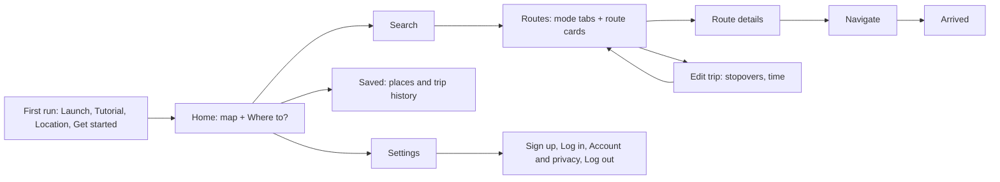

# Multimodal Router: User Flows (UI v2)

| | |
|---|---|
| **Status** | **Decided** UX, v2.1 (2026-11-17). Replaces the v1 flows of 2026-11-13. Covers the web app and the mobile app, including optional accounts and step-by-step navigation |
| **Date** | 2026-11-16 |
| **Figma** | Page [Main Wireframe Layout](https://www.figma.com/design/yi28Igc7sW9WmHXMM7GYTT/HCP-Multimodal-Router?node-id=85-5412) (the v2 wireframes): [Start here](https://www.figma.com/design/yi28Igc7sW9WmHXMM7GYTT/HCP-Multimodal-Router?node-id=85-5413) · [Kit](https://www.figma.com/design/yi28Igc7sW9WmHXMM7GYTT/HCP-Multimodal-Router?node-id=85-5414) · [Mobile app](https://www.figma.com/design/yi28Igc7sW9WmHXMM7GYTT/HCP-Multimodal-Router?node-id=85-5415) · [Web app](https://www.figma.com/design/yi28Igc7sW9WmHXMM7GYTT/HCP-Multimodal-Router?node-id=85-5416). Press ▶ Present to click through the prototype. The v1 frames are kept on the page "Wireframes v1 (archive)" |
| **Inputs** | [product-requirements.md](product-requirements.md) · [api-contract.md](api-contract.md) · [design-system.md](design-system.md) |
| **Not covered** | Visual styling (colour, final type). The wireframes are grayscale on purpose; [design-system.md](design-system.md) owns the look |

Nothing here is built yet. The current web app (`apps/web`) still has the v1 layout.

---

## 0. Decisions

### 0.1 UX decisions (v2)

| ID | Decision | Why |
|---|---|---|
| **UX-1** | **Layout.** Mobile app: full-screen map, a bottom sheet over it, and a tab bar (Plan · Saved · Settings). Web app: full-screen map, a floating 420 px panel on the left, and a top bar. | The map is always visible. One structure on both platforms. |
| **UX-2** | **Four views:** Plan → Routes → Route details → Navigate. Back (button or browser) moves one step back. | Simple mental model; no page reloads. |
| **UX-3** | User waypoints are called **"stopovers"**, never "stops". | "Stop" already means a bus stop. Validate in the first usability test. |
| **UX-4** | **Picking a destination runs the search.** There is no form to fill first. Changes on the Routes screen (mode tab, time, sort) apply straight away. Only the full trip editor (C5) has a "Find routes" button, because several fields change at once. | One main action: "Where to?". Fewer steps (≤ 3 taps from Home to routes). Replaces v1's "Find routes" + "Update routes" banner. |
| **UX-5** | **Mode tabs on the results:** Best · Transit · Bike + Transit · Bike · Walk. Each tab shows its fastest time. One tap switches the list. Transit types live in "Sort & filter". | People compare modes at a glance instead of guessing which checkboxes to tick before searching. Replaces v1's mode chips. |
| **UX-6** | **No cost anywhere**. | Prices are placeholders. |
| **UX-7** | Times in **Seattle time**; distances in **mi / ft**. | PRD PD-8, PD-11. |
| **UX-8** | The trip *request* lives in the URL on web, so links can be shared and reloaded. Guests: nothing is stored on the server. Signed-in users: only chosen trips are saved to history, and the user can pause or clear it (section 3.8). | Sharing works without keeping location history; history is opt-in by having an account, and stays under the user's control. |
| **UX-9** | **Accounts are optional (guest first; decided, PD-9).** Sign up with **email or "Continue with Google"**. An account adds synced preferences, saved places and **trip history**. Guests can do everything else. Sign-up prompts appear only where saving matters (Home/Work shortcuts, Saved, Settings, after arriving). | No one is forced to sign up, and the people who do get their places, settings and recent trips on every device. |
| **UX-10** | **Step-by-step navigation** for a chosen route, using device location and *scheduled* times. Optional alert one stop before you get off. | The PRD's "where do I get off?" problem, solved while travelling. |
| **UX-11** | **First run:** Launch → 3-step tutorial → location permission → Get started (account optional). Shown once; the tutorial can be replayed from Settings. | Teaches the three ideas (modes, stopovers, transfers) in under 30 seconds. |

### 0.2 Scope changes

All decided by the team (2026-11-17):

| Change | Decision | When (roadmap) |
|---|---|---|
| Optional accounts | Guest by default; sign-up adds preferences, saved places and trip history. Supabase sign-in and database (architecture section 16, api-contract section 17) | v1.1 backend, v1.2 web (ACC-01 to ACC-10) |
| Step-by-step navigation | Scheduled times and device location only, no real-time data | v1.1 web (NAV-01 to NAV-04), v2.0 mobile (MOB-05) |
| Mobile app | Expo app on the same API, after the web MVP | v1.2–v2.0 (MOB-01 to MOB-09) |
| Times on every mode tab | One plan request per tab until the API adds a per-mode summary (an additive change) | v1.0 |

---

## 1. App structure

| | Mobile app | Web app |
|---|---|---|
| Global navigation | Tab bar: **Plan · Saved · Settings**. Hidden during Search, Routes, details and Navigate so the map has room | Top bar: logo, Help, **Saved**, **Settings**, account menu (or **Log in** / **Sign up** for guests) |
| Trip views | Bottom sheet over the map. Three heights (peek / half / full) with Expand and Collapse buttons, so dragging is never required | Floating left panel; the map fills the rest |
| Back | Back arrow in the sheet or trip card; system back | Back link in the panel; browser Back |

---

## 2. Screens

Codes match the Figma frame names (`Mobile / D2 Routes`, `Web / D2 Routes`). Letters: **A** start, **B** account, **C** plan, **D** routes, **E** navigate, **F** saved and settings.

| Screen | Mobile | Web | Purpose |
|---|---|---|---|
| Launch / landing | A1 Launch | A1 Landing | Brand while loading (mobile); value + "Start planning" (web, first visit only) |
| Tutorial ×3 | A2–A4 | A2–A4 (modal) | Modes, stopovers, transfers. Skip any time |
| Location permission | A5 | (browser prompt on first "Use my location") | Explain before the system prompt. "Not now" keeps everything working |
| Get started | A6 | — | Create account / Log in / **Continue as guest** |
| Sign up · Log in · error · Reset · Check email | B1–B5 | B1–B5 | **Continue with Google** or email. Short forms, one action each. Sign-up says that trip history is on and can be paused |
| Home | C1 guest · C2 signed in (with **Recent trips**) | C1 Planner | Map + "Where to?" + Home/Work shortcuts; signed-in users see their 3 most recent trips |
| Search | C3 | C2 | Suggestions (King County only). Picking one shows Routes |
| Choose on map | C4 | C4 Map click menu | Mobile: move the map under a fixed pin. Web: click → menu (set as destination / start / stopover) |
| Edit trip (stopovers) | C5 | C3 | From, up to 3 stopovers (each with a stay), To, reorder, when |
| When | C6 sheet | C3 popover | Leave now / Depart at / Arrive by |
| Finding routes | D1 | D1 | Skeletons; tab times fill in |
| Routes | D2 | D2 | Mode tabs + up to 5 route cards; selected route on the map |
| Sort & filter | D3 | (same content as a popover) | Sort; transit types |
| Route details | D4 | D3 | Timeline of every step; **Start** |
| No routes | D5 | D4 | Says why and offers the next step |
| Can't load routes | D6 | D5 | Service down or offline; trip kept; Try again |
| Outside service area | D7 | (same message in search) | Place shown but disabled, with the reason |
| Navigate | E1 walk · E2 on the bus · E3 transfer · E4 at a stopover | E1 Step-by-step | One big instruction, the next step, time left |
| Arrived | E5 | E2 | Summary; "Save this place" when signed in |
| Saved places | F1 signed in · F2 guest | F3 | Home, Work, favourites. Mobile: "Places" tab of Saved |
| Trip history | F7 (the "History" tab of Saved) | F6 | Recent trips by day; tap to replan; delete one; clear all; paused state |
| Settings | F3 signed in · F6 guest | F2 | Preferences, privacy, help, log out |
| Account & privacy | F8 | F7 | Name, email, sign-in method; trip history on/off and clear; download my data; delete account; what we store |
| Delete account | F9 confirm | F8 confirm | Says what will be deleted; needs an extra confirmation step |
| Account menu | — | F1 | Saved, History, Settings, Help, Log out |
| Log out → logged out | F4 → F5 | F4 → F5 | Confirm, then back to Home as a guest with a short toast |

---

## 3. Key flows

### 3.1 First run
1. **Launch** (≤ 1.5 s) → **Tutorial** (3 cards, Next / Skip) → **Location** (Allow / Not now) → **Get started** (Create account / Log in / Continue as guest) → **Home**.
2. Returning users go straight to Home. On web, first-time visitors see the Landing page, then the tutorial as a modal over the planner.

### 3.2 Plan a trip (the main action)
1. Home → tap **Where to?**
2. Type 2+ characters → pick a suggestion. Start defaults to **Your location** when location is allowed; otherwise the From field is focused first.
3. **Routes** appear immediately with the **Best** tab selected.

Target: ≤ 3 taps and one typed query from Home to results.

### 3.3 Compare and choose
- Mode tabs show the fastest time per mode. Tabs with no route show **None**.
- Each card shows: duration → label (Fastest / Least walking / Fewest transfers) → depart–arrive → legs → transfers, walking and departure.
- Selected card = solid line on the map; others = grey previews (web: hover or focus previews a card).
- Tap a card → **Route details** → **Start**.

### 3.4 Add a stopover
Routes → **Add stopover** chip → Search ("Add a stopover") → pick → **Edit trip** opens with the stopover in place → optional **Stay** (0–4 h) → **Find routes**. Up to 3 stopovers; drag ⋮⋮ or use the up and down buttons to reorder. **Arrive by** is disabled while a stopover is set.

### 3.5 Change the time
Routes → **Leave now** chip → When sheet or popover → Depart at / Arrive by + date and time → **Done** re-runs the search. All times are Seattle time.

### 3.6 Navigate
Route details → **Start** → one step at a time: walk ("350 ft · 2 min"), ride ("3 stops · get off at U District Station"), transfer ("Wait 3 min · change to the 1 Line"), arrive. At a stopover, navigation pauses with a stay timer ("Leave by 9:17") and **Continue trip**. **End** returns to Route details.

### 3.7 Account (optional)
- **Where it starts:** Get started, the Home/Work shortcuts, Saved (guest), Settings, the web top bar, or "Save this place" after arriving. Never on the way to a route.
- **Sign up (B1):**
  - **Continue with Google** (one tap, Google's account chooser), or name + email + password (≥ 8 characters);
  - a line under the button says: "Your preferences, saved places and trip history will be saved to your account. You can pause history or delete everything at any time.";
  - afterwards the user returns to where they were, signed in. Settings chosen as a guest are kept.
- **Log in (B2):** Continue with Google, or email and password. "Forgot password?" → Reset (B4) → Check your email (B5). The reset email comes from the sign-in provider.
- **Log out:** Settings or account menu → confirm (F4) → Home as a guest, with the toast "You've logged out". Saved data stays in the account.
- **Account & privacy (F8 mobile, F7 web):**
  - shows the name, email and sign-in method (Google or email);
  - history: on/off toggle and **Clear history**;
  - **Download my data** (a JSON file);
  - **Delete account** → confirm (F9 / F8) → everything is deleted → Home as a guest.

### 3.8 Trip history (signed in)
1. **Saved automatically, but only for chosen trips:** when the user opens Route details or taps Start, and history is on. Plain searches are not saved. Nothing is saved for guests.
2. **Where it shows:**
   - Home: "Recent trips", the last 3;
   - Search: recent destinations at the top before typing;
   - Saved → **History** (mobile F7, web F6): grouped by Today, Yesterday and This week.
3. **Tap a trip** → Routes for the same trip, **leaving now** (a fresh search; old times are never reused).
4. **Manage:**
   - swipe or ⋯ → Delete;
   - **Clear history** (asks to confirm);
   - **Pause history** (Account & privacy). While paused, the History screen says "History is paused" with a **Resume** button.
5. **Retention:** trips older than 90 days are deleted automatically. The History screen says so.

---

## 4. Modes

| Tab | Routes included | API (`modes` in the plan request) |
|---|---|---|
| **Best** (default) | The best mix across everything below | `WALK`, `TRANSIT`, `BIKE` |
| **Transit** | Transit with walking to and between stops | `WALK`, `TRANSIT` |
| **Bike + Transit** | Ride your own bike to or from transit | `BIKE`, `TRANSIT`, filtered to routes that use both |
| **Bike** | Bike the whole way | `BIKE` |
| **Walk** | Walk the whole way | `WALK` |

Rules:
1. **Walking is always allowed** as a connector to and between transit.
2. **Tab times** show the fastest route in each tab, or **None** with a reason when there isn't one. They need an API addition (section 0.2).
3. **Default tab** is a setting (Settings → Default mode tab). Places are never remembered for guests.
4. **Transit types** (bus, light rail, streetcar, ferry and water taxi, commuter rail) are toggles in Sort & filter. At least one stays on.
5. **Hidden modes** (car, taxi, park & ride, bike and scooter share) don't appear at all.
6. Tabs are a `tablist` with the selected tab announced, e.g. "Transit, 24 minutes, selected".

---

## 5. Stopovers vs transfer points

| | **Stopover** (the user's) | **Transfer point** (the route's) |
|---|---|---|
| Created by | The user | The routing engine |
| Map marker | Numbered **disc** (1, 2, 3) | Small **diamond**, never numbered |
| Editable | Yes: add, reorder, set stay, remove | No |
| In the timeline | "Stopover 1 · Grocery on Broadway · Stay 15 min · leave 9:17" | "Change at U District Station · walk 250 ft · wait 3 min" |
| Counted as a transfer | No | Only transit-to-transit changes |

Other markers: start = ring, destination = square, your location = dot with a halo. Lines: walk = dotted, bike = dashed, transit = solid. Every marker and line also has a text label, so nothing relies on colour (the grayscale wireframes prove it).

API: request `waypoints[]` → response `segments[]`, `waypoint_visits[]`, `transfer_points[]` ([api-contract.md](api-contract.md)).

---

## 6. Content rules

**Route card:** duration (largest) · label tag · depart–arrive (mono) · leg pills (transit = dark pill with route name; bike = dashed pill; walk = icon + minutes) · "1 transfer · 0.3 mi walking · leaves in 3 min". No cost.

**Route details:** duration + label · times · one-line summary · **Start** · timeline (start, walk, ride with "Show N stops", transfer, stopover, arrive) · "Times are scheduled, not live" + data attributions.

**Navigation:** one instruction in large type · the next step under it · progress bar · arrival time and time left · Steps and End buttons. Times are scheduled; no live vehicle positions.

**Writing:** sentence case; plain words; say what happened and what to do next, one sentence each.

---

## 7. Loading, empty and error states

| State | Message (example) | Action | API |
|---|---|---|---|
| Finding routes | "Finding routes…" (skeletons; tab times show "…") | Back cancels | — |
| Slow (> 3 s) | "Still working…" | — | — |
| No route | "No transit at this time. Service starts again around 5:00 AM." | **Leave at 5:00 AM**, **Show bike routes** | `200` `outcome: NO_ROUTE` |
| Stopover segment fails | "We couldn't find a way from Stopover 1 to Cal Anderson Park." | Change time · Move or remove the stopover | `NO_ROUTE` (segment) |
| Outside service area | "We plan trips within King County for now." Place shown but disabled | Pick another place | `422 OUTSIDE_SERVICE_AREA` |
| Same start and end | "Start and destination are the same place." | — | `422 ORIGIN_EQUALS_DESTINATION` |
| Too many stopovers | "Up to 3 stopovers." | — | `422 TOO_MANY_WAYPOINTS` |
| Service down | "Can't load routes right now. Your trip is saved here — try again in a moment." + reference ID | **Try again** | `503 ROUTING_UNAVAILABLE` (never shown as "no routes") |
| Timeout | "That took too long. Please try again." | **Try again** | `504 ROUTING_TIMEOUT` |
| Search down | "Search isn't working right now. Choose on the map instead." | **Choose on map** | `503 GEOCODING_UNAVAILABLE` |
| Offline | "You're offline. Your trip is kept." | Retries when back online | network |
| Log-in failed | "That email and password don't match. Try again or reset your password." | Field error on Password | Supabase Auth error (not our API) |
| Google sign-in cancelled | Nothing shown; the user stays on the screen | — | Supabase Auth |
| Session expired | "Please log in again to see your saved places." | **Log in** (planning keeps working) | `401 UNAUTHENTICATED` after one token refresh |
| Account unavailable | Banner: "Your account is unavailable right now. You can keep planning trips." Saved data shown read-only from the device cache | Retries in the background | `503 ACCOUNT_SERVICE_UNAVAILABLE` |
| Too many saved places | "You can save up to 50 places. Remove one to add another." | Open Saved | `409 SAVED_PLACE_LIMIT` |
| History paused | History screen: "History is paused. New trips aren't being saved." | **Resume** | `preferences.history_enabled = false` |
| Unknown | "Something went wrong on our side." + reference ID | **Try again** | `500` + `request_id` |

Response warnings (`PARTIAL_RESULTS`, `DATA_NEAR_EXPIRY`, …) show as an info banner above the cards using the API's `message`.

---

## 8. Accounts and privacy

| | Guest (default) | Signed in |
|---|---|---|
| Plan, compare, navigate | Yes | Yes, identical |
| Preferences | This device only | Synced |
| Saved places | — | Home, Work, favourites (up to 50) |
| Trip history | — | Chosen trips; pausable; deleted after 90 days |

- **Sign-in is handled by Supabase Auth.** It holds the email and password, and handles Google sign-in and password-reset emails. Our server stores only the display name, preferences, saved places and trip history (architecture section 16).
- **Never stored, for anyone:** GPS traces, the list of searches, or plan requests. Route planning stays anonymous even when signed in.
- **The user stays in control:**
  - pause history, delete one trip, or clear all;
  - download all their data;
  - delete the account (with confirmation), which removes everything.
- Location is used only after the user allows it, to set the start and to follow progress during navigation.
- Reset password gives the same response whether or not the email exists, so it doesn't reveal accounts.
- Logging out never deletes anything. Signing up keeps the settings chosen as a guest.
- **"Continue with Google"** in the final (hi-fi) design must follow Google's sign-in branding guidelines. The wireframes use a placeholder mark.

---

## 9. Accessibility (WCAG 2.1 AA, plus 2.2's 2.4.11, 2.5.7 and 2.5.8)

- **Targets ≥ 44 × 44 px**; inputs use 16 px text; focus is always visible.
- **Nothing by colour alone:** shapes, patterns and text carry meaning.
- **No drag required:** the bottom sheet has Expand and Collapse buttons, and stopovers have up and down buttons as well as drag handles.
- **Structure:**
  - the panel or sheet is `main`, with an `h1` per view;
  - mode tabs are a `tablist`;
  - route cards are an ordered list;
  - the map is a labelled region, and everything on it is also in the text.
- **Focus:**
  - picking a suggestion moves to Routes and announces "4 routes. Fastest: 24 minutes";
  - opening details moves focus to its heading, and Back returns it to the same card;
  - dialogs trap focus, start on Cancel and close with Esc.
- **Announcements:** loading, results and toasts are polite; errors are assertive. Navigation steps are announced as they change, and the "get off next" alert uses vibration and sound as well as text.
- **Zoom and motion:** works at 200 % text and 320 px width. With reduced motion requested, the map jumps instead of flying.

---

## 10. Settled details

| Topic | What we do |
|---|---|
| Times on every mode tab | One plan request per tab until the API adds a per-mode summary |
| Sign in with Apple | Added in the iOS app if App Store rules require it alongside Google sign-in |
| History limits | 90 days and 200 trips |
| The word "Stopover" | Used everywhere; checked in usability round 1 |
| Default mode tab | Best (the mix of all modes); checked in usability round 1 |
| "Alert before my stop" | On by default |

**Acceptance checks for the designs:**
- every screen and state in sections 2, 7 has a frame;
- Home → routes takes ≤ 3 taps;
- markers and lines can be told apart in grayscale;
- the core flow works by keyboard and screen reader;
- no cost appears anywhere;
- no interaction needs dragging.
