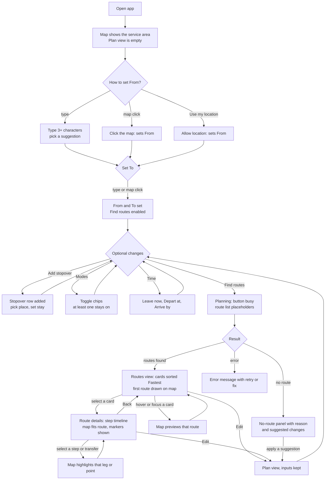
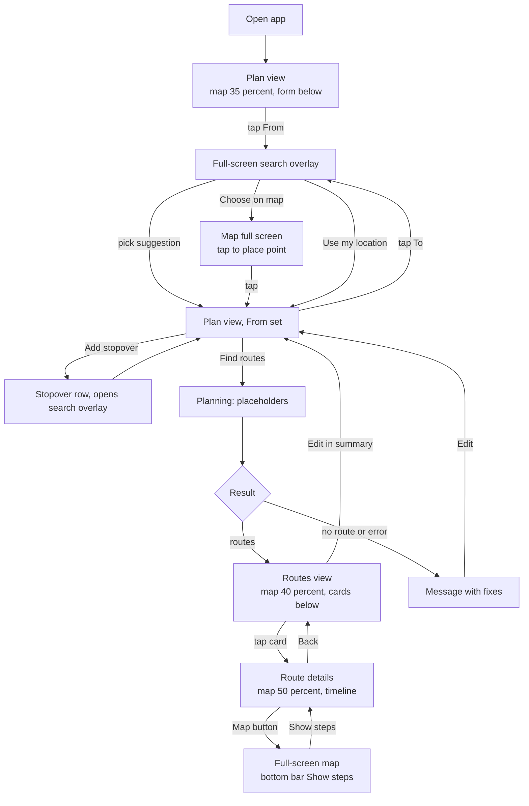
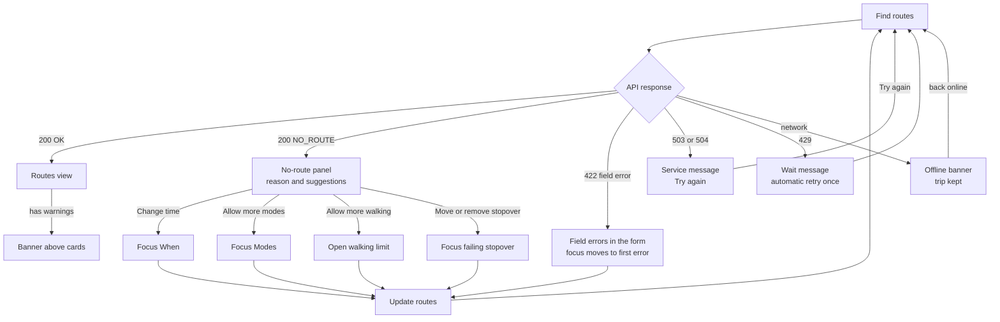
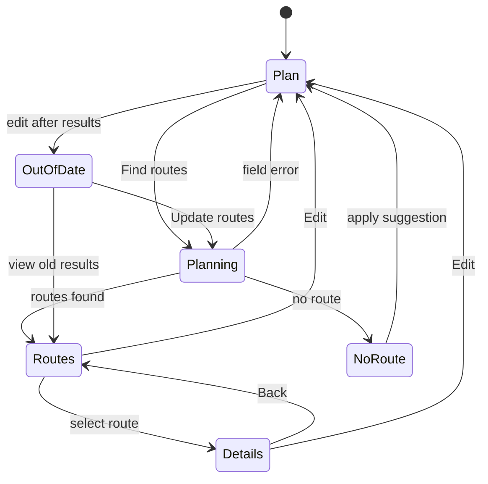

# Multimodal Router: User Flows and Figma Design Brief

| | |
|---|---|
| **Status** | UX proposal, pending team review. **No Figma file or frontend code was changed** |
| **Date** | 2026-11-13 |
| **Inputs** | [product-requirements.md](product-requirements.md) · [architecture.md](architecture.md) · [api-contract.md](api-contract.md) · [routing-engine.md](routing-engine.md) · [data-sources.md](data-sources.md) · current web app (`apps/web`, commit `de33c1f`) |
| **Scope** | Structure, flows, states, interactions and accessibility. Visual styling is out of scope: the existing "Swiss transit-signage" system (3 colours, modes told apart by pattern and label, 4 px grid, 64 px label column) stays the visual baseline |

### Reading guide

| Label | Meaning |
|---|---|
| **Exists** | In the current web app (e.g. place-search combobox, mode checkboxes, results list, leg list, click-to-set map) |
| **Change** | Exists but needs to be modified to meet the PRD |
| **New** | Doesn't exist yet |

**Other conventions:**
- Requirement IDs: FR-… and US-… refer to the PRD; API names (`outcome`, `transfer_points`, error codes) refer to the API contract.
- Screen and state IDs: `S-xx` = state, `D-xx` = desktop frame, `M-xx` = mobile frame.
- Every Mermaid diagram was checked with the Mermaid parser.

---

## 0. UX decisions for review

| ID | Decision | Proposal | Why | Alternative |
|---|---|---|---|---|
| **UX-1** | Layout | **Desktop (≥ 900 px):** a fixed side panel on the left (the current 448 px), with the map filling the rest. **Mobile (< 900 px):** the map stacked above the panel; the map's height **changes with the step** (smaller for planning, taller for route details), and a **full-screen map** toggle is available | Keeps the map in view throughout. The current breakpoint (900 px) and stacked layout already exist. Discrete heights need no drag gestures, which helps accessibility (WCAG 2.5.7) and is simpler for a student team | Draggable bottom sheet as on Google or Apple Maps, as a later enhancement on top of the same states |
| **UX-2** | One screen, three panel views | **Plan → Routes → Route details**, as panel views over one persistent map. The browser Back button moves between them | No context lost; the map never reloads; deep links possible | Separate pages |
| **UX-3** | Name for user waypoints | **"Stopover"** in the interface ("Add stopover", "Stopover 1"). Never "stop" | In a transit app, "stop" already means *bus stop*. "Stopover" can't be confused with the system's transfer points. **Validate in the first usability test** | "Add stop" (PRD wording); "Via" |
| **UX-4** | Running a search | An explicit **"Find routes"** button. Once routes are showing, edits put up a **"Trip changed — Update routes"** banner instead of re-searching automatically. **Sorting is instant** (done in the browser) | Predictable; no surprise reloads; fewer API calls during multi-field edits | Search automatically on every change |
| **UX-5** | Comparing routes | A list of up to 5 **route cards** sharing one structure. Only the selected route is drawn on the map; hovering or focusing a card previews it | Little clutter; easy to compare | Draw every route at once |
| **UX-6** | Cost | **No cost anywhere** in the MVP UI. The current cost/time slider is replaced by a **Sort** control | PRD PD-1; prices are placeholders | Show estimates |
| **UX-7** | Time and units | Times always in **Seattle time**, labelled when the device is in another timezone. Distances in **mi / ft** | PRD PD-8, PD-11 | — |
| **UX-8** | Saving trips | The trip **request** is kept in the URL, so links can be shared and reloaded. **Nothing about places is saved to device storage**; only mode preferences may be remembered | Return-to-edit and sharing work (FR-RES-9) without storing location history (PD-9) | Save the last trip on the device |

---

## 1. Information architecture

### 1.1 Structure

```mermaid
flowchart TB
  app["Multimodal Router: single page"]
  app --> shell["App shell"]
  app --> mapArea["Map area, always present"]
  app --> panel["Panel: one view at a time"]

  shell --> header["Header: product name, About and data"]
  shell --> banners["Status banners: offline, service degraded, data notice"]

  mapArea --> layers["Layers: service-area outline, selected route, preview route"]
  mapArea --> markers["Markers: From, To, numbered stopovers, transfer points, intermediate stops"]
  mapArea --> mapCtl["Controls: zoom, my location, full-screen map on mobile, legend"]
  mapArea --> chooser["Map click chooser: From, To, Add stopover"]

  panel --> plan["View 1 Plan"]
  panel --> routes["View 2 Routes"]
  panel --> details["View 3 Route details"]

  plan --> fields["From, stopovers, To, swap"]
  plan --> modes["Mode chips and transit options"]
  plan --> time["Time: Leave now, Depart at, Arrive by"]
  plan --> cta["Find routes"]

  routes --> summary["Trip summary bar with Edit"]
  routes --> sort["Sort control"]
  routes --> cards["Route cards, up to 5"]
  routes --> warn["Result warnings and data notice"]

  details --> dsummary["Trip summary bar with Edit"]
  details --> header2["Route header: duration, times, labels"]
  details --> timeline["Step timeline: legs, transfers, stopover visits"]
  details --> notice["Scheduled-times notice and attributions"]

  header --> about["About and data sources panel"]
```



### 1.2 Objects the user works with

| Object | What the user sees | API source |
|---|---|---|
| **Trip** | From, To, 0–3 stopovers (each with an optional stay), modes, time | `PlanRequest` |
| **Route** (itinerary) | One option: duration, depart–arrive, mode strip, transfers, walking, labels | `itineraries[]` |
| **Step** | A leg (walk, ride, bike) shown as a row in the timeline | `legs[]` |
| **Stopover** (user-created) | A numbered place the user must visit, with an optional stay | Request `waypoints[]` → response `waypoint_visits[]`, `segments[]` |
| **Transfer point** (system-created) | Where to board, get off, change vehicles or park a bike. Read-only | `transfer_points[]` |

### 1.3 URL state (UX-8)

| View | URL (illustrative) | Behaviour on load |
|---|---|---|
| Plan | `/` or `/?from=…&to=…` | Fields pre-filled; no search |
| Routes | `/?from=47.65332,-122.30584~UW&to=…&via=…,15&modes=WALK,TRANSIT&t=DEPART_AT~2026-11-20T08:30-08:00&view=routes` | Runs the search again and shows the results |
| Route details | `…&view=details&sel=2` | Runs the search again; opens route 2 if it still exists, otherwise falls back to Routes with "Routes have changed since this link was made" |

Itinerary IDs only live for one response (api-contract §2.6). The URL therefore stores the **request**, never IDs.

---

## 2. Desktop journey (≥ 900 px)

### 2.1 Layout

| Region | Desktop | Notes |
|---|---|---|
| Panel | Left, 448 px (current); min 384 px at 1024 px width | Scrolls on its own. A summary bar sticks at the top in the Routes and Route details views |
| Map | The rest of the width | Never covered by modals. Popovers (map chooser) are anchored to the clicked point |
| Header | Top of the panel: product name, "About & data" link | Small; not a separate bar |
| Banners | Top of the panel (offline, service status); data notice at the bottom of the results | Shown only when needed |

### 2.2 Core flow



### 2.3 Step by step

| # | User step | Panel | Map | Status vs. today |
|---|---|---|---|---|
| 1 | Opens the app | Plan view: From and To empty, default modes (from `/transport/modes` → Walk + Transit), "Leave now" | Framed on the service area with its **outline**; hint "Click the map or search to set your start" | Map + hint **exist**; outline **new** |
| 2 | Sets From | Combobox suggestions after 3 characters (250 ms debounce); or "Use my location" | Origin marker | **Exists** |
| 3 | Sets To | Same | Destination marker; map fits both | **Exists** |
| 4 | *(optional)* Adds a stopover | "+ Add stopover" between From and To: a new row with a place field and a "Stay" selector | Numbered marker "1" | **New** |
| 5 | Chooses modes | Chips: **Transit**, **Walk**, **Bike**; "Transit options" disclosure | — | **Change** (6 checkboxes today) |
| 6 | *(optional)* Sets the time | Leave now / Depart at / Arrive by + date and time (Seattle time) | — | **Change** (adds "Leave now", the label and the stopover rule) |
| 7 | Finds routes | The button shows a busy state; the list area shows 3 placeholder cards | Previous route cleared | **Change** |
| 8 | Compares | Summary bar + Sort + route cards | Route 1 drawn; hover or focus previews others | **Change** (sort, preview, no cost) |
| 9 | Selects a route | Route details view | Map fits the route; transfer markers appear | **Change** (separate view; transfer markers **new**) |
| 10 | Inspects | Timeline with segments, legs, transfers, stopover visits; transit legs expand to show stops | The selected step is highlighted | **Change / New** (intermediate stops, transfers, segments) |

---

## 3. Mobile journey (< 900 px)

### 3.1 Layout: stacked map with step-based heights (UX-1)

| View | Map height | Panel | Notes |
|---|---|---|---|
| Plan | 35% of viewport height | Form below | The map is mainly for picking points |
| Place search (focused field) | Hidden | **Full-screen search overlay**: input at the top, suggestions below, "Use my location", "Choose on map" | Stops the on-screen keyboard from covering suggestions |
| Choose on map | 100% | Floating bar: "Tap the map to set To · Cancel" | Returns to Plan after a tap |
| Routes | 40% | Summary bar + sort + cards | Current default height is 40% |
| Route details | 50% | Timeline | Selecting a step scrolls the map to it |
| Full-screen map (toggle) | 100% | Collapsed into a bottom bar: "Route 1 · 21 min · Show steps" | A button (no drag needed) toggles it |

The stacked layout and the 900 px breakpoint already **exist**. The step-based heights, search overlay, choose-on-map mode and full-screen toggle are **new**.

### 3.2 Core flow



### 3.3 Mobile-specific rules

| Area | Rule |
|---|---|
| Touch targets | ≥ 44 × 44 px (PRD RESP-1). Chips, step rows and buttons are full-width tap areas |
| Map gestures | Map gestures never conflict with page scrolling: the stacked map is sticky, and scrolling happens in the panel |
| Gestures are optional | No gesture is the *only* way to do something. Pinch, drag and swipe all have button alternatives (zoom buttons, "Move up/down" for stopovers, the Map/Steps toggle) |
| Landscape | Phone landscape (< 900 px wide, short height) uses the stacked layout with the map limited to 45% of viewport height |

---

## 4. Screen and state inventory

Every state needs a designed frame or a documented variant (§13.2 lists the frames).

### 4.1 App level

| ID | State | Trigger | What the user sees | Exit |
|---|---|---|---|---|
| S-01 | Starting up | First load: `/service-info` and `/transport/modes` pending | Plan form with placeholders; the map loads on its own | Data loaded → S-10 |
| S-02 | Settings failed to load | Those requests fail after automatic retries | Inline message "Couldn't load trip options. Retry"; map still usable; Find routes disabled | Retry |
| S-03 | Service degraded | `/health` reports `DEGRADED` or `DOWN` (checked on load) | Banner "Route planning may be unavailable right now" | Dismiss; health recovers |
| S-04 | Offline | Browser reports offline | Banner "You're offline. Changes are kept"; Find routes disabled | Back online |
| S-05 | Map tiles failed | Tile errors | Plain background with routes and markers; note "Map background unavailable" (FR-ERR-3) | Tiles recover |
| S-06 | Opened from a shared link | URL contains a trip | Fields filled; search runs automatically (S-30) | Results, or S-07 |
| S-07 | Shared link invalid | Bad parameters, or a point outside the area | Plan view with "This link couldn't be fully loaded" + the fields that did load | Edit |

### 4.2 Plan view

| ID | State | Trigger | What the user sees |
|---|---|---|---|
| S-10 | Empty | First visit | From, To empty; default modes; Leave now; Find routes disabled with "Choose a start point to continue" (exists) |
| S-11 | Searching a place | ≥ 3 characters typed | Suggestion list (≤ 5), keyboard navigable (exists); each shows name + area label (`PlaceResult.label`) |
| S-12 | No matches | Empty `results` | "No places found in King County. Try another name or choose on the map" |
| S-13 | Search unavailable | `503 GEOCODING_UNAVAILABLE` | "Search isn't working right now. Choose on the map instead" + Choose on map |
| S-14 | Locating / location denied | "Use my location" | "Locating…" then From is set; denied → "Location access was blocked. Search or choose on the map" |
| S-15 | From set, To empty | — | Map hint "Click the map to set To"; button hint "Choose a destination to continue" |
| S-16 | Map chooser | Map click while From and To are both set | Popover at the point: **Set as From · Set as To · Add stopover** (disabled when at the limit) · place name once known (reverse geocode) |
| S-17 | Point outside the area | The point fails the service-area check (client-side using `service_area.boundary`; server `422 OUTSIDE_SERVICE_AREA`) | Field error "Outside the area we cover (King County)"; the outline is emphasised; Find routes disabled |
| S-18 | Same place | From and To < 50 m apart | "Start and destination are the same place" |
| S-19 | Ready | Valid From and To; ≥ 1 mode | Find routes enabled |
| S-20 | Stopover added | "+ Add stopover" | Row "Stopover 1" with place field, Stay selector, move up/down, remove; map marker "1" |
| S-21 | Stopover limit | Count = `limits.max_waypoints` | "Add stopover" disabled; helper "Up to 3 stopovers" (or 1 if configured) |
| S-22 | Arrive by with stopovers | Arrive by chosen while stopovers exist, or the reverse | "Arrive by" is disabled with the helper "Arrive by isn't available for trips with stopovers yet" (`features.arrive_by_with_waypoints = false`) |
| S-23 | Stopover too close | < 50 m from a neighbouring point | Field error "Too close to the previous point" |
| S-24 | No mode selected | Every chip off | "Choose at least one way to travel"; Find routes disabled (US-5) |
| S-25 | Time warnings | Past time / outside the schedule window | Past: inline note "This time has passed. Leave now instead?" (search still allowed). Outside the window: error "Schedules are available until 14 Feb 2027" (`limits.departure_window`) |
| S-26 | Transit options open | "Transit options" disclosure | Bus, Light rail, Streetcar, Commuter rail, Ferry checkboxes (enabled submodes only); at least one stays on |

### 4.3 Planning, results and route details

| ID | State | Trigger | What the user sees |
|---|---|---|---|
| S-30 | Planning | Find routes | Button "Finding routes…" (busy, not disabled for screen readers); 3 placeholder cards; announced "Finding routes" |
| S-31 | Planning is slow | > 3 s | Extra line "Still working. Trips with stopovers take a little longer" |
| S-32 | Request replaced | Find routes again, or an edit + Update | The previous request is cancelled silently; only the newest result is shown (FR-ERR-4) |
| S-40 | Routes | `outcome: OK` | Summary bar, Sort, 1–5 cards, data notice; first card selected and drawn; "3 routes found" announced |
| S-41 | Single route | 1 itinerary | Same view; Sort hidden |
| S-42 | Routes with warnings | `warnings[]` at the response level | Banner above the cards, one line per warning (§10.3) |
| S-43 | Routes out of date | Any edit after results | Banner "Trip changed — Update routes" with a button; cards dimmed (still readable); the map keeps the old route |
| S-44 | Sorted | Sort changed | Cards reorder in place; labels unchanged; focus stays on the Sort control |
| S-45 | Preview | Hover or keyboard focus on a card | The map draws that route lightly over the selected one |
| S-50 | No route | `outcome: NO_ROUTE` | No-route panel: `no_route.message` + suggestion buttons (§10.2) |
| S-51 | No route: stopover leg failed | `failed_segment_index` set | The panel names the failing part ("UW → Stopover 1"), and those rows are highlighted in the Plan summary |
| S-52 | No route: limits too strict | `reason: ALL_EXCLUDED_BY_CONSTRAINTS` | "Every route found needs more walking than your limit" + "Allow more walking" |
| S-53–S-59 | Errors | 422 / 503 / 504 / 429 / 500 / network | §10.4 |
| S-60 | Route details | Card selected | Header + timeline; the map fits the route; transfer and stopover markers |
| S-61 | Stops listed | "N stops" expanded on a transit step | Intermediate stops with times; small dots on the map for that leg |
| S-62 | Transfer focused | A transfer row (or its marker) is selected | The map centres on the point; the row is highlighted; marker ↔ row are linked |
| S-63 | Stopover visit focused | A stopover visit row (or its marker) is selected | Same, for the stopover |
| S-64 | Approximate line | `GEOMETRY_APPROXIMATE` on a leg | That leg is drawn as a straight dashed line; the step shows "Route line approximate" |
| S-65 | Route warnings | Itinerary-level `warnings[]` | Inline flags on the card and step: "Tight connection (2 min)", "Long wait (24 min)", "Long trip", "Starts 600 ft from your pin" |

### 4.4 Other

| ID | State | Contents |
|---|---|---|
| S-70 | About and data sources | What the app does; "Times are scheduled, not live"; data date; required attributions (King County legend, OpenStreetMap / ODbL, OpenFreeMap, Sound Transit terms link); privacy note (what goes to the geocoder and tile server, PRD PRIV-3) |
| S-71 | Map legend | Explains the marker shapes and line patterns |
| S-72 | Full-screen map (mobile) | Map 100%; bottom bar showing the selected route |

---

## 5. Components needed on each screen

| Screen / view | Components (✱ = new) |
|---|---|
| **App shell** | `AppHeader`, `StatusBanner` ✱ (offline, degraded), `AboutPanel` ✱, `Attribution` (MapLibre: exists; data attributions ✱) |
| **Map (all views)** | `MapCanvas` (exists), `ServiceAreaOutline` ✱, `RouteLayer` (exists), `PreviewRouteLayer` ✱, `Marker`: Origin / Destination (exist), Stopover ✱, Transfer ✱, IntermediateStop ✱; `MapControls` (zoom exists; locate ✱, full-screen ✱), `MapChooserPopover` ✱, `MapLegend` ✱, `MapHint` (exists) |
| **Plan view** | `PlaceInput` combobox (exists) + `SuggestionList` (exists) + `UseMyLocation` (exists) + `ChooseOnMap` ✱; `StopoverRow` ✱ (place input, `StaySelect` ✱, `ReorderButtons` ✱, `RemoveButton` ✱); `AddStopoverButton` ✱; `SwapButton` ✱; `ModeChipGroup` ✱ (replaces the checkboxes); `TransitOptions` ✱; `TimeControl` (change); `PrimaryButton` (exists); `FieldError` ✱; `FormHint` (exists) |
| **Mobile place search** | `SearchOverlay` ✱ (full-screen version of `PlaceInput` + suggestions + locate + choose on map) |
| **Planning** | `PrimaryButton` busy state (exists); `RouteCardSkeleton` ✱; `LiveRegion` (exists as `aria-live` on results) |
| **Routes view** | `TripSummaryBar` ✱; `SortControl` ✱ (replaces `CostTimeSlider`); `RouteCard` (change of `RouteRow`); `ModeStrip` (exists as `TripStrip`); `LabelTag` ✱; `WarningBanner` ✱; `OutOfDateBanner` ✱; `DataNotice` ✱ |
| **No route / error** | `NoRoutePanel` ✱ (+ `SuggestionButton`), `ErrorPanel` ✱ (+ retry countdown, reference ID) |
| **Route details** | `TripSummaryBar` ✱; `BackButton` ✱; `RouteHeader` ✱; `SegmentHeader` ✱; `StepTimeline` (change of `LegList`); `LegRow` (walk / bike / transit); `TransitBadge` ✱; `StopsDisclosure` + `IntermediateStopList` ✱; `TransferRow` ✱; `StopoverVisitRow` ✱; `InlineFlag` ✱; `DataNotice` ✱ |

---

## 6. Route-planning form interactions

### 6.1 Field order and layout

```
From        [ Paul G. Allen Center, UW            ]  Use my location
            + Add stopover
Stopover 1  [ Grocery on Broadway                 ]  Stay [15 min ▾]  ↑ ↓ ✕
            + Add stopover
To          [ Cal Anderson Park                   ]  ⇅ Swap
Modes       (Transit ✓) (Walk ✓) (Bike)     Transit options ▾
When        (• Leave now) ( Depart at ) ( Arrive by )   [date] [time]  Seattle time
            [ Find routes → ]
```

The current 64 px label column holds "From", "Stopover 1", "To", "Modes" and "When".

### 6.2 Behaviour

| Element | Interaction | Validation and feedback |
|---|---|---|
| **Place field** (From, To, Stopover n) | Type ≥ 3 characters → suggestions after 250 ms. ↑/↓ move, Enter picks, Esc closes (exists). Picking sets the point and moves focus to the next empty field. Editing the text clears the point until a new one is picked (exists) | The service-area check runs **on pick**, against `service_area.boundary`; error inline (S-17) |
| **Use my location** | Only on explicit tap (PRIV-2). Shows "Locating…"; on success fills From with "Current location" | Denied → S-14. Outside the area → S-17 |
| **Choose on map** | Desktop: map clicks set the next empty field (exists for From and To), or open the chooser when both are set (S-16). Mobile: a full-screen pick mode | The reverse-geocoded name replaces "Dropped pin" when it arrives (FR-LOC-4) |
| **Swap** (⇅) | Swaps From and To. Stopovers keep their order but are **reversed** so the trip still makes sense (1, 2 → 2, 1). Announced | — |
| **Add stopover** | Inserts a row at the chosen position: "+ Add stopover" links sit between rows. The new field gets focus. The marker number appears | Disabled at the limit (S-21) or while Arrive by is selected (S-22), with the reason shown |
| **Stay** | Select: 0 (default, "No stop"), 5, 10, 15, 20, 30, 45 min, 1 h, 1.5 h, 2 h, 3 h, 4 h | Maps to `dwell_minutes` (0–240) |
| **Reorder** | ↑/↓ buttons on each stopover row (keyboard and screen-reader friendly); drag handle as an extra on pointer devices; marker numbers update | Announced: "Stopover moved to position 2 of 3" |
| **Remove** (✕) | Removes the row and marker; focus moves to the next row's field, or to "Add stopover" | Undo isn't needed (re-adding is cheap) |
| **Modes** | §7 | ≥ 1 mode (S-24) |
| **When** | Segmented: Leave now (default) / Depart at / Arrive by. Picking Depart at or Arrive by reveals date and time inputs pre-filled with now (rounded up to the next 5 min). The label always reads "Seattle time"; when the device timezone differs, it reads "Seattle time (your device is on Eastern time)" | Past → note (S-25). Outside `departure_window` → error. Arrive by + stopovers → S-22 |
| **Find routes** | Enabled when valid. Enter in the last field submits. After results, the label becomes **"Update routes"** while the trip has unsaved changes | Hint below lists what's missing (exists: "Choose a destination to continue") |

### 6.3 Error message principles

1. Say **what** happened and **what to do**, in one sentence each.
2. Put errors **next to the field**, linked to it (`aria-describedby`). The summary at the button repeats them.
3. Every API error code maps to exactly one message (§10.4). Unknown codes fall back to the API's `detail`.

---

## 7. Mode selection

### 7.1 Model

| Chip | Meaning (API `Mode`) | Default | Notes |
|---|---|---|---|
| **Transit** | `TRANSIT` | On | "Transit options" opens submode checkboxes (Bus, Light rail, Streetcar, Commuter rail, Ferry) → `transit_submodes_excluded` (FR-MODE-4, Should) |
| **Walk** | `WALK`: allows **walk-only routes** | On | When off, the chip shows the second line "connections only", because walking to and between stops is always included (FR-MODE-2, `connector_only_when_unselected`) |
| **Bike** | `BIKE`: **your own bike** | Off | Helper when on: "Ride the whole way, or ride to a station and park." Bikes on board are future |
| *Bike share*, *Scooter share* | `BIKE_SHARE`, `SCOOTER_SHARE` | Hidden | Shown only when `/transport/modes` reports `enabled: true` (disabled in the MVP; data-sources §10) |
| *Car*, *Taxi* | — | Hidden | Not offered in the MVP (FR-MODE-7). Disabled modes are **hidden, not greyed out**, to keep clutter down |

### 7.2 Rules

1. **The chips come from `/transport/modes`.** Labels, order and defaults follow `defaults`. The UI never hard-codes which modes exist.
2. **No mode selected:** search is disabled with the message (S-24). The last chip can still be turned off, so the UI never traps a toggle.
3. **Excluding every transit submode** isn't possible: the last checked box stays on and shows a hint.
4. **Changes after results** trigger the out-of-date banner (S-43). Nothing re-runs automatically.
5. **A mode disappearing** (`422 UNSUPPORTED_MODE`, e.g. a mode switched off on the server): refresh `/transport/modes`, deselect that mode, and show "Bike share isn't available right now".
6. **Remembering** the chip selection on the device is a Could (FR-MODE-8). Places are never remembered (UX-8).
7. **Accessibility:** chips are toggle buttons (`aria-pressed`) in a labelled group "Ways to travel". Their state shows as text or icon as well as colour.

---

## 8. Stopovers (user) vs. transfer points (system)

### 8.1 Visual and interaction language

| | **Stopover** (user-defined) | **Transfer point** (route-generated) |
|---|---|---|
| Name in the interface | "Stopover 1", "Stopover 2" | "Board", "Get off", "Change", "Park bike", "Pick up" / "Drop off" |
| Created by | The user, in the form or the map chooser | The route; it appears only after a route is chosen |
| Map marker (shape first, so it works in greyscale) | **Large numbered disc** "1", "2", "3", with the same weight as the From and To markers | **Small diamond.** A centre glyph varies by `kind`: ⇄ change; ↑ board / ↓ get off as a half-filled diamond; "P" park bike |
| Visible in | Plan, Routes and Route details | Route details only (plus the selected route on the map in the Routes view, at reduced size) |
| Editable | Yes: move, reorder, change the stay, remove | No. It is information |
| Timeline row | **Full-width row with a heading:** "Stopover 1 · Grocery on Broadway" / "Arrive 8:52 · Stay 15 min · Leave 9:07". It ends one segment heading and starts the next | **Compact row between legs:** "Change at Capitol Hill Station · 1 Line → 49 · walk 350 ft (2 min) · wait 6 min", plus a "Tight connection" flag when relevant |
| Counted as a transfer | No | Only "Change" (transit → transit) |
| When both are at the same place | It shows as the **stopover** only (PRD WAY-6) | Not shown |
| Legend wording | "Your stopovers" | "Where you board, change or get off" |

### 8.2 Segments

With stopovers, the timeline is split into segments with clear headings:

```
① UW → Stopover 1                    8:30 – 8:52
   Walk 12 min · 0.6 mi
   ◇ Board at University of Washington Station · wait 3 min
   1 Line · Light rail · toward Southbound · 3 min · no stops in between
   ◇ Get off at Capitol Hill Station
   Walk 4 min · 0.2 mi
● Stopover 1 · Grocery on Broadway   Arrive 8:52 · Stay 15 min · Leave 9:07
② Stopover 1 → Cal Anderson Park     9:07 – 9:15
   Walk 8 min · 0.4 mi
■ Arrive Cal Anderson Park           9:15
```

The source data is the `segments[]`, `legs[]`, `transfer_points[]` and `waypoint_visits[]` in the waypoint example of the API contract.

---

## 9. Comparing and selecting routes

### 9.1 Route card: content hierarchy

| Level | Content | Source |
|---|---|---|
| 1 (largest) | **Duration** ("21 min" / "1:05 h") | `duration_seconds` |
| 1 | **Label tags**: "Fastest", "Fewest transfers", "Least walking" (text tags; one card may have several) | `labels[]` |
| 2 | **Depart – arrive** ("8:30 – 8:51 AM") | `departure_time`, `arrival_time` |
| 2 | **Mode strip**: segments sized by time, told apart by pattern and short label ("WALK", "1 LINE", "49"); waits shown as gaps | `legs[]` (exists as `TripStrip`) |
| 3 | **Facts line**: "0 transfers · 0.8 mi walk", plus "1 stopover" when present | `transfers`, `walking_distance_meters` |
| 3 | **Flags**: "Tight connection" / "Long wait" / "Line approximate" | Itinerary `warnings[]` |
| — | *Not shown in the MVP:* cost (PD-1), CO₂ | — |

### 9.2 Comparing

- **One structure everywhere.** Every card has the same layout, so the eye scans down columns: duration, then times, then strip.
- **Sort** is a segmented control, "Sort: Fastest | Fewest transfers | Least walking". It reorders client-side (FR-RES-3), and the choice is sent as `optimize` on the next search.
- **Labels never move** when sorting; they describe the route, not its position.
- **Up to 5 genuinely different routes** (PD-7). Fewer are shown when fewer exist. There are no "show more" placeholders.
- **Map sync:**
  - the selected card is drawn **solid**;
  - hovering or focusing another card draws it as a **lighter preview**;
  - leaving the card removes the preview.
- **Selecting a card:**
  - **desktop:** opens Route details in the panel;
  - **mobile:** opens Route details with the map at 50%;
  - the selected card stays highlighted when the user returns.
- **Out of date** (S-43): the cards stay visible but dimmed, so the old results can still be compared while the user decides whether to update.

### 9.3 Route details: content hierarchy

1. **Back to routes**; trip summary bar.
2. **Route header:** duration, depart–arrive, labels, facts line.
3. **Timeline:**
   - start row;
   - segment headings (with stopovers);
   - leg rows;
   - transfer rows;
   - stopover visit rows;
   - arrive row.
4. **On transit legs:** route badge, submode, headsign ("toward …"), agency, board and alight stops with times, "**N stops**" expander (FR-ITIN-2/3).
5. **Data notice:** "Scheduled times, not live · Data from 9 Nov 2026", plus attributions (FR-RES-6, MAP-8).

---

## 10. Loading, empty, error and no-route states

### 10.1 Loading

| State | Panel | Map | Screen reader |
|---|---|---|---|
| App starting (S-01) | Form placeholders | Map loads on its own | — |
| Planning (S-30) | Button "Finding routes…"; 3 card placeholders | Old route removed; markers kept | Polite: "Finding routes" |
| Slow (S-31, > 3 s) | Extra line under the placeholders | — | Polite (once): "Still working" |
| Very slow (> 15 s) | "This is taking longer than usual" + **Cancel** | — | Polite |

### 10.2 Empty and no-route

| State | Message (example) | Actions |
|---|---|---|
| Empty plan (S-10) | "Where are you going? Search, use your location, or click the map." | — |
| No route (S-50), reason `NO_PATH_FOUND` | API `no_route.message`, e.g. "No route from Paul G. Allen Center, UW to Cal Anderson Park using Transit at 2:40 AM." | One button per suggestion: **Change time** (focuses When), **Allow more ways to travel** (focuses Modes), **Allow more walking** (opens the walking limit), **Move or remove a stopover** (focuses the failing row) |
| Stopover leg failed (S-51) | "We couldn't find a way from Stopover 1 to Cal Anderson Park." | The same suggestions; that segment is highlighted in the summary |
| Limits too strict (S-52) | "Routes exist, but all need more than 1.2 mi of walking." | **Allow more walking** |
| Only walking (warning `ONLY_WALKING_AVAILABLE`) | Shown as a result: "Walking is your best option for this trip." | — |

### 10.3 Response warnings (banner above the cards)

| Code | Banner text | Severity |
|---|---|---|
| `PARTIAL_RESULTS` | "Some options couldn't be checked. There may be more routes." + Retry | Warning |
| `DEPARTURE_IN_PAST` | "That time has passed. Showing routes for the time you chose." + Use now | Info |
| `RESULTS_LIMITED_BY_CONSTRAINTS` | "Some routes were hidden by your walking or transfer limits." + Adjust | Info |
| `SHARED_MOBILITY_UNAVAILABLE` | "Bike and scooter share availability is unavailable right now." | Warning |
| `DATA_NEAR_EXPIRY` | "Schedules are being updated. Times after 26 Mar may change." | Info |
| `DEVELOPMENT_ROUTER` | "Test data: routes are not real." (never in production) | Warning |
| Unknown code | The API's `message` | Info |

### 10.4 Errors (one message per API code)

| API | Message | Recovery | Placement |
|---|---|---|---|
| `422 INVALID_COORDINATES` | "That location isn't valid. Pick it again." | Clears the field | At the field |
| `422 OUTSIDE_SERVICE_AREA` | "Outside the area we cover (King County)." | Outline emphasised | At the field |
| `422 ORIGIN_EQUALS_DESTINATION` | "Start and destination are the same place." | — | At To |
| `422 WAYPOINT_TOO_CLOSE` / `TOO_MANY_WAYPOINTS` | "Too close to the previous point." / "Up to 3 stopovers." | — | At the row |
| `422 UNSUPPORTED_MODE` | "Bike share isn't available right now." | Mode list refreshed | At Modes |
| `422 TIME_OUTSIDE_SERVICE_WINDOW` | "Schedules are available until 14 Feb 2027." | — | At When |
| `422 ARRIVE_BY_WITH_WAYPOINTS` | (prevented in the UI; S-22) | — | At When |
| `503 ROUTING_UNAVAILABLE` | "Route planning is temporarily unavailable." | **Try again** (counts down `Retry-After`) | Panel |
| `504 ROUTING_TIMEOUT` | "That took too long. Please try again." | **Try again** | Panel |
| `429 RATE_LIMITED` | "Too many requests. Wait a moment." | Automatic retry after `Retry-After` (once) | Panel |
| `503 GEOCODING_UNAVAILABLE` | "Search isn't working right now. Choose on the map instead." | **Choose on map** | Under the field |
| `500` / unknown | "Something went wrong on our side." + "Reference: 9f1c3e6b" (`request_id`) | **Try again** | Panel |
| Network / offline | "You're offline. Your trip is kept." | Retries automatically when back online | Banner |

### 10.5 Recovery flow



---

## 11. Keyboard and screen-reader considerations

These target WCAG 2.1 AA (PRD ACC-1). The doc also recommends meeting these WCAG 2.2 AA criteria, which matter for map apps:
- **2.4.11 Focus Not Obscured:** the sticky map and banners must not hide the focused field.
- **2.5.7 Dragging Movements:** every drag has a button alternative.
- **2.5.8 Target Size (Minimum).**

### 11.1 Structure and landmarks

| Region | Semantics |
|---|---|
| Header | `banner` with product name; "About & data" link |
| Panel | `main` containing the current view's heading (`h1`: "Plan a trip" / "Routes" / "Route details") |
| Trip form | `form` labelled "Plan a trip"; stopovers as a list (`ol`) labelled "Stopovers" |
| Modes | `group` labelled "Ways to travel"; chips are toggle buttons (`aria-pressed`) |
| Results | Region with `aria-live="polite"` and `aria-busy` while loading (exists); cards in an ordered list |
| Map | `region` labelled "Route map" (exists). **Not essential:** everything shown on the map is also in the panel (US-22) |

### 11.2 Focus order and keyboard

| Situation | Behaviour |
|---|---|
| Page load | Focus starts on the "Skip to trip form" link, then From |
| Picking a suggestion | Focus moves to the next empty place field, or to Find routes when all are set |
| Results arrive | Focus stays on the button; the live region announces "3 routes found. Fastest: 21 minutes." The user moves into the list with Tab |
| Selecting a card (Enter or Space) | Route details opens; focus moves to its `h1`. **Back** returns focus to the same card |
| Edit (summary bar) | Plan opens with focus on the field that was clicked |
| Errors | Field errors: focus moves to the first invalid field after submit. Panel errors use `role="alert"` |
| Map | MapLibre keyboard controls (arrow keys pan, +/− zoom) work once the map is focused. Markers can't be reached by Tab; their rows in the panel are the way in, and selecting a row centres the map |
| Map chooser popover | Opened with the pointer. The keyboard equivalent is the form's own fields. Esc closes it; focus returns to the map |
| Escape | Closes suggestion lists, popovers and the mobile search overlay |
| Reordering stopovers | ↑/↓ buttons; the new position is announced; focus stays on the moved row's button |

### 11.3 Announcements and text alternatives

| What | How |
|---|---|
| Mode strip | Accessible name, e.g. "Walk 12 minutes, then 1 Line 3 minutes, then walk 3 minutes" (exists) |
| Times | Read in full with the zone when it differs: "8:30 AM Seattle time" |
| Labels and flags | Plain text, never icon-only |
| Transfer rows | "Change at Capitol Hill Station from 1 Line to route 49, walk 350 feet, about 2 minutes, wait 6 minutes. Tight connection." |
| Stopover rows | "Stopover 1, Grocery on Broadway. Arrive 8:52 AM, stay 15 minutes, leave 9:07 AM." |
| Loading and results | Polite live region; errors `assertive` / `role="alert"` |
| Out-of-date banner | Polite announcement, once per editing session: "Trip changed. Update routes to see new results." |

### 11.4 Other requirements

- **Visible focus:** every control has a visible focus style (exists).
- **Motion:** with reduced motion requested, nothing animates (map jumps instead of flying; the existing CSS already removes transitions).
- **Zoom:** works at 200% text zoom and at a 320 CSS px width (WCAG 1.4.10) with no horizontal scrolling.
- **Colour:** never the only signal. Mode patterns, marker shapes and text labels carry the meaning (exists in the design system).
- **Sticky elements** (map, summary bar, banners) never cover the focused element. The panel scrolls the focused element into view below them.

---

## 12. Returning to edit an existing trip

### 12.1 Trip summary bar

The bar sits at the top of the Routes and Route details views, as a sticky strip:

```
UW → Cal Anderson Park · 1 stopover · Transit, Walk · Leave 8:30 AM      [Edit]
```

- **Each part is a button.** Clicking "UW" opens Plan with focus on From, "1 stopover" opens it on the stopover rows, "Transit, Walk" on Modes, "Leave 8:30 AM" on When.
- **[Edit]** opens Plan with focus on the first field.
- **Mobile:** the bar wraps to two lines, and **Edit** stays visible.

### 12.2 Edit loop



### 12.3 Rules

1. **Editing never loses work.** Every input is kept when moving between views, and the previous results stay available, marked out of date, until the user updates.
2. **"Update routes" re-runs the search** with the current inputs. The selection resets to the first route, unless the previously selected route is still present by mode and route pattern.
3. **Browser Back:** Details → Routes → Plan. Each step keeps scroll position and selection (the URL `view` parameter, UX-8).
4. **"New trip"** (a link in Plan) clears From, To, stopovers and time; modes stay. There is no confirmation dialog, because the URL history lets the user go back.
5. **Reloading the page or opening a shared link** restores the trip from the URL and re-runs it (S-06).

---

## 13. Figma-ready design brief

### 13.1 File structure

| Page | Contents |
|---|---|
| 00 · Read me | Scope (structure only), decisions UX-1 to UX-8, links to these docs |
| 01 · Flows | Diagrams from §2.2, §3.2, §10.5, §12.2, redrawn as FigJam/Figma flow |
| 02 · Desktop | Frames D-01 … D-14 |
| 03 · Mobile | Frames M-01 … M-14 |
| 04 · Components | Inventory in §13.3, with variants |
| 05 · Prototype | Click-through of the core flow (desktop + mobile) |

### 13.2 Frames

**Desktop (≥ 900 px).**
- **Primary frame:** 1440 × 900.
- **Check frames:** 1280 × 800 and 1024 × 768 (panel 384 px).
- **Panel grid:** 448 px wide, 16 px side padding, 64 px label column, 4 px base spacing (all existing tokens). The map fills the rest.

| Frame | State(s) | Content to show |
|---|---|---|
| D-01 | S-10 | Empty plan, outline of the area, map hint |
| D-02 | S-11 | From focused with 5 suggestions (one highlighted) |
| D-03 | S-16 | Map chooser popover (From, To, Add stopover) |
| D-04 | S-19 + S-20 | Ready form with 1 stopover (stay 15 min); modes Transit + Walk; Depart at 8:30 |
| D-05 | S-22 + S-21 | Arrive by disabled with explanation; Add stopover disabled at limit |
| D-06 | S-30 / S-31 | Planning with placeholders, slow-state line |
| D-07 | S-40 + S-45 | Routes: 3 cards, labels, sort, card 2 previewed on the map |
| D-08 | S-42 + S-65 | Response warning banner; card with "Tight connection" |
| D-09 | S-60 + S-61 | Route details with segments, a transit step expanded (stops listed), transfer and stopover rows |
| D-10 | S-62 | Transfer row selected ↔ map centred on its diamond marker |
| D-11 | S-43 | Routes out of date after an edit |
| D-12 | S-51 | No route on a stopover segment, with suggestion buttons |
| D-13 | S-55 | Routing unavailable with retry countdown |
| D-14 | S-70 | About & data sources (attributions, privacy note) |

**Mobile (< 900 px).**
- **Primary frame:** 390 × 844.
- **Check frames:** 360 × 800 and 430 × 932; tablet portrait 820 × 1180 uses the mobile layout.
- **Grid:** 16 px gutters, 44 px minimum targets.

| Frame | State(s) | Content to show |
|---|---|---|
| M-01 | S-10 | Map 35%, empty form |
| M-02 | S-11 | Full-screen search overlay with suggestions, Use my location, Choose on map |
| M-03 | Choose on map | Full map with "Tap the map to set To · Cancel" bar |
| M-04 | S-20 | Form with 1 stopover; ↑/↓/✕ controls visible |
| M-05 | S-30 | Planning placeholders |
| M-06 | S-40 | Routes: map 40%, summary bar (2 lines), sort, cards |
| M-07 | S-60 | Route details: map 50%, timeline |
| M-08 | S-61 | Stops expanded on a transit step |
| M-09 | S-72 | Full-screen map with bottom bar "Show steps" |
| M-10 | S-43 | Out-of-date banner |
| M-11 | S-50 | No route |
| M-12 | S-55 / S-04 | Service error / offline banner |
| M-13 | S-17 | Outside-area field error with outline |
| M-14 | S-70 | About & data sources |

### 13.3 Component inventory (Figma components and variants)

| Component | Variants / properties | Status |
|---|---|---|
| `PlaceInput` | role: From / To / Stopover n · state: empty, focused, typing, filled, error, locating · accessory: Use my location, Choose on map | Change |
| `SuggestionList` / `SuggestionItem` | item: default, active · category glyph: address, place, transit stop · empty, unavailable | Exists / change |
| `StopoverRow` | index 1–3 · stay value · state: default, error · controls: ↑ ↓ ✕ (↑ disabled on the first row, ↓ on the last) | New |
| `AddStopoverButton` | enabled, disabled (limit), disabled (arrive by) | New |
| `SwapButton` | default, focus | New |
| `ModeChip` | mode: Transit, Walk, Bike, Bike share, Scooter share · selected, unselected · Walk "connections only" sub-label · focus | New (replaces checkboxes) |
| `TransitOptions` | collapsed, expanded · submode checkboxes | New |
| `TimeControl` | Leave now, Depart at, Arrive by (disabled + helper) · timezone note on/off | Change |
| `PrimaryButton` | Find routes, Update routes, busy, disabled + hint | Change |
| `TripSummaryBar` | 1-line, 2-line (mobile) · with stopovers count · each part interactive | New |
| `SortControl` | Fastest, Fewest transfers, Least walking selected | New |
| `RouteCard` | default, hover/preview, selected, out-of-date (dimmed) · labels 0–3 · flags 0–2 · with stopovers | Change (`RouteRow`) |
| `ModeStrip` | segments: walk, bike, transit (bus, light rail, streetcar, commuter rail, ferry), wait gap · label shown or hidden by width | Exists (`TripStrip`) |
| `LabelTag` | Fastest, Fewest transfers, Least walking | New |
| `WarningBanner` | info, warning · with action button | New |
| `OutOfDateBanner` | default | New |
| `RouteCardSkeleton` | — | New |
| `NoRoutePanel` | general, segment failure, constraints · suggestion buttons | New |
| `ErrorPanel` | service unavailable (countdown), timeout, internal (reference ID) | New |
| `RouteHeader` | duration, times, labels, facts | New |
| `SegmentHeader` | ① ② ③ with from → to and time span | New |
| `LegRow` | walk, bike, transit · selected · approximate line flag | Change (`LegList`) |
| `TransitBadge` | route short name; submode glyph or pattern | New |
| `StopsDisclosure` + `IntermediateStopList` | collapsed "N stops", expanded with times | New |
| `TransferRow` | kind: board, get off, change, park bike, pick up, drop off · flags: tight, long wait · selected | New |
| `StopoverVisitRow` | index · arrive / stay / leave · selected | New |
| `DataNotice` | scheduled-times line + data date + attributions | New |
| `MapMarker` | origin (hollow ring), destination (filled square), stopover (numbered disc 1–3), transfer (diamond + kind glyph), intermediate stop (dot) · default, selected, focus ring | Origin/destination exist; others new |
| `MapChooserPopover` | both options, add-stopover disabled, outside area | New |
| `ServiceAreaOutline` | default, emphasised (error) | New |
| `MapLegend` | collapsed, expanded | New |
| `MapControls` | zoom, locate, full-screen (mobile) | Change |
| `SearchOverlay` (mobile) | empty, typing, results, unavailable | New |
| `StatusBanner` | offline, degraded, test data | New |
| `AboutPanel` | — | New |

### 13.4 Content hierarchy per view

| View | 1st (what the user needs first) | 2nd | 3rd |
|---|---|---|---|
| Plan | From and To fields | Modes, time, stopovers | Transit options, About link |
| Routes | Duration + labels on each card | Times + mode strip | Transfers, walking, flags; sort; data notice |
| Route details | Duration + depart–arrive | Step timeline (board, get off, change, stopover visits) | Intermediate stops (collapsed), data notice, attributions |
| Errors / no route | What happened | What to do (buttons) | Reference ID |

### 13.5 Interaction requirements

| ID | Requirement | PRD link |
|---|---|---|
| IR-1 | Suggestions appear after ≥ 3 characters and a 250 ms pause; ↑/↓/Enter/Esc work; picking moves focus forward | FR-LOC-1, US-1 |
| IR-2 | A map click sets the next empty point; with both points set it opens the From / To / Add stopover chooser; nothing is replaced silently | FR-MAP-3, US-2 |
| IR-3 | Points outside the service area are rejected on pick, with the outline emphasised | FR-LOC-5, US-4 |
| IR-4 | Stopovers: add (anywhere between From and To), reorder with ↑/↓ (drag optional), remove, stay 0–240 min; at most `limits.max_waypoints` | FR-WAY-1–3, US-15–17 |
| IR-5 | Arrive by and stopovers are mutually exclusive in the UI, with an explanation | FR-WAY-7 |
| IR-6 | Mode chips come from `/transport/modes`; walking is always a connector; ≥ 1 mode is required to search | FR-MODE-1, -2, US-5 |
| IR-7 | Find routes cancels any earlier request; after results, edits show "Update routes" and nothing re-runs automatically | FR-ERR-4, UX-4 |
| IR-8 | Sorting reorders cards instantly without a request; labels never change with sorting | FR-RES-3 |
| IR-9 | Hovering or focusing a card previews its route; selecting opens details and fits the map | FR-MAP-6, MAP-7 |
| IR-10 | Selecting a step, transfer or stopover row highlights it on the map, and vice versa for markers | FR-XFER-2, US-13 |
| IR-11 | Transit steps show route, submode, headsign, agency, board and alight stops, and an expandable stop list | FR-ITIN-2, -3, US-11, -12 |
| IR-12 | Every API outcome and error code has one defined message and recovery (§10) | FR-ERR-2, US-19, -20 |
| IR-13 | The summary bar is on Routes and Details; each part opens Plan focused on that field | §12 |
| IR-14 | The URL holds the trip request; reload, Back and shared links restore the view | FR-RES-9, UX-8 |
| IR-15 | Times are in Seattle time with a label when the device timezone differs; distances in mi/ft | FR-TIME-4, PD-11 |
| IR-16 | No cost is shown; no CO₂ | PD-1 |
| IR-17 | The scheduled-times notice, data date and attributions are visible with results and in About | FR-RES-6, MAP-8, data-sources §12 |
| IR-18 | Mobile: the place field opens a full-screen search; the map height follows the view; a full-screen map toggle; no gesture is required | UX-1, RESP-1 |

### 13.6 UX acceptance criteria

| ID | Criterion | How it is checked |
|---|---|---|
| UXA-1 | Every state in §4 has a frame or a documented variant in Figma | Design review checklist |
| UXA-2 | A first-time user can plan A → B (type, pick, type, pick, Find routes) in **≤ 5 actions** with defaults | Prototype walkthrough |
| UXA-3 | In greyscale, the stopover, transfer, origin and destination markers can be told apart by shape and label alone | Greyscale review of D-09/D-10 |
| UXA-4 | Testers can say which places they chose (stopovers) and which the route chose (transfers) | Usability test, ≥ 80% correct (PRD §11) |
| UXA-5 | ≥ 80% of usability-test participants complete "plan walk + transit and say where to change" unaided; ≥ 70% complete "add a stopover" | PRD §11.1 |
| UXA-6 | The core flow (plan → compare → select → inspect → edit) can be completed with the keyboard alone and with a screen reader (VoiceOver or NVDA) | Accessibility walkthrough |
| UXA-7 | Everything shown only on the map (transfers, stopovers, stops) is also in the panel text | Content audit |
| UXA-8 | Touch targets ≥ 44 × 44 px on mobile frames; text zoom 200% and a 320 px width with no horizontal scroll | Frame check + browser test |
| UXA-9 | No interaction depends only on dragging or swiping (WCAG 2.5.7) | Interaction audit |
| UXA-10 | No sticky element covers a focused control at 360 × 800 (WCAG 2.4.11) | Mobile keyboard test |
| UXA-11 | Each API error code and warning in api-contract §10 / §4.3.6 has a designed message and action | Mapping table review (§10) |
| UXA-12 | Returning to edit keeps every input; "Update routes" is the only thing that re-runs a search | Prototype walkthrough |
| UXA-13 | The user-facing term for waypoints ("Stopover") is validated, or replaced, after the first usability round | Usability test notes (UX-3) |
| UXA-14 | No cost or price appears anywhere in MVP frames | Design review |

---

## 14. Open questions

| # | Question | Default |
|---|---|---|
| Q-UX1 | "Stopover", "Stop" or "Via" for user waypoints? (UX-3) | "Stopover", tested in round 1 |
| Q-UX2 | Is a draggable bottom sheet worth building after the MVP, on top of the step-based heights? | Not in the MVP |
| Q-UX3 | Should the walking limit be exposed in the form (FR-ROUTE-4 UI is a Should), or only through the no-route suggestion "Allow more walking"? | Only through the suggestion in the MVP |
| Q-UX4 | Remember mode choices on the device (FR-MODE-8, Could)? | No, until privacy wording is agreed |
| Q-UX5 | Show transfer markers for the selected route in the Routes view, or only in Route details? | Routes view at reduced size; full in details |
| Q-UX6 | Who runs the usability sessions, and are approvals needed? (PRD AS-9) | Course staff to confirm |
